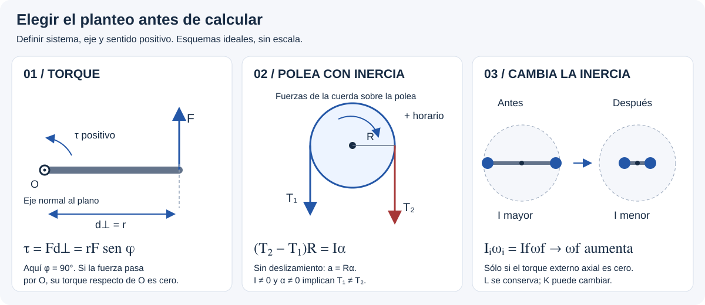

# Cuerpo Rígido — aprender desde cero

Esta es la **puerta de entrada**, no un formulario ni una colección de soluciones. La idea es entender qué representa cada magnitud antes de usarla en el TP 9. Si ya conocés el concepto, pasá a la [teoría esencial](teoria-esencial.md); si estás resolviendo un ejercicio, intentá tu propio planteo antes de mirar la [guía por casos (incluye resultados)](resolucion-por-casos.md).

## Antes de empezar: ¿qué está girando?

Pensá en una puerta, una rueda o una plataforma: cada punto describe una circunferencia alrededor de un **eje**. Los puntos de un cuerpo rígido que gira sobre un eje fijo comparten velocidad angular, aunque los más alejados recorren más distancia en el mismo tiempo.

Antes de calcular, hacete cuatro preguntas:

1. ¿Cuál es el **sistema** que voy a estudiar (una pieza o varias)?
2. ¿Dónde está el **eje** y qué distancias se miden desde él?
3. ¿Qué sentido de giro elijo como **positivo**?
4. ¿Me preguntan por la **causa del giro**, su **resistencia a cambiar** o qué **se conserva**?

## Recorrido progresivo

### 1. Torque: ¿por qué una fuerza hace girar?

Abrir una puerta desde el picaporte es más fácil que empujar cerca de la bisagra. No basta conocer la fuerza: importa la distancia **perpendicular** entre el eje y la línea de acción de esa fuerza. Dos fuerzas pueden causar giros opuestos y compensarse.

[Leer la ficha de torque y equilibrio](torque.md).

**Probá explicarlo:** ¿qué ocurre si empujás la puerta en dirección a la bisagra?

### 2. Momento de inercia: ¿por qué cuesta cambiar el giro?

No alcanza con saber cuánta masa hay: importa **dónde está respecto del eje**. Un aro y un disco de igual masa y radio no tienen la misma resistencia a cambiar su velocidad angular. En un sistema de partículas, cada una aporta según su distancia al eje.

[Leer la ficha de momento de inercia](momento-de-inercia.md).

**Probá explicarlo:** ¿qué masa influye más: una cerca del eje o la misma masa lejos de él?

### 3. Steiner: ¿qué cambia si el eje se mueve?

La inercia es una propiedad del cuerpo **respecto de un eje**, no un número fijo para cualquier eje. Si conocés la inercia respecto de un eje que pasa por el centro de masa, Steiner permite calcularla para **otro eje paralelo**.

[Leer la ficha de Steiner](steiner.md).

**Probá explicarlo:** ¿por qué una barra cuesta más ponerla a girar alrededor de un extremo que alrededor de su centro?

### 4. Energía rotacional: ¿dónde está la energía del giro?

Cada partícula del cuerpo se mueve, así que tiene energía cinética. Al sumar todas esas energías aparece una expresión compacta para la rotación. Un cuerpo que además traslada su centro de masa tiene **dos aportes** a la energía cinética.

[Leer la ficha de energía rotacional](energia-rotacional.md).

**Probá explicarlo:** ¿un disco que gira sobre un eje fijo necesita sumar energía de traslación de su centro de masa?

### 5. Momento angular: ¿qué pasa cuando las masas se acercan al eje?

Imaginá una persona en una plataforma giratoria que acerca dos pesas al cuerpo. Al redistribuir la masa, cambia la inercia. Si el torque externo **respecto del eje** es nulo, se conserva el momento angular; la rapidez angular puede variar. Eso **no** obliga a conservar la energía cinética.

[Leer la ficha de momento angular](momento-angular.md).

**Probá explicarlo:** si la inercia disminuye y se conserva el momento angular, ¿qué debe pasar con la velocidad angular?

## Conversión breve para no mezclar unidades

- **Una vuelta** equivale a **2π radianes**.
- **rpm** significa vueltas por minuto, no radianes por segundo.
- Para pasar de rpm a rad/s, multiplicar por **2π/60**. Para volver, multiplicar por **60/(2π)**.
- Ejemplo didáctico: **60 rpm = 1 vuelta/s = 2π rad/s**. No es un dato de un ejercicio del TP.
- Mantener unidades explícitas: torque en N·m, inercia en kg·m², energía en J y momento angular en kg·m²/s.

## Ruta de práctica sin adelantar resultados

**TP 9, ejercicio 2 (masas y eje)** y **familia 28, 30 y 31 (distribución de masa y plataformas)**:

1. Abrir el **enunciado original del TP 9** y dibujar el sistema; este documento no reemplaza el enunciado.
2. Elegir el eje, identificar qué magnitudes se mantienen y escribir un planteo propio.
3. Sólo si hace falta, consultar las [pistas graduales sin resultados](pistas-tp9.md).
4. Cuando el intento esté hecho, contrastar con la [resolución por casos](resolucion-por-casos.md) y las [comprobaciones y advertencias de fuentes](fuentes.md). **Estas últimas páginas revelan fórmulas y resultados.**
5. Registrar el error conceptual en el [índice de errores frecuentes](../../errores-comunes/README.md), sin copiar toda la solución.

Los ejemplos de puerta, aro, disco y plataforma son **explicaciones didácticas**, no enunciados oficiales de la cátedra.

[Volver al tema](README.md) · [Preparación del tercer parcial](../../parciales/Tercer_Parcial/README.md)
