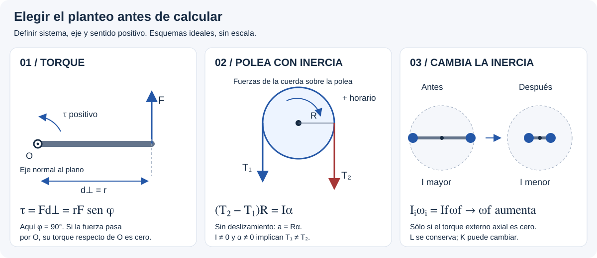

# Ficha — momento angular y conservación

## 🎯 Qué recordar

El **momento angular** (momento cinético) describe el movimiento de giro respecto de un punto o eje. Su cambio depende del **torque externo neto** respecto de ese punto o eje.

Ejemplo didáctico: dos pesas sobre una plataforma giratoria se acercan al eje. Si el torque externo alrededor del eje vertical es nulo, el **momento angular total** no cambia. Como la inercia disminuye, aumenta la rapidez angular. La energía cinética puede aumentar por el trabajo que se realiza al mover las pesas.

## 🖼️ Esquema / dibujo

## 📐 Fórmula

$
\sum\tau_{\mathrm{ext},z}=\frac{dL_z}{dt},\qquad
\sum\tau_{\mathrm{ext},z}=0\Rightarrow L_{z,i}=L_{z,f}.
$

Si **todas las partes giran juntas** alrededor del mismo eje en cada estado:

$
L_z=I_z\omega_z,\qquad I_i\omega_i=I_f\omega_f.
$

Si partes distintas giran con velocidades angulares diferentes, sumar sus \(I_j\omega_j\) con signo; no imponer una única \(\omega\). Unidad de \(L\): **kg·m²/s**.

## ⚠️ Error frecuente

Conservar el momento angular de la plataforma **sola** cuando interactúa con las personas o las pesas; asumir que no hay fuerzas externas porque el torque externo axial es nulo; conservar automáticamente la energía cinética.

Si \(I\) cambia, no sustituir la ecuación general por \(\tau=I\alpha\) sin considerar esa variación.

## 🔗 Ver también

- [Recorrido desde cero](desde-cero.md)
- [Momento de inercia](momento-de-inercia.md)
- [Energía rotacional](energia-rotacional.md)
- [Pistas del TP 9, familia 28/30/31](pistas-tp9.md)
- [Teoría esencial: conservación y sus condiciones](teoria-esencial.md#momento-angular-impulso-y-conservación)
