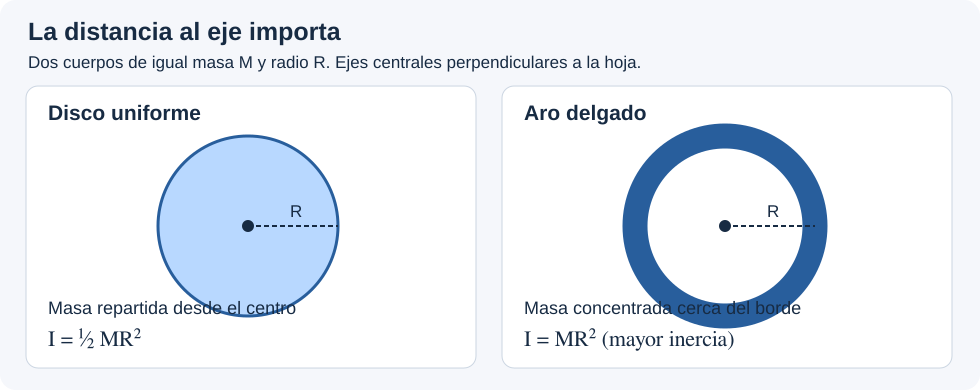

# Ficha — momento de inercia

## 🎯 Qué recordar

El **momento de inercia** mide la resistencia de una distribución de masa a cambiar su velocidad angular **respecto de un eje elegido**. No es lo mismo que la masa: la distancia al eje pesa **al cuadrado**.

Ejemplo didáctico: un **aro delgado** y un **disco uniforme** de igual masa \(M\), radio \(R\) y eje central. En el aro, casi toda la masa está lejos del eje; en el disco también hay masa cerca. Por eso el aro tiene mayor momento de inercia.

## 🖼️ Esquema / dibujo

Los ejes indicados son perpendiculares al plano del dibujo y pasan por los centros.

## 📐 Fórmula

\[
I=\sum_i m_i r_{\perp i}^{\,2},
\qquad I_{\mathrm{disco}}=\tfrac12 MR^2,\qquad
I_{\mathrm{aro}}=MR^2.
\]

\(r_{\perp i}\) es la distancia **perpendicular** de la masa \(m_i\) al eje. Para un sistema de piezas, sumar sus aportes **respecto del mismo eje**. Una partícula ubicada sobre el eje contribuye cero. Unidad: **kg·m²**.

## ⚠️ Error frecuente

Usar la distancia entre partículas o hasta el centro geométrico en vez de la distancia al eje; asumir que dos cuerpos de igual masa siempre tienen la misma inercia.

## 🔗 Ver también

- [Recorrido desde cero](desde-cero.md)
- [Steiner: cambiar de eje](steiner.md)
- [Tabla de inercias en teoría esencial](teoria-esencial.md#inercia-siempre-indicar-el-eje)
- [Pistas del TP 9, ejercicio 2](pistas-tp9.md)
