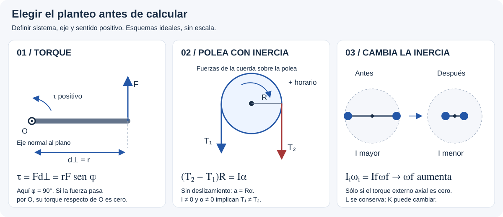

# Cuerpo Rígido — resolución por casos

> **Atención: esta guía contiene planteos, comprobaciones y resultados.**
> Para un primer intento, partir del [recorrido desde cero](desde-cero.md)
> y usar [pistas opcionales sin soluciones](pistas-tp9.md).
> Los enunciados oficiales deben consultarse en el TP 9 original.

## 🎯 Qué recordar

**Sistema → DCL → eje y signos → I → ecuaciones → unidades y verificación.**
El momento de inercia y todos los torques deben referirse al mismo eje.
Los números siguientes son los del **TP 9**, no los ejercicios del libro.

## 🖼️ Esquema / dibujo

## 📐 Fórmula

### Caso 1 — Calcular I y elegir el eje

**TP 9: 1–4; 9 (radio de giro); 20 y 33 (cuerpos compuestos / cambio de eje).**

1. Dibujar el eje, no sólo un punto. Medir distancias perpendiculares.
2. Para partículas usar $I=\sum m_ir_{\perp i}^2$; una masa sobre el eje aporta cero.
3. Para piezas extensas usar su fórmula y, si corresponde, Steiner:
   $I=\sum_j(I_{cm,j}+M_jd_j^2)$.
4. Si piden energía o momento angular: $K=I\omega^2/2$, $L_z=I\omega$.

**Comprobación, ej. 2:** cuatro masas de 2 kg en un rectángulo de 3 × 2 m,
eje normal al plano por una esquina:

$$I=2(0^2+3^2+2^2+\sqrt{13}^{\,2})=52\;\mathrm{kg\,m^2}.$$

Con K = 184 J: $\omega=\sqrt{2K/I}=2{,}660$ rad/s = 25,40 rpm.
El eje cambia I aunque las masas permanezcan en los mismos lugares.

### Caso 2 — Motor, tracción y frenado

**TP 9: 5–7, 9–10 y 16.**

1. Hallar I, convertir rpm a rad/s y vueltas a radianes.
2. Escribir $\tau_{motor}-\tau_{roce}=I\alpha$ para el sentido elegido.
3. Si el torque neto es constante, usar cinemática angular.
4. En el frenado con el motor apagado: $-\tau_{roce}=I\alpha_{freno}$.
   Esa etapa permite hallar el torque resistente y volver a la etapa motriz.
5. Para trabajo y potencia: $W=\tau\Delta\theta$, $\mathcal P=\tau\omega$.

En el **ej. 5**, $\tau_{roce}/\tau_{motor}$ también da la fracción de potencia
que vence al roce cuando se comparan al mismo ω (o trabajos en el mismo giro).

**Comprobación, ej. 6a–b:** I = 2,7 kg·m², R = 0,60 m, F = 49 N:
$\alpha=FR/I=10{,}89$ rad/s². Al tirar 6 m, $W=Fs=294$ J,
igual al aumento de energía cinética de la rueda.

**Atención:** tirar con 49 N y colgar un peso de 49 N son situaciones distintas.
En la segunda, el cuerpo acelera y la tensión es menor que su peso.

### Caso 3 — Bloques y polea con inercia

**TP 9: 6c, 8, 11–14, 17–18 y 22–23.** Cuerda ideal sin deslizamiento,
polea con eje fijo. En el ej. 18 la cuerda actúa sobre el radio interior.

1. Un DCL por bloque y otro para la polea. Usar tensiones diferentes por tramo.
2. Para cada bloque plantear Newton sobre su dirección de movimiento.
3. Para la polea usar $\sum\tau=I\alpha$ y vincular $a=r\alpha$,
   con el radio **de arrollamiento** r.
4. Resolver simultáneamente; recuperar las tensiones por separado.

**Bloque m₁ en mesa lisa y m₂ colgante** (ej. 8):

$$T_1=m_1a,\qquad m_2g-T_2=m_2a,\qquad
(T_2-T_1)R=I\frac aR.$$

$$a=\frac{m_2g}{m_1+m_2+I/R^2}.$$

Si es disco uniforme, $I/R^2=M/2$. Con m₁ = 50 kg, m₂ = 200 kg,
M = 15 kg: a = 7,612 m/s², T₁ = 380,58 N y T₂ = 437,67 N.

**Dos masas colgantes** (ej. 22), m₁ baja y m₂ sube:

$$m_1g-T_1=m_1a,\quad T_2-m_2g=m_2a,\quad
(T_1-T_2)R=I\frac aR.$$

$$a=\frac{(m_1-m_2)g}{m_1+m_2+I/R^2}.$$

**Una masa que desenrolla un cilindro fijo** (ej. 13, 17–18 y 23):

$$mg-T=ma,\quad Tr=I\frac ar,\quad
a=\frac{mg}{m+I/r^2}.$$

Si se mide una caída h en un tiempo t desde reposo (ej. 17):
$a=2h/t^2$ y $I=mr^2(g/a-1)$.
En los planos inclinados, reemplazar el peso tangencial por $mg\sin\beta$
y agregar $f_k=\mu_kmg\cos\beta$ con el sentido correcto. La aceleración
de la cuerda es tangencial: no usar $R\omega^2$ para el bloque.

### Caso 4 — Dos radios de arrollamiento

**TP 9: 19.** Un cuerpo rígido, dos cuerdas: misma α, distintas aceleraciones.

Si m₁ baja por el radio R y m₂ sube por el radio r:

$$m_1g-T_1=m_1R\alpha,\quad T_2-m_2g=m_2r\alpha,$$
$$T_1R-T_2r=I\alpha,\qquad
\alpha=\frac{g(m_1R-m_2r)}{I+m_1R^2+m_2r^2}.$$

Después, $a_1=R\alpha$, $a_2=r\alpha$. Un resultado negativo invierte el
sentido supuesto. Verificar la geometría de la figura: no imponer a₁ = a₂.
El aro interior se desprecia según el enunciado; el disco de masa M sí aporta I.
Las respuestas de tensiones impresas requieren revisión: ver [fuentes](fuentes.md).

### Caso 5 — Energía con rotación

**TP 9: 6b, 13, 20–24.** Piden rapidez después de un recorrido, energía o trabajo.

1. Elegir dos estados y una referencia para la altura.
2. Incluir $mv^2/2$ por cada bloque y $I\omega^2/2$ por cada pieza giratoria.
3. Usar $v=r\omega$ donde no hay deslizamiento y $U_g=Mgh_{cm}$
   para piezas extensas que cambian de altura.
4. Plantear $K_i+U_i+W_{nc}=K_f+U_f$.

**Ej. 23:** el enunciado no especifica la distribución de masa de la polea.
Con la hipótesis de **disco uniforme**, usada por la respuesta impresa:

$$mgh=\frac12mv^2+\frac12I(v/R)^2,\qquad
v=\sqrt{\frac{2mgh}{m+I/R^2}}.$$

No suponer disco si otro enunciado da I o una geometría diferente.

**Ej. 24:** parte del reposo y el resorte de longitud natural. Con descenso h,
el bloque de la mesa se desplaza h y estira el resorte esa cantidad:

$$W_{roce}=\frac12(m_1+m_2)v^2+\frac12I(v/R)^2
+\frac12kh^2-m_2gh.$$

Con los datos del TP resulta **−2,20 J**, comprobación del signo disipativo.
Para la barra y bola del ej. 20, aplicar Steiner a ambas piezas y calcular
el descenso del CM de cada una. Distinguir radio de la bola y distancia de
su centro al pivote; $v_{centro}=\omega d$.

### Caso 6 — Rodadura sin deslizamiento

**Complemento del título del TP y Sears §10.3.** El TP 9 no incluye una
serie específica de cuerpos rodando en rampas; no atribuirle números inventados.

Sobre una superficie fija, $v_{contacto}=0$ instantáneamente y
$v_{cm}=R|\omega|$. El punto superior tiene rapidez $2v_{cm}$.

$$K=\frac12Mv_{cm}^2+\frac12I_{cm}\omega^2
=\frac12I_{contacto}\omega^2,\qquad I_{contacto}=I_{cm}+MR^2.$$

Para un cuerpo circular simétrico bajando por una rampa fija de ángulo β,
sin pérdidas y con roce estático suficiente:

$$a_{cm}=\frac{g\sin\beta}{1+I_{cm}/(MR^2)},\qquad
v_{cm}=\sqrt{\frac{2gh}{1+I_{cm}/(MR^2)}}.$$

Usar DCL para hallar fₛ y comprobar $|f_s|\le\mu_sN$.
El roce estático ideal no disipa energía sobre piso fijo. Si patina,
estas expresiones dejan de valer; plantear traslación y rotación por separado.

### Caso 7 — Calcular el momento angular

**TP 9: 25, 32–33.**

- Partícula: $\vec L_O=\vec r\times m\vec v$, o $L=mvd_\perp$ en módulo.
- Cuerpo rígido girando alrededor de un eje fijo: $L_z=I_z\omega$.
- Sistema: sumar los aportes con signo respecto del mismo punto/eje.

**Ej. 25:** I = (4 + 3)(0,5)² = 1,75 kg·m²;
ω = 5/0,5 = 10 rad/s; |L| = 17,50 kg·m²/s. La dirección es normal al
plano XZ; su signo sobre Y depende del sentido de giro.

**Ej. 32:** si la bola se suelta desde reposo, tomar x hacia la derecha,
y hacia arriba y origen en P. x = ℓ cos θ permanece constante y vᵧ = −gt:

$$L_z(t)=-m g\ell\cos\theta\,t,\qquad
\tau_z=-m g\ell\cos\theta.$$

La respuesta impresa omite t y tiene unidades de torque, no de momento angular.

### Caso 8 — Persona y plataforma con giros distintos

**TP 9: 26–27 y 29.** Sistema = persona + plataforma, eje vertical sin roce.
Peso y apoyo no producen torque en esa dirección: se conserva Lz.

$$L_z=I_p\omega_p+mr^2\omega_h.$$

Si parten del reposo: $0=I_p\omega_p+mr^2\omega_h$.
Si dan velocidad **respecto de Tierra**, $\omega_h=v_{Tierra}/r$.
Si dan velocidad **respecto de la plataforma**:
$\omega_h=\omega_p+v_{rel}/r$, con signos.

En el ej. 26, para volver al punto de partida **sobre la plataforma**:
$t=2\pi/|\omega_h-\omega_p|$. Para volver al punto de partida
**respecto de Tierra**: $t=2\pi/|\omega_h|$.
Después calcular $\Delta\theta_p=\omega_p t$.

En el ej. 27, al detenerse la persona respecto de la plataforma, ambos
comparten ωf: $L_i=(I_p+mr^2)\omega_f$.
En el ej. 29b se pide el trabajo para mover **la mesa**: $\Delta K_p$;
si se pidiera el trabajo mecánico total habría que incluir también a la mujer.

### Caso 9 — Cambia la distribución de masa

**TP 9: 28, 30–31.** Masas se acercan al eje sin torque externo axial.

1. Calcular Iᵢ e If sumando plataforma, barra, personas o pesas.
2. Conservar momento angular: $\omega_f=I_i\omega_i/I_f$.
3. Si piden energía, calcular después $\Delta K=I_f\omega_f^2/2-I_i\omega_i^2/2$.

**Comprobación, ej. 31:** Iᵢ = 8 + 2·10·1² = 28 kg·m²;
If = 8 + 2·10·0,25² = 9,25 kg·m².
Con ωᵢ = 2 rad/s: **ωf = 6,054 rad/s**, **ΔK = +113,51 J**.
La energía aumenta por el trabajo interno realizado al acercar las pesas.

### Caso 10 — Enganche o choque rotacional

**TP 9: 34–35.** Separar el instante de enganche de cualquier movimiento posterior.

1. Elegir como sistema carrusel + persona y el eje vertical fijo.
2. Justificar impulso angular externo despreciable durante el enganche.
3. Sumar L inicial de ambos y usar $(I_p+mR^2)\omega_f=L_i$.

Para quien llega tangencialmente: $L_{persona,i}=\pm mvR$.
En el ej. 34, la respuesta supone aporte angular inicial nulo de la niña;
el texto no explicita su velocidad tangencial. Con esa hipótesis:

$$\omega_f=\frac{250(10\,2\pi/60)}{250+25(2)^2}
=0{,}748\;\mathrm{rad/s}.$$

En el ej. 35 la plataforma parte quieta y $I_p=MR_g^2$:
$\omega_f=mvR/(MR_g^2+mR^2)=0{,}769$ rad/s.
El enganche es inelástico: no conservar K para obtener ωf.

### Caso 11 — Impulso angular, precesión y Kepler

**Presentación: diap. 20–28; complemento conceptual, sin caso específico del TP.**

- Torque conocido durante un intervalo: $\Delta L_z=\int\tau_zdt$;
  si es constante, $\Delta L_z=\tau_z\Delta t$.
- Giróscopo rápido con precesión estable: usar $\vec\tau=d\vec L/dt$.
  Para eje horizontal, $\Omega\simeq Mgd/(I_s\omega_s)$; distinguir
  velocidad de giro propia ωs de velocidad de precesión Ω. El torque cambia
  principalmente la dirección de L.
- Fuerza central: r es paralela a F, de modo que τ = 0 respecto del centro
  de fuerzas. Se conserva L y $dA/dt=|L|/(2m)$; la rapidez puede cambiar.

## ⚠️ Error frecuente

- Aplicar fórmulas de un caso sin revisar cuerda, radio, eje y geometría.
- Omitir la energía de la polea o suponer tensión igual al peso de un bloque acelerado.
- Conservar el momento angular sólo de la plataforma cuando una persona interactúa con ella.
- Copiar respuestas del TP sin comprobar dimensiones: consultar las erratas registradas.

## 🔗 Ver también

- [Teoría esencial y tabla de inercias](teoria-esencial.md)
- [Fuentes, hipótesis y comprobaciones](fuentes.md)
- [Volver al tema](README.md)
