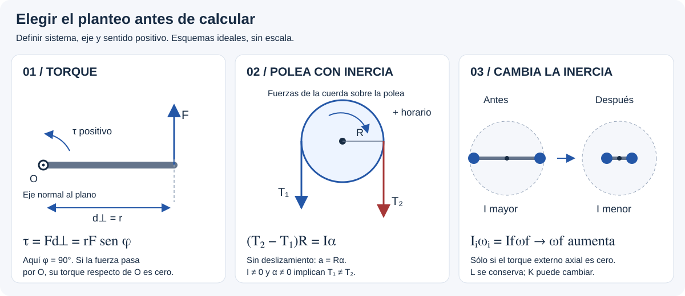

# Cuerpo Rígido — teoría esencial

## 🎯 Qué recordar

- **Cuerpo rígido:** modelo que mantiene las distancias entre sus partículas.
  Puede trasladarse, rotar o combinar ambos movimientos.
- **Momento de una fuerza o torque τ:** mide su capacidad para cambiar la
  rotación respecto de un punto/eje. Importa el brazo perpendicular.
- **Momento de inercia I:** depende de la masa, de cómo se distribuye y del
  **eje elegido**. Alejar masa del eje aumenta I.
- **Momento angular o cinético L:** se conserva si el torque externo neto
  respecto del punto/eje usado es nulo. Eso no implica conservar energía cinética.
- Elegir primero **sistema, eje y sentido positivo**. Dibujar sólo fuerzas
  reales; el torque se calcula a partir de esas fuerzas.

## 🖼️ Esquema / dibujo

## 📐 Fórmula

### Cinemática: describir el giro

Todos los puntos del cuerpo tienen la misma ω y α, pero no la misma rapidez lineal.

| Magnitud | Relación | Condición |
| --- | --- | --- |
| Velocidad y aceleración angular | $\omega=d\theta/dt$, $\alpha=d\omega/dt$ | Componentes sobre el eje elegido |
| Giro uniformemente acelerado | $\omega=\omega_0+\alpha t$ | α constante |
| Ángulo recorrido | $\Delta\theta=\omega_0t+\frac12\alpha t^2$ | α constante |
| Sin tiempo | $\omega^2=\omega_0^2+2\alpha\Delta\theta$ | α constante |
| Punto a distancia r del eje fijo | $v=r|\omega|$, $a_t=r\alpha$, $a_n=r\omega^2$ | $a_t$ con signo tangencial; $a_n$ hacia el eje |
| Conversión | $|\omega|=\mathrm{rpm}\,2\pi/60$, $\Delta\theta=2\pi N$ | N: vueltas con signo; θ en radianes |

Si ω y α tienen signos opuestos, el giro se frena. α negativa por sí sola
no significa frenado.

### Inercia: siempre indicar el eje

$$I=\sum_i m_ir_{\perp i}^2=\int r_\perp^2\,dm,
\qquad I_P=I_{cm}+Md^2,\qquad I=MR_g^2.$$

Steiner sólo une **ejes paralelos**, uno por el centro de masa; d es la
distancia entre ellos. $R_g=\sqrt{I/M}$ es el radio de giro, no necesariamente
el radio geométrico. Para un conjunto rígido, sumar las inercias de todas sus
piezas respecto **del mismo eje**.

| Cuerpo uniforme | Eje | I |
| --- | --- | --- |
| Masa puntual | A distancia r | $mr^2$ |
| Barra delgada de longitud ℓ | Por el centro, perpendicular a la barra | $M\ell^2/12$ |
| Barra delgada | Por un extremo, perpendicular a la barra | $M\ell^2/3$ |
| Disco / cilindro macizo | Eje central de simetría | $MR^2/2$ |
| Aro delgado | Eje central perpendicular a su plano | $MR^2$ |
| Cilindro hueco de pared gruesa | Eje central de simetría | $M(R_1^2+R_2^2)/2$ |
| Esfera maciza | Diámetro | $2MR^2/5$ |
| Esfera hueca delgada | Diámetro | $2MR^2/3$ |
| Placa rectangular de lados a, b | Por el centro, normal al plano | $M(a^2+b^2)/12$ |

### Dinámica: por qué cambia el giro

$$\vec\tau_O=\vec r\times\vec F,\qquad
|\tau|=rF\sin\phi=Fd_\perp,\qquad
\tau_z=r_xF_y-r_yF_x.$$

φ se mide entre r y F. Una fuerza cuya línea de acción pasa por O no produce
torque respecto de O, aunque su módulo sea grande.

| Situación | Planteo | Condición |
| --- | --- | --- |
| Eje fijo, I constante | $\sum\tau_{ext,z}=I_z\alpha_z$ | Usar I respecto de ese eje |
| Traslación del centro de masa | $\sum\vec F_{ext}=M\vec a_{cm}$ | Marco inercial |
| Rotación plana alrededor del CM | $\sum\tau_{ext,cm}=I_{cm}\alpha$ | Cuerpo rígido, eje perpendicular al plano |
| Cuerda sobre polea fija | $a=R\alpha$, $v=R\omega$ | Sin deslizamiento, signos compatibles |
| Rodadura sobre piso fijo | $v_{cm}=R|\omega|$ | Sin deslizamiento; en magnitudes $a_{cm}=R|\alpha|$ en movimiento rectilíneo |

**Polea con inercia:** si α ≠ 0, normalmente las tensiones difieren:
$(T_2-T_1)R=I\alpha$. «Eje sin rozamiento» no elimina la interacción
entre cuerda y polea que transmite el torque.

### Trabajo y energía

$$K_{eje\ fijo}=\frac12I\omega^2,\qquad
K=\frac12Mv_{cm}^2+\frac12I_{cm}\omega^2.$$

$$W=\int\tau_z\,d\theta,\qquad W_{neto}=\Delta K,
\qquad \mathcal P=\tau_z\omega_z.$$

Para τ constante, $W=\tau\Delta\theta$. Con gravedad, resorte y otras fuerzas:

$$K_i+U_i+W_{nc}=K_f+U_f,\qquad
U_g=Mgh_{cm},\quad U_e=\frac12kx^2.$$

Sumar la energía de **cada cuerpo** del sistema. Una polea con centro fijo
gira pero no tiene traslación de su CM.

### Momento angular, impulso y conservación

$$\vec L_O=\sum_i\vec r_i\times m_i\vec v_i,\qquad
\sum\vec\tau_{ext,O}=\frac{d\vec L_O}{dt},\qquad
\int_{t_i}^{t_f}\vec\tau_{ext,O}\,dt=\vec L_f-\vec L_i.$$

Estas relaciones se usan respecto de un punto O fijo de un marco inercial
(también puede formularse respecto del CM). Con eje fijo, $L_z=I_z\omega_z$.
La igualdad **vectorial** $\vec L=I\vec\omega$ se usa para un eje principal,
como el de simetría; no es una identidad para cualquier cuerpo y eje.

Si $\sum\tau_{ext,z}=0$, se conserva **Lz del sistema completo**:

$$L_{i,z}=L_{f,z};\qquad I_i\omega_i=I_f\omega_f
\quad\text{si todas las partes comparten el giro en cada estado}.$$

Si I cambia, no reemplazar la ley general por τ = Iα: sobre un eje de
dirección fija aparece también $\dot I\omega$.

**Complementos de la presentación:** en precesión lenta y estable,
$\Omega\simeq Mgd/(I_s\omega_s)$ para el giróscopo ideal con eje horizontal;
d es la distancia pivote–CM. Para una partícula bajo fuerza central,
$dA/dt=|L|/(2m)$: áreas iguales en tiempos iguales (segunda ley de Kepler).

**Unidades:** I en kg·m²; τ en N·m; L en kg·m²/s; energía en J;
potencia en W. Se usa g = 9,8 m/s² salvo indicación.

## ⚠️ Error frecuente

- Usar la distancia al centro del cuerpo en vez de la distancia al **eje**.
- Usar τ = RF cuando F no es perpendicular a r.
- Igualar las tensiones a ambos lados de una polea que acelera y tiene I.
- Usar el radio exterior para una cuerda arrollada en un eje de radio menor.
- Conservar K durante un enganche o cuando una persona mueve sus brazos.
- Confundir «torque externo nulo» con «ninguna fuerza externa».
- Usar el eje instantáneo para aceleraciones como si fuera un pivote fijo:
  es una herramienta cinemática; su punto de contacto puede tener aceleración.

## 🔗 Ver también

- [Resolución por casos del TP 9](resolucion-por-casos.md)
- [Fuentes y comprobaciones](fuentes.md)
- [Movimiento Circular](../movimiento-circular/README.md)
- [Trabajo y Energía](../trabajo-energia/README.md)
- [Impulso y cantidad de movimiento](../impulso-cantidad-movimiento/README.md)
- [Volver al tema](README.md)
