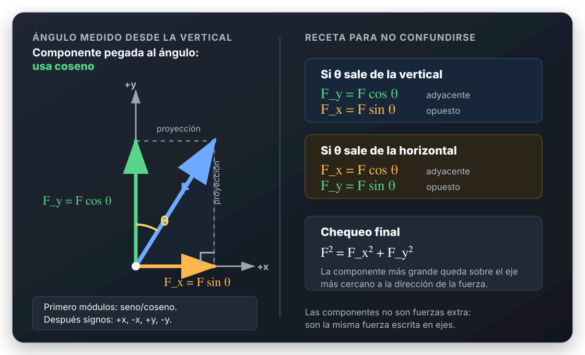

# Descomponer una fuerza inclinada

## 🎯 Idea central

Descomponer una fuerza es reemplazar **un mismo vector** por dos componentes
perpendiculares: una sobre el eje $x$ y otra sobre el eje $y$.

La pregunta clave no es “¿$x$ va con coseno?”, sino:

> **¿Desde qué eje está medido el ángulo?**

La componente que queda **pegada al ángulo** es el cateto adyacente y usa
coseno. La componente que queda **enfrente del ángulo** es el cateto opuesto y
usa seno.

## 🖼️ Esquema / dibujo

## 📐 Regla práctica

En el triángulo de componentes:

- La fuerza $\vec F$ es la **hipotenusa**.
- La componente sobre el eje desde donde se mide $\theta$ es el **cateto
  adyacente**.
- La componente sobre el eje perpendicular es el **cateto opuesto**.

Por eso, si $\theta$ está medido desde la **vertical**:

$$
F_y = F\cos\theta
\qquad
F_x = F\sin\theta
$$

En cambio, si $\theta$ está medido desde la **horizontal**:

$$
F_x = F\cos\theta
\qquad
F_y = F\sin\theta
$$

## 🧭 Signos

Primero calculá los módulos de las componentes, que siempre son positivos.
Después asigná el signo según el sentido elegido para los ejes.

| Sentido de la componente | Signo |
| --- | --- |
| Hacia $+x$ | $F_x > 0$ |
| Hacia $-x$ | $F_x < 0$ |
| Hacia $+y$ | $F_y > 0$ |
| Hacia $-y$ | $F_y < 0$ |

Ejemplo: si la fuerza apunta hacia la derecha y hacia arriba, entonces
$F_x$ y $F_y$ son positivas. Si apunta hacia la izquierda y hacia arriba,
$F_x$ es negativa y $F_y$ es positiva.

## 🧠 Cómo decidir seno o coseno

1. Dibujá la fuerza inclinada.
2. Marcá el ángulo $\theta$ y escribí desde qué eje se mide.
3. Completá el triángulo rectángulo con las proyecciones sobre $x$ e $y$.
4. Identificá qué componente queda adyacente a $\theta$.
5. Usá coseno para la adyacente y seno para la opuesta.
6. Recién al final agregá los signos.

## 🔎 Ejemplo rápido

Una fuerza de módulo $F = 80\,\text{N}$ forma un ángulo de $30^\circ$ con la
vertical y apunta hacia la derecha y hacia arriba.

Como el ángulo se mide desde la vertical:

$$
F_y = 80\cos 30^\circ \approx 69,3\,\text{N}
$$

$$
F_x = 80\sin 30^\circ = 40\,\text{N}
$$

Ambas componentes son positivas porque la fuerza apunta hacia $+x$ y hacia
$+y$.

Si el mismo ángulo de $30^\circ$ estuviera medido desde la horizontal, las
componentes quedarían al revés:

$$
F_x = 80\cos 30^\circ \approx 69,3\,\text{N}
\qquad
F_y = 80\sin 30^\circ = 40\,\text{N}
$$

## ✅ Chequeos útiles

- La componente mayor suele estar sobre el eje más cercano a la fuerza.
- Si $\theta$ es chico, la componente sobre el eje desde donde se mide debe ser
  grande, porque usa coseno.
- Debe cumplirse:

$$
F^2 = F_x^2 + F_y^2
$$

Si esa relación no se cumple, probablemente intercambiaste seno y coseno o
perdiste un signo.

## ⚠️ Errores frecuentes

- Elegir seno o coseno antes de dibujar el triángulo.
- Memorizar “$x$ lleva coseno” sin mirar desde dónde se mide el ángulo.
- Confundir el módulo positivo de una componente con su signo algebraico.
- Dibujar $F_x$ y $F_y$ como fuerzas nuevas además de $\vec F$: son componentes
  de la misma fuerza.
- Usar el ángulo complementario sin darse cuenta. Si cambiás de vertical a
  horizontal, el ángulo pasa de $\theta$ a $90^\circ-\theta$.

## 🔗 Ver también

- [Trigonometría](../referencias-rapidas/trigonometria.md)
- [Elegir ejes y asignar signos](../metodos/elegir-ejes-y-signos.md)
- [Dividir ecuaciones](../metodos/dividir-ecuaciones.md)
- [Movimiento Circular - machete visual](../../movimiento-circular/Movimiento_Circular_UTN_FRLP.md)
