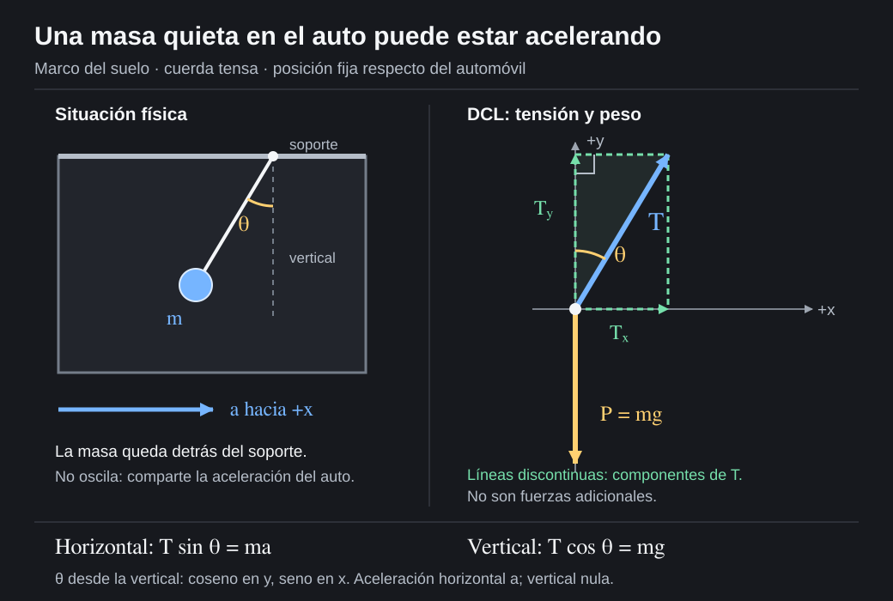
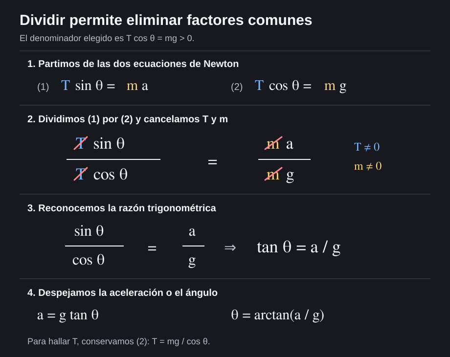

# Dividir ecuaciones para eliminar una incógnita común

## 🎯 Qué recordar

Si dos ecuaciones del **mismo problema** contienen una incógnita como factor
común, dividir una por la otra puede eliminarla sin despejarla.

> **Dividí miembro a miembro, cancelá solo factores no nulos y conservá una
> ecuación original para recuperar la incógnita eliminada.**

Conviene cuando el cociente simplifica el sistema: por ejemplo, al dividir
las componentes horizontal y vertical de una tensión aparecen
$\sin\theta/\cos\theta=\tan\theta$.

## 🖼️ Esquema / dibujo

La masa queda **detrás del soporte**. La tensión tira hacia el soporte:
su componente horizontal apunta hacia la derecha, en el sentido de la
aceleración. El peso apunta hacia abajo.

## 📐 Fórmula

### 1. Por qué se pueden dividir dos ecuaciones

Una igualdad afirma que ambos miembros tienen el mismo valor. Si
$A=B$ y $C=D$, entonces dividir esos valores iguales por otros valores
iguales conserva la igualdad, siempre que los denominadores no sean cero:

$$
A=B,\qquad C=D,\qquad C=D\neq0
\quad\Longrightarrow\quad
\frac{A}{C}=\frac{B}{D}
$$

Es **dividir miembro a miembro**: izquierdo entre izquierdo y derecho
entre derecho, manteniendo el mismo orden.

No se exige que el numerador sea distinto de cero: $0/D$ está definido si
$D\neq0$.

### 2. Planteo físico: una masa en un automóvil acelerado

Suponemos una cuerda ideal y tensa, sin resistencia del aire. El automóvil
acelera horizontalmente hacia la derecha y la masa **mantiene su posición
respecto del automóvil**, sin oscilar. No aplicamos este planteo al instante
inicial si el péndulo todavía está oscilando.

Elegimos el **marco del suelo**, aproximadamente inercial, con $+x$ hacia la
derecha y $+y$ hacia arriba. La aceleración de la masa en ese marco es:

$$
a_x=a,\qquad a_y=0
$$

Aquí $a\geq0$ es el módulo de la aceleración horizontal, $m>0$ es la masa y
$g>0$ es el módulo de la aceleración gravitatoria.

En el DCL hay dos fuerzas reales: **tensión $\vec T$ y peso $\vec P$**.
Las componentes $T_x$ y $T_y$ son una forma de escribir la misma tensión.

Como $\theta$ se mide desde la **vertical**, la componente adyacente usa
coseno y la opuesta usa seno:

$$
T_x=T\sin\theta,\qquad T_y=T\cos\theta
$$

Aplicando $\sum F_x=ma_x$ y $\sum F_y=ma_y$:

$$
T\sin\theta=ma
\qquad\text{(1)}
$$

$$
T\cos\theta-mg=0
\quad\Longrightarrow\quad
T\cos\theta=mg
\qquad\text{(2)}
$$

**Que la masa esté quieta respecto del automóvil no implica que esté en
equilibrio en el marco del suelo.** La resultante vertical es cero, pero la
horizontal vale $ma$.

### 3. Dividir y simplificar, paso a paso

Dividimos **(1) por (2)**:

$$
\frac{T\sin\theta}{T\cos\theta}
=
\frac{ma}{mg}
$$

$T$ multiplica a todo el numerador y a todo el denominador del primer
cociente; $m$ hace lo mismo en el segundo. Por eso se simplifican:

$$
\frac{\sin\theta}{\cos\theta}=\frac{a}{g}
$$

Usando la identidad $\tan\theta=\sin\theta/\cos\theta$:

$$
\boxed{\tan\theta=\frac{a}{g}}
$$

La división es válida porque el denominador de (2) vale $mg>0$. En esta
situación $T>0$ y $0\leq\theta<90^\circ$, por lo que $\cos\theta>0$.

**Lectura física:** la razón entre las componentes horizontal y vertical
de la tensión es igual a la razón entre las aceleraciones $a$ y $g$.
La masa no aparece en el ángulo: dentro de estas hipótesis, una masa mayor
requiere más tensión, pero conserva la misma inclinación para el mismo $a$.

### 4. Despejar lo que pide el ejercicio

| Qué se busca | Relación útil | Datos necesarios |
| --- | --- | --- |
| Aceleración | $a=g\tan\theta$ | $\theta$ y $g$ |
| Ángulo desde la vertical | $\theta=\arctan(a/g)$ | $a$ y $g$ |
| Tensión | $T=mg/\cos\theta$ | $m$, $g$ y $\theta$ |

$\arctan$ es la función inversa de la tangente: devuelve el ángulo cuya
tangente vale $a/g$. Para obtener el resultado en grados, usá el modo
**DEG** de la calculadora.

El cociente permite hallar $a$ o $\theta$, pero **no alcanza por sí solo
para hallar $T$**. Para eso volvemos a (2):

$$
T=\frac{mg}{\cos\theta}
$$

También puede obtenerse con las dos componentes y Pitágoras:

$$
T^2=(ma)^2+(mg)^2
\quad\Longrightarrow\quad
T=m\sqrt{a^2+g^2}
$$

### 5. Ejemplo numérico y comprobación

**Ejemplo ilustrativo:** $m=0,20\,\text{kg}$, $a=3,0\,\text{m/s}^2$ y
$g=9,8\,\text{m/s}^2$. La masa mantiene su posición respecto del automóvil.

Primero calculamos el ángulo:

$$
\theta=\arctan\left(\frac{3,0}{9,8}\right)\approx17,0^\circ
$$

Luego recuperamos la tensión:

$$
T=0,20\sqrt{3,0^2+9,8^2}\,\text{N}\approx2,05\,\text{N}
$$

Verificamos las ecuaciones originales con los valores sin redondear:

$$
T\sin\theta=0,600\,\text{N}=ma
$$

$$
T\cos\theta=1,96\,\text{N}=mg
$$

El peso vale $1,96\,\text{N}$ y la tensión es algo mayor: además de sostener
el peso, aporta la componente horizontal que acelera a la masa.

### 6. Chequeos rápidos

- **Unidades:** $a/g$ no tiene unidades, como corresponde a una tangente.
- **Sin aceleración:** si $a=0$, entonces $\theta=0$ y $T=mg$. La división
  (1)/(2) sigue siendo válida: el numerador puede valer cero.
- **Mayor aceleración:** para el mismo $g$, aumentan $\theta$ y $T$.
- **Tensión:** debe cumplirse $T\geq mg$; es mayor si $a>0$.
- **Validez física:** si la masa oscila o hay aceleración vertical, hay que
  replantear las componentes de Newton antes de dividir.

### 7. ¿Dividir o sumar?

| Cómo aparece la incógnita | Operación que suele convenir |
| --- | --- |
| Como factor en ambos miembros izquierdos: $T\sin\theta$, $T\cos\theta$ | Dividir, si el denominador no es cero |
| Como términos con signos opuestos: $+T$ y $-T$ | Sumar las ecuaciones |

La operación se elige mirando la estructura de las ecuaciones. No es
necesario dividir en todos los problemas: despejar y sustituir también es
válido.

## ⚠️ Error frecuente

### Cancelar términos que están sumando

En una fracción se cancelan **factores del numerador completo y del
denominador completo**. No se borra una letra solo porque aparece arriba y
abajo.

Por ejemplo, en el cociente siguiente no se puede borrar $2x$. Sí se puede
sacar y cancelar el factor común $2$:

$$
\frac{2x+6}{2x+10}
=
\frac{2(x+3)}{2(x+5)}
=
\frac{x+3}{x+5},
\qquad x\neq-5
$$

Para $x=2$, el cociente vale $10/14=5/7$. Borrar $2x$ daría $6/10=3/5$,
un resultado distinto.

### Dividir por una cantidad que puede ser cero

La división (2)/(1) exige $ma\neq0$ y excluye el caso $a=0$.
Elegir (1)/(2) evita esa restricción en este problema, porque $mg>0$.

Si una incógnita podría valer cero, analizá ese caso **antes de cancelarla**.
Cancelar un factor nulo puede hacer que pierdas soluciones.

### Otros errores a evitar

- Medir $\theta$ desde la horizontal y usar estas mismas componentes.
- Confundir $\tan\theta$ con $\theta$: $a/g$ es la tangente, no el ángulo.
- Tomar $a_y=0$ como si implicara que toda la resultante es cero.
- Agregar una fuerza $ma$ al DCL: $ma$ es la resultante en el marco inercial.
- Mezclar marcos. Desde el automóvil, no inercial, hay que incluir
  explícitamente $\vec F_{\text{inercial}}=-m\vec a$.
- Quedarse solo con el cociente y olvidar las ecuaciones originales.

> En un examen: “Dividiendo miembro a miembro (1) por (2), cuyo denominador
> es $mg\neq0$, se simplifican $T$ y $m$ y se obtiene
> $\tan\theta=a/g$. Luego se usa (2) para hallar la tensión”.

## 🔗 Ver también

- [Descomponer una fuerza inclinada](../herramientas-matematicas/descomponer-fuerza-inclinada.md)
- [Referencia rápida de trigonometría](../referencias-rapidas/trigonometria.md)
- [Elegir ejes y asignar signos](elegir-ejes-y-signos.md)
- [Eliminar la tensión sumando ecuaciones](eliminar-tension-sistemas.md)
- [Marcos inerciales y no inerciales](../conceptos/marcos-inerciales-y-no-inerciales.md)
