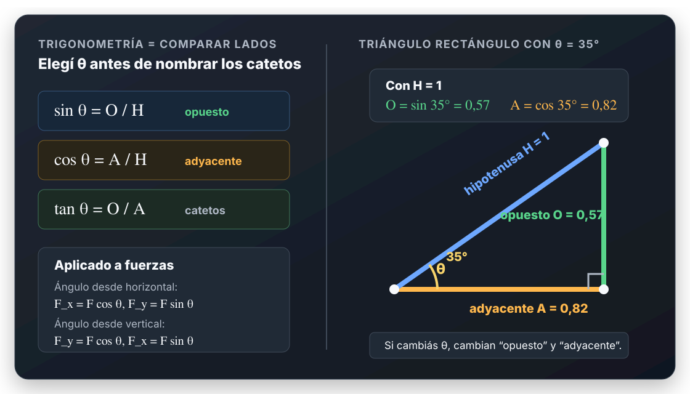

# Trigonometría

## 🎯 Qué recordar

La trigonometría en Física sirve para relacionar **ángulos** con **componentes**
de un vector o con lados de un triángulo rectángulo.

Antes de usar seno, coseno o tangente, elegí el ángulo de referencia. Los
nombres “opuesto” y “adyacente” dependen de ese ángulo; la hipotenusa no
cambia.

## 🖼️ Esquema / dibujo

## 🧩 Nombres de los lados

En un triángulo rectángulo:

- **Hipotenusa $H$**: lado más largo, siempre enfrente del ángulo de $90^\circ$.
- **Cateto adyacente $A$**: cateto que toca al ángulo $\theta$.
- **Cateto opuesto $O$**: cateto que queda enfrente de $\theta$.

Si cambiás el ángulo de referencia, pueden cambiar los nombres de $O$ y $A$.
Por eso el primer paso siempre es marcar $\theta$.

## 📐 Razones trigonométricas

| Relación | Fórmula | Cuándo usarla |
| --- | --- | --- |
| Seno | $\sin\theta = \dfrac{O}{H}$ | Conectar opuesto e hipotenusa |
| Coseno | $\cos\theta = \dfrac{A}{H}$ | Conectar adyacente e hipotenusa |
| Tangente | $\tan\theta = \dfrac{O}{A}$ | Conectar los dos catetos |

Una forma de memorizarlo:

$$
\text{SOH}:\ \sin\theta=\frac{O}{H}
\qquad
\text{CAH}:\ \cos\theta=\frac{A}{H}
\qquad
\text{TOA}:\ \tan\theta=\frac{O}{A}
$$

## 🔧 Despejes típicos

Si conocés la hipotenusa y el ángulo:

$$
O = H\sin\theta
\qquad
A = H\cos\theta
$$

Si conocés un cateto y el ángulo:

$$
H = \frac{O}{\sin\theta}
\qquad
H = \frac{A}{\cos\theta}
$$

Si conocés los dos catetos:

$$
\theta = \arctan\left(\frac{O}{A}\right)
$$

Si conocés un cateto y la hipotenusa:

$$
\theta = \arcsin\left(\frac{O}{H}\right)
\qquad
\theta = \arccos\left(\frac{A}{H}\right)
$$

## 🧠 Cómo pensarlo en componentes

Cuando un vector de módulo $F$ se descompone, $F$ funciona como la hipotenusa.
Las componentes son los catetos.

Si el ángulo se mide desde la horizontal:

$$
F_x = F\cos\theta
\qquad
F_y = F\sin\theta
$$

Si el ángulo se mide desde la vertical:

$$
F_y = F\cos\theta
\qquad
F_x = F\sin\theta
$$

No cambió la trigonometría: cambió cuál componente quedó adyacente al ángulo.

## 🔁 Ángulos complementarios

Los ángulos medidos desde la horizontal y desde la vertical son
complementarios:

$$
\alpha + \beta = 90^\circ
$$

Por eso:

$$
\sin\alpha = \cos\beta
\qquad
\cos\alpha = \sin\beta
$$

Esta es la razón matemática por la que a veces “se intercambian” seno y coseno.

## 🔎 Ejemplo rápido

Para un triángulo rectángulo con hipotenusa $H = 10$ y ángulo
$\theta = 35^\circ$:

$$
O = 10\sin 35^\circ \approx 5,74
$$

$$
A = 10\cos 35^\circ \approx 8,19
$$

Chequeo:

$$
5,74^2 + 8,19^2 \approx 10^2
$$

## ⚠️ Errores frecuentes

- Intercambiar el cateto opuesto y el adyacente.
- Usar seno o coseno sin haber elegido el ángulo de referencia.
- Invertir el cociente de la tangente.
- Usar arcoseno o arcocoseno con un cociente fuera de $[-1,1]$.
- Mezclar grados y radianes en la calculadora.
- Redondear demasiado pronto y perder precisión en el resultado final.

## 🔗 Ver también

- [Dividir ecuaciones para eliminar una incógnita común](../metodos/dividir-ecuaciones.md)
- [Descomponer una fuerza inclinada](../herramientas-matematicas/descomponer-fuerza-inclinada.md)
