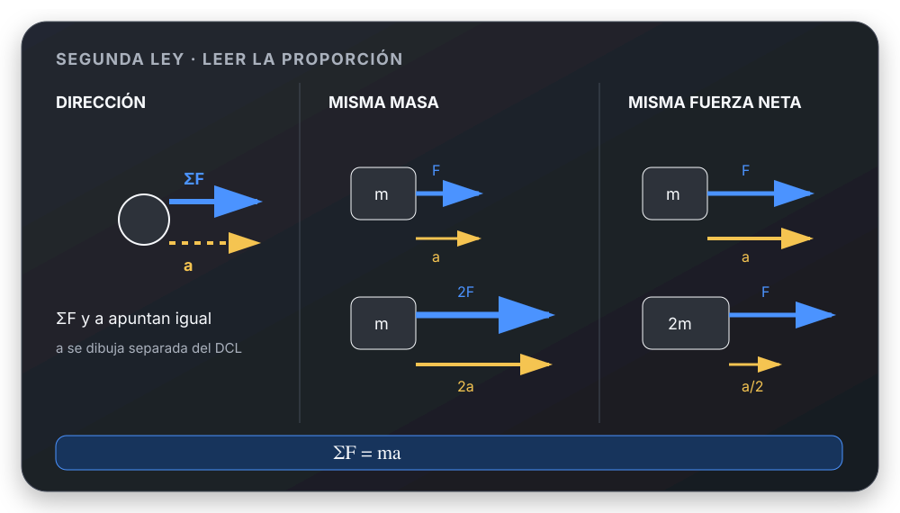
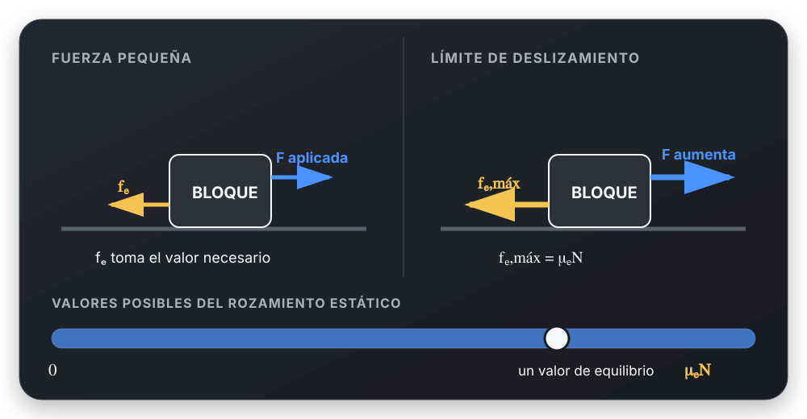
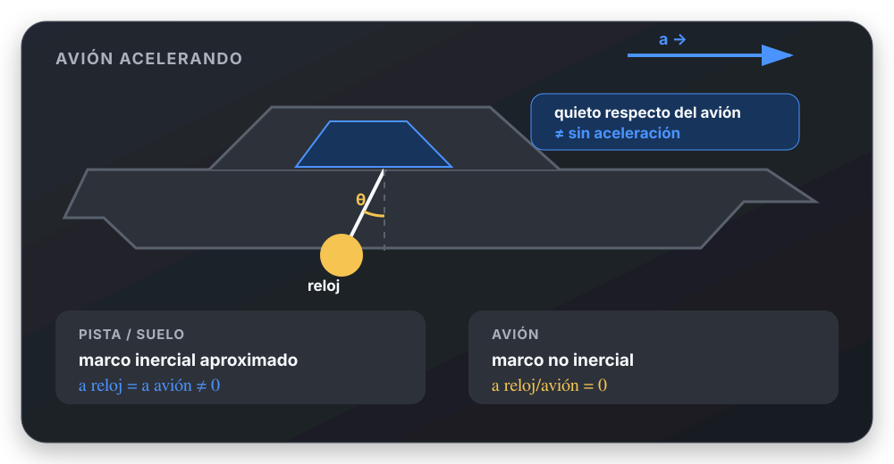

# Dinámica: el tema explicado

[Volver al tema](README.md) · [Elegir un caso](resolucion-por-casos.md) · [Ejercicios resueltos](../../ejercicios/dinamica/README.md) · [Fuentes](fuentes.md)

## Cómo usar este apunte

Leé primero las secciones 1 a 6. Después estudiá los vínculos y los sistemas
de varios cuerpos con un ejercicio al lado. La sección 9 reúne fuerzas que
aparecen en las presentaciones ampliadas, aunque no sean el centro de los TP.

Las explicaciones se basan en tus presentaciones, guías y recortes de Sears.
Los ejemplos numéricos usan $g=9{,}8\ \mathrm{m/s^2}$, salvo indicación contraria.
Los símbolos $f_e,f_s$ representan rozamiento estático; $f_d,f_k$, cinético.

## 1. Qué estudia la Dinámica

La **Cinemática** describe posición, velocidad y aceleración. La **Dinámica**
relaciona la aceleración con las interacciones entre cuerpos.

Una fuerza puede cambiar el módulo de la velocidad, su dirección o ambos.
Por eso un auto que toma una curva a rapidez constante acelera. También por
eso un objeto que sube puede tener una fuerza resultante hacia abajo.

Antes de calcular hay que elegir:

| Decisión | Qué significa | Ejemplo |
| --- | --- | --- |
| Sistema | Cuerpo o conjunto que vamos a estudiar | Un bloque; luego los dos bloques juntos |
| Entorno | Agentes externos que interactúan con el sistema | Tierra, mesa, cuerda |
| Modelo | Aspectos que conservamos del objeto real | Partícula si estudiamos su traslación |
| Marco de referencia | Desde dónde describimos el movimiento | El suelo, aproximadamente inercial |
| Ejes | Direcciones sobre las que proyectamos los vectores | Paralelo y perpendicular a un plano |

Modelar como partícula no significa que el cuerpo no tenga tamaño: significa
que su rotación y deformación no son necesarias para esa pregunta. Si hay que
estudiar vuelco o rotación, la ecuación de traslación por sí sola no alcanza.

**Base:** [presentación y TP introductorio](fuentes.md#bases-conceptuales).

## 2. Las tres leyes de Newton, conectadas

### Primera ley: qué pasa si la resultante es cero

En un marco inercial:

$$
\sum\vec F=\vec0
\quad\Longrightarrow\quad
\vec a=\vec0
\quad\Longrightarrow\quad
\vec v=\text{constante}.
$$

El cuerpo puede permanecer en reposo o moverse en línea recta con velocidad
constante. No necesita una fuerza neta para seguir moviéndose.

**Equilibrio de una partícula** significa resultante nula. No significa
ausencia de fuerzas: una lámpara puede tener peso y tensión equilibrados.
En cambio, estar detenido en un instante no prueba equilibrio: en la cima de
un tiro vertical, $v=0$ pero $a_y=-g$.

Un marco inercial es aquel en el que un cuerpo libre no acelera. En los
problemas terrestres de esta guía usamos el laboratorio o el suelo como
aproximación inercial, salvo que el problema estudie su rotación.

### Segunda ley: cuánto acelera y hacia dónde

Para masa constante y en un marco inercial:

$$
\boxed{\sum\vec F_{\mathrm{externas}}=m\vec a}
$$

La suma es **vectorial**: primero se consideran todas las fuerzas sobre el
cuerpo elegido y después se proyectan.

$$
\sum F_x=ma_x,\qquad \sum F_y=ma_y.
$$

La masa mide la inercia: con la misma fuerza neta, una masa mayor adquiere
menor aceleración. En SI:

$$
[m]=\mathrm{kg},\qquad [a]=\mathrm{m/s^2},\qquad
1\ \mathrm N=1\ \mathrm{kg\,m/s^2}.
$$

Si $a_x<0$, la aceleración apunta hacia $-x$. Eso no indica por sí solo hacia
dónde se mueve el cuerpo: puede ir hacia $+x$ y estar frenando.

### Tercera ley: a quién pertenece cada fuerza

$$
\vec F_{A\to B}=-\vec F_{B\to A}.
$$

Las fuerzas de un par actúan simultáneamente, tienen igual módulo y sentidos
opuestos, y están aplicadas **en cuerpos distintos**. No se cancelan en el
DCL de uno solo.

| Fuerza sobre el bloque | Su reacción está sobre… |
| --- | --- |
| Peso: Tierra sobre bloque | Tierra: bloque sobre Tierra |
| Normal: mesa sobre bloque | Mesa: bloque sobre mesa |
| Tensión: cuerda sobre bloque | Cuerda: bloque sobre cuerda |
| Rozamiento: mesa sobre bloque | Mesa: bloque sobre mesa |

Peso y normal pueden tener igual módulo sin ser acción y reacción.
La igualdad $N=mg$, cuando vale, se obtiene de Newton sobre el bloque.

**Para profundizar:** [Segunda Ley](conceptos/segunda-ley-newton.md) y
[Tercera Ley](conceptos/tercera-ley-newton.md).

## 3. Cómo construir un diagrama de cuerpo libre

1. Elegí **un** cuerpo y representalo separado de su entorno.
2. Nombrá cada agente que lo toca o actúa a distancia.
3. Dibujá las fuerzas que esos agentes ejercen **sobre él**.
4. Marcá los ejes y los ángulos necesarios.
5. Indicá velocidad y aceleración en un esquema aparte, si ayudan.
6. Escribí una ecuación por componente y por cuerpo.

No se agregan al DCL $m\vec a$, la velocidad ni una fuerza que “mantenga el
movimiento”. Tampoco se suman simultáneamente una fuerza y sus componentes:
son dos representaciones del mismo vector.

En el TP introductorio se piden también las reacciones. Dibujalas sobre sus
respectivos agentes, en un esquema de interacciones separado.

Un buen hábito es poder completar la frase: “esta flecha es la fuerza
que **…** ejerce sobre **…**”. Si no hay agente, revisá la flecha.

## 4. Fuerzas habituales y condiciones de uso

### Peso y gravitación

Cerca de la superficie terrestre, con $g$ aproximadamente constante:

$$
\vec P=m\vec g,\qquad P=mg.
$$

La masa se mide en kg y el peso en N. El peso apunta verticalmente hacia
abajo, aunque el cuerpo se mueva hacia arriba o esté en un plano inclinado.

Para una órbita, donde la distancia al centro importa:

$$
F_g=\frac{GMm}{r^2},\qquad g(r)=\frac{GM}{r^2}.
$$

Se usa para masas puntuales o, externamente, para cuerpos con simetría
esférica. $r$ es la distancia **entre centros**, no la altura sobre el suelo.

### Normal: una respuesta del contacto

La normal es perpendicular a la superficie y empuja al cuerpo hacia afuera
de ella. Se calcula con Newton; no hay una fórmula universal $N=mg$.

| Situación, con sus hipótesis | Ecuación que determina $N$ |
| --- | --- |
| Mesa horizontal, sin otras fuerzas verticales, $a_y=0$ | $N-mg=0$ |
| Plano fijo, cuerda paralela al plano, contacto mantenido | $N-mg\cos\beta=0$ |
| Se tira hacia arriba con una fuerza inclinada $F$ | $N+F\sin\theta-mg=0$ |
| Piso de ascensor, $+y$ hacia arriba | $N-mg=ma_y$ |

Un contacto simple exige $N\geq0$. Si el cálculo exige que la superficie
tire del cuerpo, ese modelo dejó de valer: hay que estudiar la separación.

### Tensión

Una cuerda tensa tira del cuerpo a lo largo de la cuerda y hacia el otro
extremo. No puede empujarlo: $T\geq0$.

Una misma cuerda **sin masa**, sobre poleas ideales sin masa ni rozamiento,
tiene el mismo módulo de tensión a lo largo de su recorrido. Cuerdas
distintas no tienen por qué compartir tensión.

Si una polea móvil está sostenida por dos tramos, cada tramo ejerce una
tensión: la fuerza total de sostén puede ser $2T$. Eso no significa que la
tensión dentro de la cuerda se haya duplicado.

### Fuerza de contacto entre bloques

Cada bloque recibe una fuerza del otro. Para calcularla hay que aislar uno
de los bloques. La ecuación del conjunto permite obtener la aceleración,
pero elimina esa interacción interna.

### Fuerza aplicada

Si una persona tira con una cuerda o empuja con la mano, el agente es esa
cuerda o mano. En un auto, la fuerza externa de tracción normalmente es la
del suelo sobre las ruedas; el motor produce el torque que hace posible
esa interacción. Cuando el TP habla de “fuerza del motor” usamos su modelo
de fuerza de tracción efectiva y despreciamos las resistencias indicadas.

## 5. Rozamiento: elegir el régimen antes de reemplazar

La fuerza de contacto puede descomponerse en normal y rozamiento, tangente
a la superficie. El criterio es el **deslizamiento relativo entre las
superficies**, no el movimiento respecto del suelo.

### Estático: no hay deslizamiento relativo

$$
0\leq f_e\leq\mu_eN.
$$

El módulo se ajusta al necesario para cumplir el movimiento supuesto.
Para hallarlo, usá Newton y después compará con el máximo.

Una caja que acompaña a un camión acelerado puede tener rozamiento
**estático y aceleración no nula**: $f_e=ma$. No está deslizando sobre la caja
del camión aunque se mueva respecto del suelo.

En una mesa fija con un bloque inicialmente en reposo, una fuerza horizontal
pequeña requiere $f_e=F$. Si $F=0$ y no hay otra tendencia a deslizar, $f_e=0$.
Que la mesa sea rugosa no obliga a que actúe rozamiento.

### Cinético o dinámico: las superficies deslizan

$$
f_d=\mu_dN.
$$

Su sentido se opone a la velocidad **relativa de deslizamiento** en el
contacto. Un bloque que sube por un plano recibe roce hacia abajo; si baja,
el roce apunta hacia arriba. Una cinta puede rozar e impulsar un bloque
en el mismo sentido de su movimiento respecto del suelo.

Estas relaciones son el modelo de rozamiento seco usado por la cátedra.
Los coeficientes son adimensionales y dependen del par de superficies.

### Procedimiento para decidir

1. Si se sabe que desliza, usar el régimen cinético.
2. Si podría no deslizar, suponer adherencia y plantear las aceleraciones
   compatibles con ella.
3. Obtener el rozamiento requerido $f_{\mathrm{req}}$.
4. Si $|f_{\mathrm{req}}|\leq\mu_eN$, la adherencia es posible.
5. Si no, replantear con deslizamiento y verificar su sentido.

**Sólo en el umbral de deslizamiento** se impone $f_e=\mu_eN$.
La palabra “máximo” no basta: hay que identificar qué límite físico se pide.

**Práctica:** [bloque de 196 N y planos](../../ejercicios/dinamica/rozamiento-y-planos.md).

## 6. Plano inclinado: por qué aparecen seno y coseno

Sea $\beta$ el ángulo del plano con la horizontal. Elegimos $+x$ cuesta abajo
y $+y$ perpendicular hacia afuera. El peso forma el ángulo $\beta$ con la
dirección perpendicular hacia adentro:

$$
P_x=mg\sin\beta,\qquad P_y=-mg\cos\beta.
$$

Si sólo actúan peso y normal, el plano es fijo y se mantiene el contacto:

$$
N=mg\cos\beta,\qquad a_x=g\sin\beta.
$$

La aceleración es cuesta abajo incluso cuando el cuerpo está subiendo.
En ese caso pierde rapidez hasta detenerse y luego puede bajar.

Con deslizamiento hacia abajo:

$$
mg\sin\beta-\mu_dmg\cos\beta=ma_x.
$$

Con deslizamiento hacia arriba, el roce también apunta cuesta abajo y cambia
el signo de su término: $mg\sin\beta+\mu_dmg\cos\beta=ma_x$.

Para un bloque inicialmente quieto, sin otras fuerzas paralelas:

$$
mg\sin\beta\leq\mu_emg\cos\beta
\quad\Longleftrightarrow\quad
\tan\beta\leq\mu_e.
$$

No uses este último criterio si hay una cuerda u otra fuerza paralela sin
incluirla en el balance. Tampoco uses $N=mg\cos\beta$ si otra fuerza tiene
componente perpendicular.

## 7. Varios cuerpos y condiciones de vínculo

La ecuación de Newton no cuenta toda la geometría. Una cuerda inextensible,
un apoyo o la ausencia de deslizamiento relacionan los movimientos.

| Vínculo | Relación que permite usar | Cuándo deja de valer |
| --- | --- | --- |
| Dos bloques en contacto que avanzan juntos | Misma aceleración normal al contacto | Se separan |
| Bloques apilados sin deslizar | Misma aceleración tangencial | El roce requerido supera el máximo |
| Cuerda tensa inextensible y polea fija simple | Igual módulo de aceleración de sus extremos | Se afloja o cambia la geometría |
| Polea móvil | Relación obtenida de la longitud de cuerda | No se puede asumir $a_1=a_2$ |

**Polea móvil:** si $x$ crece acercando un extremo a la polea fija y $y$ crece
al bajar la polea móvil, una geometría posible da
$\ell=\text{cte}-x+2y$. Derivando dos veces:

$$
-v_x+2v_y=0,\qquad -a_x+2a_y=0.
$$

El factor 2 viene de los dos tramos que cambian de longitud. Hay que escribir
la longitud para **la figura real**, antes de elegir signos o copiar relaciones.

### Sumar ecuaciones y recuperar las fuerzas internas

Para un bloque $A$ sobre mesa y otro $B$ colgante, con polea fija ideal,
elegimos $+x_A$ hacia la polea y $+y_B$ hacia abajo:

$$
T-f_d=m_Aa,\qquad m_Bg-T=m_Ba.
$$

Sumando estas ecuaciones escalares:

$$
a=\frac{m_Bg-f_d}{m_A+m_B}.
$$

Después se recupera $T$ de una ecuación original.

**Detalle importante:** aquí se sumaron proyecciones sobre ejes distintos,
ligadas por la cuerda. No se afirma que las dos tensiones sobre los bloques
sean vectores opuestos: una es horizontal y otra vertical. La cancelación
vectorial de fuerzas internas corresponde al sistema completo y a cada
par de interacción; la polea y su soporte también ejercen fuerzas.

Ver [sistemas resueltos](../../ejercicios/dinamica/sistemas-y-vinculos.md)
y [método de eliminación](metodos/eliminar-tension-sistemas.md).

## 8. Referencia acelerada y peso aparente

Elegir el suelo como marco suele evitar fuerzas inerciales. Si una masa
permanece quieta respecto de un vehículo acelerado, tiene la aceleración
del vehículo respecto del suelo.

En un marco que **se traslada sin rotar** con aceleración $\vec a_0$:

$$
\sum\vec F_{\mathrm{reales}}-m\vec a_0=m\vec a_{\mathrm{relativa}}.
$$

El término $-m\vec a_0$ es una fuerza inercial: no representa una interacción.
Hay que identificarlo como tal y no mezclar este planteo con Newton desde el
suelo. Los marcos que rotan requieren otros términos; esta expresión sola
no describe cualquier marco no inercial.

Una balanza mide una fuerza de apoyo o una tensión. En un ascensor:

$$
N=m(g+a_y)\quad\text{o}\quad T=m(g+a_y),
$$

con $+y$ hacia arriba y el cuerpo acompañando al ascensor. La lectura depende
de la **aceleración**, no de si está subiendo o bajando. En caída libre,
$a_y=-g$ y la lectura ideal es cero, aunque el peso $mg$ sigue actuando.

## 9. Complementos presentes en las fuentes

### Resorte ideal

La ley de Hooke relaciona la fuerza elástica con la deformación respecto
de la longitud natural:

$$
F_x=-k\,\Delta x,\qquad [k]=\mathrm{N/m}.
$$

El signo indica una fuerza restauradora. Es válida dentro del régimen
elástico lineal; $\Delta x$ no es necesariamente la coordenada medida
desde el equilibrio del sistema.

### Resistencia de un fluido

El arrastre se opone a la velocidad respecto del fluido. Los modelos de las
presentaciones son:

$$
\vec F_{\mathrm{arr}}=-b\vec v_{\mathrm{rel}},
\qquad
\vec F_{\mathrm{arr}}=-c|\vec v_{\mathrm{rel}}|\vec v_{\mathrm{rel}}.
$$

Aquí $[b]=\mathrm{kg/s}$ y $[c]=\mathrm{kg/m}$. Para una caída vertical,
tomando positivo hacia abajo y despreciando empuje:

$$
m\frac{dv}{dt}=mg-bv
\quad\text{o}\quad
m\frac{dv}{dt}=mg-cv^2.
$$

La rapidez terminal se alcanza asintóticamente cuando la resultante tiende a
cero: $v_{\mathrm{term}}=mg/b$ o $\sqrt{mg/c}$. Terminal no significa reposo.
Como la aceleración varía, no se pueden usar las ecuaciones de MRUV en todo
el descenso.

Para el modelo lineal, desde el reposo y con $\tau=m/b$:

$$
v(t)=g\tau(1-e^{-t/\tau}),\qquad
y(t)-y_0=g\tau\left[t-\tau(1-e^{-t/\tau})\right].
$$

La notación de $b$ en las distintas presentaciones necesita cuidado:
[criterios y correcciones](fuentes.md#criterios-y-discrepancias).

### Alcance del modelo

La mecánica newtoniana es el modelo de estos ejercicios macroscópicos,
con velocidades pequeñas frente a la de la luz. El caos no invalida Newton:
puede surgir de sus propias ecuaciones y limitar la predicción práctica por
la sensibilidad a las condiciones iniciales.

## 10. Conexión con MCU y repaso oral

En un giro de radio fijo, Newton sigue siendo la misma ley. Se proyecta sobre
la dirección radial hacia el centro:

$$
\sum F_r=m\frac{v^2}{R}.
$$

“Centrípeta” describe la resultante radial de las fuerzas reales. No es una
interacción adicional. En MCU hay aceleración radial aunque no haya cambio
de rapidez. Continuá en [Movimiento Circular](../movimiento-circular/teoria-completa.md).

Antes de dar el tema por entendido, intentá responder sin mirar:

| Pregunta | Idea que debería aparecer |
| --- | --- |
| ¿Puede haber movimiento sin fuerza neta? | Sí: MRU en marco inercial |
| ¿Puede haber $v=0$ y $a\ne0$? | Sí: instante de retorno |
| ¿Por qué normal y peso no son acción y reacción? | Actúan sobre el mismo cuerpo |
| ¿Cuándo vale $N=mg$? | Cuando lo da el balance vertical y sus hipótesis |
| ¿Puede el roce estático acelerar? | Sí: adherencia no es equilibrio |
| ¿Cómo sé si dos aceleraciones son iguales? | Por el vínculo, no por memorizar |
| ¿Qué significa una tensión negativa? | La cuerda no puede sostener el movimiento supuesto |
| ¿Qué reviso si $a$ sale negativa? | Ejes, ecuaciones y sentido de la aceleración; no cambiar el roce automáticamente |

[Pasar a resolución por casos](resolucion-por-casos.md)
