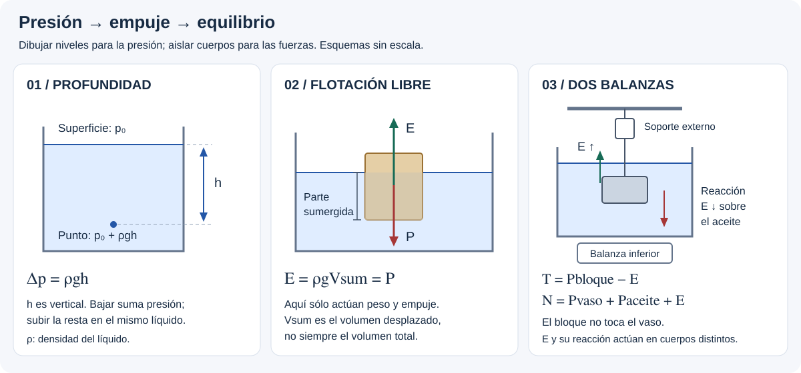

# Elasticidad e Hidrostática — resolución por casos

## 🎯 Qué recordar

**Convertir unidades → dibujar niveles o DCL → elegir presión de referencia →
plantear hidrostática / equilibrio → verificar unidades y sentido físico.**
Se usa la numeración de **tp11.pdf, ejercicios 1–21**, sin cambios en la copia
del 7/11. Las referencias «diap.» de los casos 1–8 corresponden a la
presentación **práctica anterior**, no a las 27 diapositivas de teoría nueva.
Elasticidad se agrega como E1–E4: procedimientos basados en la nueva teoría,
**sin asignarles números de ejercicio inexistentes en el TP**.

## 🖼️ Esquema / dibujo

## 📐 Fórmula

### Caso 1 — Densidad y conversión de unidades

**TP 11: 1–3 y 10. Ej. 2 · diap. 1.** Masa 535,0 g; volumen 25,0 cm³.

1. Pasar masa a kg y volumen a m³: m = 0,535 kg, V = 0,000025 m³.
2. Dividir: $\rho=0{,}535/(25\cdot10^{-6})=\mathbf{21400\ kg/m^3}$.
3. Comparar con una tabla: es compatible con platino, como indica la diapositiva.
   La densidad por sí sola no identifica inequívocamente una composición.

La diapositiva escribe un cero de menos en un denominador: usar 0,000025,
no 0,00025 m³. También equivale a 21,4 g/cm³.

**Ej. 1:** esfera de hierro: r = 0,015 m y
$m=7800(4\pi r^3/3)=0{,}1103$ kg.
**Ej. 3:** con r = 10000 m,
$\rho=1{,}99\cdot10^{30}/(4\pi r^3/3)=4{,}75\cdot10^{17}$ kg/m³.
**Ej. 10:** corona: $\rho=0{,}5/(185\cdot10^{-6})=2703$ kg/m³;
no coincide con oro macizo (19300 kg/m³ en la tabla del TP).

### Caso 2 — Barómetro

**Ej. 4 · diap. 2.** Vino de densidad 984 kg/m³.

1. En la superficie abierta, p = patm. Encima de la columna, p = psuperior.
2. Igualar presiones al nivel de la base:
   $p_{atm}=p_{superior}+\rho gh$.
3. Con vacío ideal y el dato usado en la diapositiva, patm = 103000 Pa:

$$h=\frac{103000}{984\cdot9{,}8}=\mathbf{10{,}68\ m}.$$

Si se adopta 1 atm = 101325 Pa, resulta 10,51 m; indicar cuál se usó.
El PDF da 10,50 m, compatible aproximadamente con esta última referencia;
la presentación usa 103000 Pa.
El vino produce vapor y no se espera un vacío tan bueno como sobre mercurio:
si psuperior no es despreciable, $h=(p_{atm}-p_{superior})/(\rho g)$.
La presentación no aporta presión de vapor ni temperatura para corregirlo.

### Caso 3 — Tubo en U

**Ej. 5 · diap. 3–4.** Ambos extremos abiertos; kerosene de 820 kg/m³
con columna hk = 6 cm y agua de 1000 kg/m³.

1. Dibujar una horizontal por la interfaz agua–kerosene.
2. Igualar presión en la interfaz y en el agua del otro brazo al mismo nivel.
3. Medir ha desde la superficie del agua hasta esa horizontal:

$$p_{atm}+\rho_ag h_a=p_{atm}+\rho_kg h_k
\quad\Rightarrow\quad h_a=\frac{820}{1000}(6\;\mathrm{cm})=4{,}92\;\mathrm{cm}.$$

4. La diferencia entre superficies es
   **h = hk − ha = 1,08 cm**. La superficie del kerosene queda más alta.
   No confundir h con la altura de una de las columnas.

### Caso 4 — Prensa o elevador hidráulico

**Ej. 6 · diap. 5.** A₁ = 3 cm²; A₂ = 200 cm²; carga F₂ = 15 kN.

$$F_1=F_2\frac{A_1}{A_2}=15000\frac3{200}=\mathbf{225\ N}.$$

Se cancelan las unidades de área porque son las mismas en el cociente.
Para calcular presión en Pa sí convertir áreas a m²:
Δp = 225/(3·10⁻⁴) = 750000 Pa.
Se desprecia desnivel, roce y peso de los pistones, como en la presentación.

Si hay palanca, hacer momentos respecto de su pivote:
**Foperador·brazooperador = F₁·brazoémbolo**.
Sin longitudes no se puede dar una fuerza adicional numérica.

### Caso 5 — Flotación en dos líquidos

**Ej. 12 · diap. 6–8.** Cubo de arista L = 0,10 m, ρb = 500 kg/m³,
aceite ρo = 800 kg/m³ y agua ρa = 1000 kg/m³.
Sobresalen 4 cm respecto de la superficie del aceite.

1. Longitud sumergida total: ho + ha = 0,10 − 0,04 = 0,06 m.
2. DCL del cubo: peso hacia abajo, empujes del aceite y del agua hacia arriba.
3. Con área horizontal A = L²:

$$\rho_bALg=\rho_oAh_og+\rho_aAh_ag.$$

4. Cancelar Ag y sustituir ha = 0,06 − ho:
   $500(0{,}10)=800h_o+1000(0{,}06-h_o)$.
   Resulta **ho = 0,05 m**, **ha = 0,01 m**.
5. Presión manométrica de la cara inferior:

$$p_{man}=800(9{,}8)(0{,}05)+1000(9{,}8)(0{,}01)
=\mathbf{490\ Pa}.$$

La presión absoluta sería patm + 490 Pa. Las dos alturas deben ser positivas
y sumar los 6 cm sumergidos: control rápido de la geometría.

### Caso 6 — Flotador con lastre

**Ej. 11 del PDF · ej. 13 de las diap. 9–10.** Madera: 0,60 × 0,30 × 0,05 m;
ρm = 600 kg/m³. Plomo: ρPb = 11300 kg/m³. Agua: 1000 kg/m³.

1. Sistema = madera + plomo; ambos desplazan agua cuando la cara superior
   queda justo al nivel del líquido. Vm = 0,009 m³.
2. El peso de ambos se equilibra con el empuje sobre **ambos**:

$$\rho_mV_mg+\rho_{Pb}V_{Pb}g=\rho_a(V_m+V_{Pb})g.$$

3. Despejar:

$$V_{Pb}=\frac{(\rho_a-\rho_m)V_m}{\rho_{Pb}-\rho_a}
=0{,}0003495\;\mathrm{m^3}\simeq\mathbf{350\ cm^3}.$$

No despreciar el empuje sobre el plomo: es pequeño, pero el ejercicio lo incluye.

### Caso 7 — Dos balanzas y un cuerpo sumergido

**Ej. 17 del PDF · ej. 18 de las diap. 11–13.** Vaso de 1 kg, aceite de 2 kg y ρo = 916 kg/m³;
bloque de hierro de 2 kg y ρFe = 7800 kg/m³. El bloque cuelga de un soporte
externo, totalmente sumergido, sin tocar el vaso ni derramar aceite.

1. Volumen del bloque: $V_b=2/7800=0{,}00025641$ m³.
2. Empuje: $E=\rho_oV_bg=\mathbf{2{,}302\ N}$.
3. DCL del bloque: T + E − mbg = 0. El dinamómetro marca:

$$T=2(9{,}8)-E=\mathbf{17{,}298\ N}.$$

4. DCL de vaso + aceite: el bloque ejerce sobre el aceite una fuerza E
   **hacia abajo**, reacción al empuje. La balanza inferior marca:

$$N=(m_{vaso}+m_{aceite})g+E=\mathbf{31{,}702\ N}.$$

5. Comprobar: T + N = (1 + 2 + 2)g = **49 N**.

Si las balanzas muestran masa equivalente, dividir por g:
arriba **1,765 kg**, abajo **3,235 kg**. Los valores en N no son kg.
La presentación cambia indebidamente la densidad del aceite por la del agua,
omite la reacción al empuje en el DCL inferior y rotula fuerzas en kg;
por eso aquí se rehace el planteo. El nivel sube, pero no aumenta la masa de aceite.
Las respuestas del **PDF** sí coinciden con este cálculo: 17,3 N y 31,7 N.

### Caso 8 — Barra parcialmente sumergida

**Ej. 20 del PDF · ej. 21 de las diap. 14–16.** Barra uniforme de ℓ = 3,6 m y mb = 12 kg;
lastre mL = 6 kg en A; cuerda vertical en B. Mitad de la barra sumergida,
sección uniforme, agua de 1000 kg/m³; se desprecia empuje sobre el lastre.

1. Sistema = barra + lastre. Peso de la barra en su centro, peso del lastre
   en A, tensión en B y empuje en el centro de la mitad sumergida.
2. Medidas desde B a lo largo de la barra: 1,8 m para el peso propio,
   3,6 m para el lastre y **2,7 m para el empuje**.
3. Momentos respecto de B. Para ángulo α con la horizontal, las fuerzas
   verticales aportan un factor común cos α que se cancela si no es cero:

$$E(2{,}7)\cos\alpha=(12g)(1{,}8)\cos\alpha+(6g)(3{,}6)\cos\alpha.$$

4. Resulta **E = 156,8 N**. Equilibrio vertical:
   T = (12 + 6)g − E = **19,6 N**.
5. $V_{sum}=E/(\rho_ag)=0{,}016$ m³.
   Como está sumergida la mitad: **Vtotal = 0,032 m³**.

El empuje no pasa por el centro de la barra completa; usarlo allí cambia
el torque y el resultado. Para una barra vertical, la ecuación de momentos
anterior no permite despejar E: no cancelar cos α = 0.

### Caso 9 — Fuerzas sobre paredes y compuertas

**TP 11: 7–9.** Con agua a un lado y atmósfera común a ambos, usar presión
manométrica. Para pared vertical rectangular, ancho b y profundidad H:

$$dF=\rho gh\,b\,dh,\qquad F=\int_0^H\rho gbh\,dh
=\frac12\rho gbH^2.$$

1. Dibujar la presión triangular: cero arriba, ρgH abajo.
2. La resultante actúa a **2H/3 bajo la superficie**, no en H/2.
3. Para bisagra horizontal a profundidad H/2:
   $|\tau|=F(H/6)=\rho gbH^3/12$.

**Ej. 7:** b = 50 m, H = 3 m → **F = 2205000 N**.
**Ej. 8:** b = 3 m, H = 1,8 m → **|τ| = 14288,4 N·m**.
El PDF imprime N: la unidad correcta de momento es N·m.

**Ej. 9:** fondo horizontal: $F=\rho gHA$; paredes verticales: integrar
como arriba. Con profundidad 2 m: fondo **5,88·10⁶ N**; cada extremo de
10 m de ancho **1,96·10⁵ N**; cada lado de 30 m **5,88·10⁵ N**.
Son fuerzas relativas a la atmósfera común. Sobre una cara aislada, si se
pide presión absoluta, incluir patmA.

### Caso 10 — Carga y fracción sumergida

**TP 11: 13–15.** Distinguir volumen exterior y volumen de material.

**Ej. 13, hielo con una persona:** al área mínima, la cara superior llega
justo al agua. Espesor e = 0,30 m, persona de 90 kg, ρh = 917 kg/m³:

$$\rho_aAe\,g=\rho_hAe\,g+m_pg\quad\Rightarrow\quad
A_{min}=\frac{m_p}{(\rho_a-\rho_h)e}=\mathbf{3{,}614\ m^2}.$$

Es un límite ideal, sin margen de seguridad y suponiendo que no vuelca.

**Ej. 14:** al flotar, $\rho_b=f\rho_l$.
50 % en agua → **ρesfera = 500 kg/m³**;
40 % en aceite → **ρaceite = 1250 kg/m³**.
Aunque este aceite sea más denso que los habituales, es lo que exigen los datos.

**Ej. 15:** esfera hueca cerrada, Ri = 0,09 m, Re = 0,10 m;
$V_{ext}=4\pi R_e^3/3$, $V_{mat}=4\pi(R_e^3-R_i^3)/3$.
Despreciando el aire interior:

$$\rho_{mat}V_{mat}g=800(V_{ext}/2)g.$$

Resulta **ρmat = 1476 kg/m³**, **P = 16,42 N**.
Para permanecer completamente sumergida sin otras fuerzas,
**ρlíquido = m/Vext = 400 kg/m³**. El volumen desplazado es el exterior.

### Caso 11 — Fuerzas sobre un bloque sumergido

**TP 11: 16.** Bloque de 10 kg, altura vertical 0,12 m y
área horizontal A = 0,01 m². Cara superior a 0,05 m, inferior a 0,17 m.

1. Con patm = 101300 Pa, dada en el enunciado, las fuerzas absolutas son:

$$F_{sup}=(p_{atm}+\rho g\,0{,}05)A=\mathbf{1017{,}90\ N}
\quad\text{hacia abajo},$$
$$F_{inf}=(p_{atm}+\rho g\,0{,}17)A=\mathbf{1029{,}66\ N}
\quad\text{hacia arriba}.$$

2. Restar: **E = Finf − Fsup = 11,76 N = ρgV**.
3. Dinamómetro: **T = mg − E = 86,24 N**.

El PDF da 4,9 N y 16,6 N para las caras: son contribuciones **manométricas**,
no las fuerzas absolutas con patm. Ambas convenciones dan el mismo empuje
si se usan consistentemente.

### Caso 12 — Boya cilíndrica y oscilación

**TP 11: 18.** Peso de la boya 15680 N, diámetro D = 0,90 m,
agua salada de 1030 kg/m³ y persona de 75 kg.

1. Área de flotación: A = πD²/4 = 0,63617 m².
2. Empuje adicional = peso adicional:
   $\rho gA\Delta h=m_pg$ → **Δh = 0,1145 m**.
3. Al irse la persona, para un desplazamiento y respecto del equilibrio
   original, $F_{rest}=-\rho gAy=-k_{ef}y$.
4. Masa que oscila: M = 15680/g = 1600 kg, **sin la persona**:

$$T=2\pi\sqrt{\frac{M}{\rho gA}}=\mathbf{3{,}136\ s}.$$

Modelo ideal: boya vertical con área de flotación constante, sin sumergirse
por completo ni salir del agua; sin amortiguamiento ni masa de agua arrastrada.
Conecta con [MAS](../movimiento-armonico-simple/teoria-esencial.md).

### Caso 13 — Cubo entre dos líquidos

**TP 11: 19.** Cubo de 0,10 m: 0,02 m en agua y 0,08 m en aceite de
600 kg/m³. La figura da **10 cm de espesor total de aceite**, cuya superficie
queda 2 cm sobre el cubo.

1. Para la masa, usar los volúmenes del cubo en cada líquido:

$$m=1000(0{,}10)^2(0{,}02)+600(0{,}10)^2(0{,}08)
=\mathbf{0{,}680\ kg}.$$

2. Para la presión inferior, usar las columnas completas desde la superficie:

$$p_{man}=600g(0{,}10)+1000g(0{,}02)=\mathbf{784\ Pa}.$$

No confundir los 8 cm del cubo dentro del aceite con los 10 cm de capa de aceite.

### Caso 14 — Estabilidad del flotador

**TP 11: 21.** Cubo de arista L = 0,30 m, mitad sumergido,
CG a 0,075 m sobre su cara inferior, como muestra la figura.

1. Peso = empuje: $P=\rho_agL^3/2=132{,}3$ N.
2. Centro geométrico O a 0,15 m de la base:
   OG = 0,15 − 0,075 = 0,075 m, hacia abajo en el cubo.
3. A 45°, la sección sumergida es triangular y simétrica respecto de la
   vertical por O: la línea de empuje pasa por esa vertical.
4. Separación horizontal entre peso y empuje:
   $d=OG\sin45^\circ=0{,}05303$ m.
5. Par enderezador: **|τ| = Pd = 7,016 N·m**, de sentido restaurador.

El PDF imprime N en lugar de N·m. El centro de empuje no es el CG.
Este brazo está justificado para 45°: a otros ángulos recalcular el
centro del volumen sumergido.

### Ampliación — Manómetro y atmósfera

**Nueva teoría: diap. 19–21; Sears §12.2, ejemplo 12.4 y ej. 12.16.**
No es un ejercicio nuevo del TP 11.

1. Elegir y hacia arriba y una horizontal dentro del mismo líquido conectado.
2. Recorrer desde una superficie conocida: bajar suma ρgh; subir resta.
3. Con un único líquido y un brazo abierto:
   $p_{gas}-p_{atm}=\rho g(y_{abierto}-y_{gas})$.
4. Si pgas > patm, el gas empuja el líquido hacia abajo en su brazo: comprobar
   el signo con el dibujo. Convertir h a m y patm a Pa antes de sumar.

Si se pide presión atmosférica a otra altitud, **no** tomar la densidad del
aire constante en un gran desnivel. Usar el modelo indicado por el enunciado;
para el isotérmico de diap. 21:
$p(y)=p_0e^{-\rho_0gy/p_0}$, con y desde el nivel de p₀ y ρ₀.
Control: a y = 0 se recupera p₀; al subir, p disminuye. Si se pide hallar y,
$y=-[p_0/(\rho_0g)]\ln(p/p_0)$. El cociente del logaritmo no lleva unidades.

### E1 — Tracción o compresión axial

**Nueva teoría de cátedra: diap. 4 y 8. Sin ejercicio numerado en TP 11.**

1. Dibujar la barra y hacer un corte imaginario: hallar la fuerza interna
   axial F por equilibrio. Dos fuerzas opuestas de módulo F no se suman a 2F.
2. Identificar longitud inicial L₀ y sección perpendicular a F.
   Si dan diámetro, $A=\pi d^2/4$; convertir mm² a m² (factor 10⁻⁶).
3. Usar Y del material: $\Delta L=FL_0/(AY)$; $L_f=L_0+\Delta L$.
   Si se pide Y: $Y=FL_0/(A\Delta L)$ en el tramo proporcional.
4. Verificar $|\Delta L|/L_0\ll1$ y que no se excedan los límites del material
   si están dados. Pequeña deformación por sí sola no certifica rango elástico.

**Control propio, no enunciado de TP:** acero con Y = 200 GPa (diap. 8),
L₀ = 2 m, A = 1 mm² y F = 100 N de tracción:
ΔL = **0,001 m = 1 mm**, S = **100 MPa**, ε = **0,0005**.
El cálculo supone régimen lineal; la fuente no da aquí un límite de fluencia
para esa muestra. No se lo verifica sólo con Y.

### E2 — Leer una curva de tracción

**Nueva teoría: diap. 5.** Reconocer primero qué representan los ejes.

1. Si son F–ΔL, pendiente inicial $k=\Delta F/\Delta(\Delta L)$, en N/m;
   obtener $Y=kL_0/A$. Si son S–ε, la pendiente inicial ya es Y, en Pa.
2. Distinguir fin de proporcionalidad, límite elástico, fluencia y rotura.
   No prolongar la recta de Hooke sobre el tramo plástico.
3. Para energía, identificar el área: $\int F\,d(\Delta L)$ da J;
   $\int S\,d\varepsilon$ da J/m³. El área elástica recuperable no es toda
   el área hasta la rotura.
4. Si faltan escala, geometría o curva de descarga, explicar cualitativamente
   lo observable; no inventar Y ni deformación residual numérica.

### E3 — Deformación por corte

**Nueva teoría: diap. 6 y 8.** Caras paralelas de área A, separadas h;
una se desplaza x respecto de la otra bajo una fuerza tangencial F∥.

1. A es el área sobre la que actúa la fuerza, no el área de la cara lateral.
2. Plantear $G=(F_\parallel/A)/(x/h)$ → $x=F_\parallel h/(AG)$.
3. Si piden ángulo, $\varphi\simeq x/h$ en radianes, para corte pequeño.
4. Comprobar que G está en Pa y x en m. No usar módulo de Young en su lugar.

Control propio: Gacero = 80 GPa, F∥ = 100 N, h = 0,10 m y A = 1 cm²
dan **x = 1,25 μm** y **φ ≈ 1,25 × 10⁻⁵ rad**.

### E4 — Compresión volumétrica

**Nueva teoría: diap. 7–8.** La presión aumenta uniformemente alrededor
del cuerpo o fluido; no es una fuerza aplicada sólo en un extremo.

1. Identificar V₀ y **Δp = pf − pi**. Un incremento de 1 MPa es 10⁶ Pa.
2. Usar $\Delta V=-V_0\Delta p/B$ y $V_f=V_0+\Delta V$.
3. Si dan compresibilidad K, usar $B=1/K$, no B = K.
4. Controlar signos: al aumentar p disminuye V; B positivo. Usar B constante
   sólo en el intervalo donde la aproximación lineal sea válida.

Control propio: 1 L de agua, B = 2,0 GPa (diap. 8) y Δp = 1 MPa:
**ΔV = −0,5 cm³**, **Vf = 999,5 cm³**; reducción relativa de 0,0005.
Para gases no trasladar ese B: depende del estado y del proceso térmico.

## ⚠️ Error frecuente

- Aplicar Arquímedes con la densidad del sólido.
- Olvidar un líquido en la presión del fondo o un cuerpo en el empuje total.
- Igualar las fuerzas de los émbolos en vez de sus presiones.
- Dibujar el empuje dos veces, como resultante y como sus fuerzas de presión.
- Confundir reacción al empuje con el peso completo del bloque sobre el vaso.
- Copiar E − P − T = 0 para un dinamómetro superior: T apunta hacia arriba.
- Convertir GPa a Pa con 10⁶: 1 GPa = 10⁹ Pa.

## 🔗 Ver también

- [Teoría esencial](teoria-esencial.md)
- [Fuentes y comprobaciones](fuentes.md)
- [Equilibrio de barras](../estatica-rototraslacion/resolucion-por-casos.md)
- [Volver al tema](README.md)
