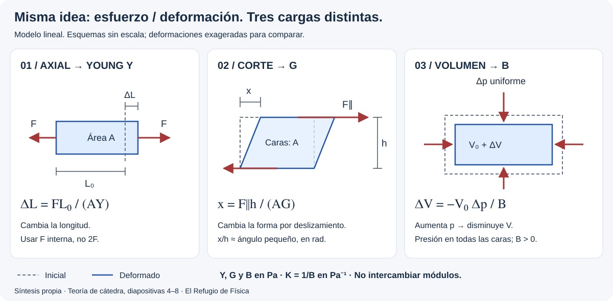
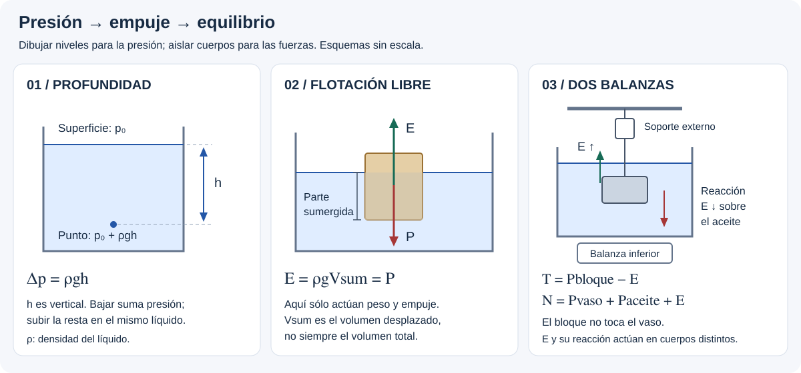

# Elasticidad e Hidrostática — teoría esencial

## 🎯 Qué recordar

- **Modelo deformable:** admite cambios de forma o tamaño. Elasticidad es
  recuperar la forma al retirar la carga; deformación plástica deja cambios
  permanentes. La proporcionalidad esfuerzo–deformación tiene un rango limitado.
- **Hidrostática:** estudia fluidos en reposo. La presión aumenta con la
  profundidad y actúa normal a las superficies.
- **Densidad del fluido** determina presión hidrostática y empuje;
  **densidad del cuerpo** relaciona su masa con su propio volumen.
- **Empuje:** resultante de las fuerzas de presión; equivale al peso del
  fluido desplazado. Un cuerpo que se hunde también recibe empuje.
- **Equilibrio:** sumar fuerzas reales. Si importan sus puntos de aplicación,
  sumar también momentos, como en la barra flotante.

Base: presentación teórica de cátedra del 7/11/2026, TP 11 y Sears
§12.1–12.3. Los casos prácticos anteriores se conservan. Ver
[alcance, correspondencias y erratas](fuentes.md).

## 🖼️ Esquema / dibujo

## 📐 Fórmula

### Sólido, líquido y gas — qué idealizamos

Un sólido resiste cambios de forma y puede sostener esfuerzos normales y de
corte. Un fluido no sostiene un esfuerzo de corte estático: se deforma
continuamente si se lo aplica. El líquido conserva aproximadamente su volumen;
el gas ocupa el recipiente y es mucho más compresible.

En el modelo **ideal** de las diapositivas 14–16, el fluido es incompresible
(ρ constante) y no viscoso. Viscosidad significa resistencia al movimiento
relativo entre capas; no es densidad ni módulo de corte. Un fluido real en
reposo también se estudia con hidrostática: no hace falta que su viscosidad
sea cero. No se añaden fórmulas de flujo a este tema.

### Elasticidad — tracción y compresión axial

**Cátedra: diap. 4 y 8.** Barra uniforme, carga axial y régimen elástico lineal:

$$S=\sigma=\frac{F_\perp}{A},\qquad
\varepsilon=\frac{\Delta L}{L_0},\qquad
S=Y\varepsilon\quad\Rightarrow\quad
\boxed{\Delta L=\frac{FL_0}{AY}}.$$

S es la «tensión» o esfuerzo normal de cátedra, **no una fuerza**;
ε es la deformación específica. Y (también E en la diapositiva) es el módulo
de Young: en Pa, al igual que S; ε no tiene unidades. F es la fuerza axial
interna que transmite una sección, no la suma de las fuerzas de ambos extremos.
Se usa geometría inicial y pequeñas deformaciones. Con tracción positiva,
ΔL > 0; la compresión da ΔL < 0. Un elemento largo puede pandear: esta fórmula
no analiza ese modo de fallo.

Para comparar con un resorte: $k_{axial}=AY/L_0$ en N/m; Y es propiedad del
material, mientras que k también depende de la geometría.

### Curva de tracción — no toda elasticidad es lineal

**Cátedra: diap. 5.** En el tramo proporcional, S crece linealmente con ε.
Límite de proporcionalidad y límite elástico son conceptos distintos:
puede haber respuesta elástica no lineal. Superado el límite elástico queda
deformación permanente; la fluencia describe el avance de la deformación
plástica y la rotura termina el ensayo.

- En gráfico **S–ε**, la pendiente inicial es Y.
- En gráfico **F–ΔL**, como el dibujo de la diapositiva, es $k=AY/L_0$,
  **no Y**. Para obtener Y hay que conocer A y L₀.
- Ductilidad: deformación plástica admitida antes de romperse. Resiliencia:
  energía elástica recuperable por volumen; tenacidad: energía absorbida por
  volumen hasta la rotura. En una curva S–ε se relacionan con áreas bajo la
  curva, con unidades J/m³; en F–ΔL el área es trabajo, en J.

### Corte y compresión volumétrica

**Cátedra: diap. 6–8.** No usar Young para cualquier deformación:

| Carga y cambio geométrico | Relación lineal | Qué mide el módulo |
| --- | --- | --- |
| Fuerza paralela a caras de área A, separadas h; desplazamiento lateral x | $G=(F_\parallel/A)/(x/h)$, $x=F_\parallel h/(AG)$ | Resistencia al corte |
| Aumento uniforme de presión Δp; volumen inicial V₀ | $B=-\Delta p/(\Delta V/V_0)$, $\Delta V=-V_0\Delta p/B$ | Resistencia al cambio de volumen |

Para corte pequeño, $x/h=\tan\varphi\simeq\varphi$ (en radianes).
Y, G y B se expresan en Pa, pero **no son intercambiables**. La compresibilidad
de cátedra es $K=1/B$, en Pa⁻¹: B grande significa poca compresibilidad.
En B se usa el **incremento de presión**, no la presión absoluta inicial;
Δp > 0 produce ΔV < 0 y B > 0.

Valores orientativos de la diapositiva 8: acero Y = 200 GPa y G = 80 GPa;
agua B = 2,0 GPa. Usar el dato del enunciado si difiere. Para gases, el módulo
depende del proceso; la tabla indica temperatura constante y presión normal.

### Densidad y unidades

$$\rho=\frac mV,\qquad d_r=\frac{\rho}{\rho_{referencia}}.$$

La densidad relativa no tiene unidades; para sólidos y líquidos suele
referirse al agua, si así se indica. En estos ejercicios:
ρagua = 1000 kg/m³ y g = 9,8 m/s².

| Conversión | Equivalencia |
| --- | --- |
| Masa | 1 g = 10⁻³ kg |
| Área | 1 cm² = 10⁻⁴ m² |
| Volumen | 1 cm³ = 10⁻⁶ m³; 1 L = 10⁻³ m³ |
| Densidad | 1 g/cm³ = 1000 kg/m³ |
| Presión | 1 Pa = 1 N/m²; 1 kPa = 1000 Pa |

### Presión: fijar nivel y referencia

$$p=F_\perp/A\quad\text{si es uniforme},\qquad
p=p_{superficie}+\rho gh.$$

h es la **profundidad vertical**, no el recorrido por un tubo. Para varios
estratos: $p_{fondo}=p_{superficie}+\sum_j\rho_jgh_j$.
Al bajar se suma ρgh; al subir se resta. En un mismo fluido conectado,
homogéneo y en reposo, puntos al mismo nivel tienen igual presión.
En una interfaz ideal la presión es continua (se desprecia tensión superficial).

$$p_{man}=p_{abs}-p_{atm}.$$

Una superficie abierta al aire tiene presión manométrica cero, pero su presión
absoluta es patm (Sears §12.2). La presión es **escalar**; la fuerza de presión
sí tiene dirección, siempre normal a la superficie en un fluido en reposo.

### Manómetro, barómetro y presión atmosférica

Para un manómetro de un líquido conectado a gas y abierto al aire:

$$p_{gas}-p_{atm}=\rho g(y_{abierto}-y_{gas}),$$

donde las y son alturas de las superficies, positivas hacia arriba.
Si el líquido queda más bajo del lado del gas, la presión del gas es mayor.
En un barómetro: $p_{atm}=p_{superior}+\rho gh$; sólo aproximar
$p_{superior}\simeq0$ si se justifica despreciar el vapor.

**Cátedra: diap. 19–21; Sears §12.2.** Referencia estándar:
1 atm = 101325 Pa = 1013,25 hPa; 1 hPa = 100 Pa.
No confundirla con la presión atmosférica real de cada lugar.

Con altura y positiva hacia arriba, $dp/dy=-\rho g$.
En gases, ρ puede cambiar con la altitud. La exponencial de la diapositiva 21,

$$p(y)=p_0\exp\!\left(-\frac{\rho_0g}{p_0}y\right),$$

corresponde a un modelo de gas ideal **isotérmico**, con g constante y
$\rho/p=\rho_0/p_0$. No supone densidad uniforme ni describe toda atmósfera
real. En un líquido de ρ constante se mantiene la relación lineal p₀ + ρgh.

### Pascal: transmitir presión

$$\frac{F_1}{A_1}=\frac{F_2}{A_2}.$$

Para pistones ideales a igual altura o con desnivel despreciable, despreciando
sus pesos y el roce; la presión exterior común se cancela. Con desnivel,
agregar la corrección hidrostática.
No se iguala la presión de todo el líquido si cambia la altura.
En un sistema incompresible sin pérdidas, $A_1\Delta x_1=A_2\Delta x_2$:
ganar fuerza requiere mayor recorrido del pistón pequeño.

### Arquímedes y flotación

$$E=\rho_{fluido}gV_{desplazado},\qquad P=mg.$$

En varios líquidos: $E=\sum_j\rho_jgV_j$, donde Vj es el volumen del cuerpo
sumergido en cada uno. Para un cuerpo homogéneo que flota libremente en un
solo líquido, despreciando el aire:

$$E=P\quad\Rightarrow\quad
\frac{V_{sum}}{V_{total}}=\frac{\rho_{cuerpo}}{\rho_{fluido}}.$$

Con cuerda, lastre u otros apoyos, plantear Newton en lugar de imponer E = P
al cuerpo aislado. El empuje pasa por el centro del volumen desplazado en
un líquido homogéneo; no necesariamente por el CM del cuerpo (diap. 24;
Sears §12.3). La presentación lo llama «centro de flotación»; aquí también
se lo identifica como **centro de empuje**.

Con y positiva hacia arriba: cuerpo colgante desde arriba, **T + E − P = 0**.
Si hay apoyo inferior y el agua rodea al cuerpo: **N + E − P = 0**.
No copiar los signos negativos de T y N de la diapositiva 26: contradicen
sus flechas. Si el cuerpo sella contra el fondo sin agua debajo, revisar las
fuerzas de presión: no aplicar automáticamente E = ρgV.

### Presión variable y estabilidad — ampliación con el TP completo

En una pared vertical rectangular con el borde superior al nivel del agua,
ancho b y profundidad H, integrar la presión manométrica:

$$F=\int_0^H\rho gh\,b\,dh=\frac12\rho gbH^2,
\qquad h_{centro\ de\ presión}=\frac{2H}{3}.$$

La resultante queda por debajo del centro geométrico de la pared. Para
hallar un momento usar su brazo respecto de la bisagra (ej. 7–9).
En una cara horizontal a profundidad constante, sí puede usarse F = pA.

Un flotador puede tener peso igual al empuje y aun así volcar: para su
estabilidad importan las **líneas de acción**. Al inclinarlo, el centro del
volumen desplazado cambia; si el par peso–empuje restaura la orientación,
es enderezador (ej. 21).

Para una boya cilíndrica vertical con área de flotación A constante,
el empuje adicional ante un pequeño descenso y es ρgAy. Al restar el
equilibrio, resulta $F_{rest}=-\rho gAy$, equivalente a un resorte ideal
de constante $k_{ef}=\rho gA$ (ej. 18).

### Tensión superficial — explicación conceptual disponible

**Sears §12.3, p. impresa 378 (PDF 10).** La cohesión molecular hace que la
superficie líquida tienda a reducir su área y se comporte como una membrana
tensa. Por eso un objeto pequeño y más denso que el agua puede sostenerse
en la superficie: no basta con analizar sólo el empuje volumétrico.
El efecto cobra importancia a pequeña escala, por la mayor relación
área/volumen. No confundir tensión superficial con tensión de una cuerda ni
con esfuerzo normal de un sólido.

El texto suministrado aporta este desarrollo cualitativo, no una práctica
específica de capilaridad. En los 21 ejercicios del TP se mantiene el modelo
sin tensión superficial. No se inventan ejercicios ni se deduce su peso en
el examen a partir del título.

## ⚠️ Error frecuente

- Convertir cm³ a m³ multiplicando sólo por 0,01: hay que elevar al cubo.
- Usar Vtotal en el empuje cuando el cuerpo está parcialmente sumergido.
- Decir «misma altura, misma presión» entre líquidos desconectados sin justificarlo.
- Confundir presión con fuerza o expresar fuerzas en kg.
- Contar el peso del bloque dentro de la lectura inferior aunque lo sostenga
  un soporte externo: la balanza del vaso recibe la reacción al empuje.
- Reemplazar aceite por agua en un cálculo sólo por costumbre.
- Aplicar Young fuera del tramo lineal o confundir Y (Pa) con k (N/m).
- Usar una fuerza de corte en una fórmula de tracción.
- Obtener B negativo por olvidar que la compresión reduce el volumen.
- Igualar una presión absoluta al doble cuando se duplica la profundidad:
  se duplica ρgh, no necesariamente p₀ + ρgh.

## 🔗 Ver también

- [Casos de los 21 ejercicios del TP 11](resolucion-por-casos.md)
- [Fuentes y correcciones](fuentes.md)
- [Estática: fuerzas y momentos](../estatica-rototraslacion/teoria-esencial.md)
- [Laboratorio 3: constante de un resorte](../../laboratorios/laboratorio-3.md)
- [Volver al tema](README.md)
