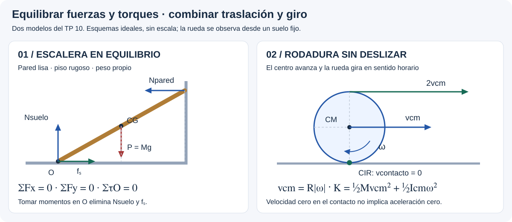

# Estática y Rototraslación — resolución por casos

## 🎯 Qué recordar

**DCL → ejes y signos → momentos respecto de un punto conveniente →
ecuaciones → comprobar contacto y rozamiento.**

Si rueda: agregar la rotación del CM y la restricción de no deslizamiento.
Los números corresponden a los ejercicios del **TP 10**.

## 🖼️ Esquema / dibujo

## 📐 Fórmula

### Caso 1 — Escaleras y cargas

**TP 10: 1–2.** Sea ℓ la longitud, β el ángulo con el piso y s la distancia
que subió la persona **a lo largo de la escalera**. Pesos Pₑ y Pₚ.

1. Dibujar los pesos, la normal de la pared y la normal del piso.
2. Agregar cable horizontal (ej. 1) o roce del piso (ej. 2).
3. Tomar momentos respecto del pie para eliminar las fuerzas de ese apoyo:

$$N_{pared}\ell\sin\beta
=P_e\frac\ell2\cos\beta+P_p s\cos\beta.$$

4. Fuerzas horizontales: T = Npared o fₛ = Npared, según el caso.
5. Para el límite usar T = Tmáx o fₛ = μₛNsuelo; verticalmente
   Nsuelo = Pₑ + Pₚ. Antes del límite calcular el roce real, sin imponer su máximo.

**Ej. 2:** cos β = 3,6/6 = 0,6, sin β = 0,8.
El máximo roce disponible es $f_{s,max}=0{,}40(392+784)=470{,}4$ N.
Para s = 3 m, fₛ = 441 N. Igualando al máximo: **s = 3,30 m**.
Verificar siempre que s ≤ ℓ.

### Caso 2 — Puntales, barras y puertas

**TP 10: 3–6.**

1. Aislar la barra/puerta y ubicar el peso en su CG.
2. Descomponer la reacción de la articulación en H y V.
3. Elegir el pivote para anular esas reacciones en la ecuación de torque.
4. Hallar la tensión con momentos y recuperar H, V con fuerzas.
5. Si piden reacción total: $C=\sqrt{H^2+V^2}$ y dirección mediante atan2(V,H).

**Ej. 3a:** respetando los ángulos de la figura:

$$T\ell\sin75^\circ=(9800\ell+4900\ell/2)\sin60^\circ.$$

Se cancela ℓ: T ≈ 10,98 kN. Luego H = T cos 45° y
V = 14700 − T sin 45°. No usar el ángulo del cable con la horizontal
como si fuera automáticamente el ángulo entre cable y puntal.

**Ej. 4:** el disco transmite torque $TR$, con R = 0,15 m y T = 235,2 N.
Inicialmente, $TR=P_b\ell/2$, de donde Pb = 58,8 N.
Con el peso adicional Q = 19,6 N, si β se mide desde la horizontal:

$$TR=(P_b\ell/2+Q\ell)\cos\beta\quad\Rightarrow\quad\beta=53{,}13^\circ.$$

**Ej. 5:** la figura da ancho 2,4 m y altura 1,2 m, mientras el texto resulta
ambiguo: dibujar las cotas explícitas. Con $H_A=0$, tomar momentos en B:
$T(2{,}4\sin30^\circ+1{,}2\cos30^\circ)=400(1{,}2)$.
Resulta T = 214,36 N, HB = T cos 30° = 185,64 N y
VA + VB = 400 − T sin 30° = 292,82 N. Las reacciones verticales individuales
no quedan determinadas sólo por estas ecuaciones.

**Ej. 6:** dos fuerzas horizontales opuestas forman el par que compensa el
peso: $H(1{,}80)=300(0{,}9/2)$, de donde **H = 75 N** en cada bisagra.

### Caso 3 — Deslizar, volcar o perder contacto

**TP 10: 7–9.** No imponer que la resultante normal pase por el centro.

**Ej. 7, bloque arrastrado a velocidad constante:** base b, peso P,
fuerza horizontal a altura h, rozamiento cinético μk.

$$N=P,\qquad F=\mu_kP,\qquad x_N=\frac{Fh}{P}=\mu_kh.$$

xN se mide desde el centro de la base hacia el borde delantero.
Al llegar $x_N=b/2$, comienza el vuelco:
$h_{lim}=b/(2\mu_k)$.
Datos del TP: F = 98 N; h = 0,15 m → xN = 0,06 m desde el centro,
o **0,09 m desde el borde derecho**; hlim = 0,375 m.

**Ej. 8, tabla inclinada lentamente:** calcular ambos umbrales,
$\beta_D=\arctan\mu_s$ y $\beta_V=\arctan(b/H)$.
Con b/H = 0,30/0,60, βV = 26,565°:

| μₛ | βD | Ocurre primero |
| --- | --- | --- |
| 0,40 | 21,801° | Desliza |
| 0,60 | 30,964° | Vuelca |
| 0,50 | 26,565° | Ambos límites coinciden |

La coincidencia de límites no es «equilibrio neutro» de la teoría de estabilidad.

**Ej. 9, puerta sobre carril:** ruedas trabadas → roce **cinético**, no rodadura.
Con separación d y empuje horizontal F a distancia h bajo el carril:

$$N_A+N_B=P,\quad F=\mu_kP,\quad
N_A=P/2-Fh/d,\quad N_B=P/2+Fh/d.$$

Aquí las etiquetas y el sentido siguen la figura del TP.
Con h = 0,90 m: NA = 98 N, NB = 686 N.
El límite NA = 0 da **hmáx = d/(2μk) = 1,20 m**.

### Caso 4 — Energía de rodadura

**TP 10: 10, 12 y 14–15.**

1. Elegir Icm según el cuerpo; si el TP lo da, usar ese dato.
2. Aplicar $\omega=v/R$ con el radio exterior de contacto.
3. Calcular $K_t=Mv^2/2$, $K_r=I_{cm}\omega^2/2$, $K=K_t+K_r$.
4. Si parte del reposo sobre piso horizontal, el trabajo neto necesario es K.
   Si baja desde una altura h sin pérdidas: Mgh = K, si también partió del reposo.

**Ej. 10:** con cilindro macizo uniforme, M = 10 kg y v = 10 m/s:
Kt = 500 J, Kr = 250 J y **K = 750 J**.

**Ej. 12:** esfera maciza, $I=2MR^2/5$ y v = Rω = 10 m/s:
**W = 10 500 J**.

**Ej. 15:** anillo de pared gruesa,
$I=M(R_e^2+R_i^2)/2$ y $\omega=v/R_e$.
Con los datos: **K = 215,46 J**, **h = 1,221 m** si parte del reposo
y rueda sin pérdidas. Estas hipótesis no están explícitas en todo el enunciado.

### Caso 5 — Rodar en una pendiente

**TP 10: 11, 13 y 16.** Definir $c=I_{cm}/(MR^2)$.

Para bajar sin patinar:

$$Mg\sin\beta-f_s=Ma,\quad f_sR=I_{cm}\alpha,\quad a=R\alpha,$$
$$a=\frac{g\sin\beta}{1+c},\qquad
\mu_{s,min}=\frac{c}{1+c}\tan\beta.$$

**Ej. 11:** disco c = 1/2 → a = (2/3)g sin β y μₛ,min = tan β/3;
aro c = 1 → a = g sin β/2. El disco acelera más.

**Ej. 13:** desde h = 2,70 m, $v=\sqrt{2gh/(1+c)}$:
disco **5,94 m/s**, aro **5,14 m/s**. Por la misma rampa llega primero el disco.
Las fuerzas de roce no son iguales para ambos aunque sus masas fueran iguales.

**Ej. 16, sigue subiendo:** desde el punto donde se conoce v₀:

$$\frac12Mv_0^2+\frac12I(v_0/R)^2=Mg\,\Delta s\sin37^\circ,$$
$$\Delta s=\frac{(1+c)v_0^2}{2g\sin37^\circ}.$$

Usando R = 0,08 m, Ri = 0,06 m y c = 0,78125:
**Δs = 1,184 m** adicionales; recorrido total ≈ 3,184 m.
No confundir recorrido por la rampa con altura vertical.

### Caso 6 — Tirar de un cilindro o carrete

**TP 10: 17–18.** La dirección de fₛ es una incógnita.
Tomar +x a la derecha y giro antihorario positivo; f tiene signo algebraico.

Para una fuerza F hacia la derecha aplicada a altura y respecto del CM:

$$F+f=Ma,\qquad -yF+Rf=I\alpha,\qquad\alpha=-a/R,$$
$$a=\frac{F(1+y/R)}{M+I/R^2},\qquad f=Ma-F.$$

**Ej. 18, cilindro uniforme:** M = 1 kg, F = 3 N, I/R² = M/2:

| Aplicación | y | a hacia la derecha | fₛ |
| --- | --- | --- | --- |
| Entre el centro y el suelo | −R/2 | 1 m/s² | 2 N hacia la izquierda |
| En el centro | 0 | 2 m/s² | 1 N hacia la izquierda |
| Arriba | +R | 4 m/s² | 1 N hacia la derecha |

**Ej. 17:** la cuerda tira **hacia la izquierda** desde la parte inferior
del núcleo de radio r, según la figura. Con F como módulo positivo:

$$-F+f=Ma,\quad-rF+Rf=I\alpha,\quad
a=-\frac{F(1-r/R)}{M+I/R^2}.$$

La respuesta **0,261 m/s² a la izquierda** presupone I = MR²/2.
La distribución de masa del carrete no está especificada claramente;
si I cambia, también cambia el valor. Verificar $|f|\le\mu_sN$ en ambos casos.

### Caso 7 — Carretón con ruedas

**TP 10: 19.** Desde reposo, a = 2x/t² = 2,4 m/s².
La respuesta interpreta los 100 kg como masa del vehículo **sin** las
cuatro ruedas: Mtotal = 100 + 4·10 = 140 kg.

- **Piso sin roce:** no se genera el giro de las ruedas inicialmente quietas;
  deslizan, y F = Mtotal a = **336 N**.
- **Rodadura sin patinar:** además hay que acelerar los giros:

$$F=\left(M_{total}+\sum_{j=1}^4 I_j/R^2\right)a
=(140+4\cdot5)\,2{,}4=\mathbf{384\ N}.$$

Aquí no se conserva energía mecánica: la fuerza aplicada entrega trabajo.

### Caso 8 — Bola en un loop

**TP 10: 20.** Esfera maciza ideal, sin pérdidas. Para reproducir el resultado
impreso se aproxima r ≪ R, donde r es el radio de la bola y R el de la pista.

1. En la cima del loop: $N+mg=mv^2/R$. Contacto límite N = 0 → v² = gR.
2. Relacionar la liberación desde reposo con la cima:
   $mgh=mg(2R)+\frac12mv^2+\frac12(2mr^2/5)(v/r)^2$.
3. Resulta **hmín = 2,7R = 2,70 m** para R = 1 m.
4. En B (lateral): $v_B^2=\frac{10}{7}g(h-R)=23{,}8$ m²/s;
   $a_n=v_B^2/R=23{,}8$ m/s² y $|a_t|=5g/7=7$ m/s².
   La aceleración **total del CM** es $\sqrt{a_n^2+a_t^2}=24{,}8$ m/s².

El TP imprime 7 m/s² para aCM y 14 m/s² para aT: esas etiquetas no
coinciden con las componentes normal/tangencial del CM del modelo anterior.
Consultar qué punto de la bola se pretende analizar antes de copiar esos valores.
Con radio finito, el CM describe radio R − r y debe corregirse la geometría.
Además, comprobar que el roce disponible permite rodar: N ≥ 0 por sí solo
no garantiza adherencia en todo el loop.

### Caso 9 — Cilindro rodante y masa colgante

**TP 10: 21.** El cable sale por arriba del cilindro, pasa por una polea
ideal y no desliza. El cilindro también rueda sin deslizar sobre el piso.

1. Para el cilindro aplicar el caso de fuerza en su parte superior:
   $a_{cm}=4T/(3M)$ si es macizo uniforme.
2. Vincular velocidades del cable y del punto superior:
   $v_m=2v_{cm}$ → **am = 2acm**, no am = acm.
3. Para la masa: $mg-T=ma_m$.

$$T=\frac{mg}{1+8m/(3M)},\qquad
a_{cm}=\frac{4T}{3M},\quad a_m=2a_{cm},\quad |\alpha|=a_{cm}/R.$$

Con M = 1 kg, m = 0,2 kg, R = 0,20 m:
**T = 1,278 N; acm = 1,704 m/s²; am = 3,409 m/s²; |α| = 8,522 rad/s²**.
fₛ = T/3 hacia la derecha; para N = Mg, se necesita μₛ ≥ 0,0435.
Las pequeñas diferencias con el TP son de redondeo.

## ⚠️ Error frecuente

- Igualar aceleraciones de la cuerda y del CM en el caso 9.
- Usar rozamiento cinético en un contacto que no desliza.
- Suponer rodadura sobre un piso liso con ruedas inicialmente sin giro.
- Usar radio interior para vcm = Rω cuando el cuerpo apoya sobre el exterior.
- Confundir el límite de vuelco con el de deslizamiento o con equilibrio neutro.

## 🔗 Ver también

- [Teoría esencial](teoria-esencial.md)
- [Fuentes y comprobaciones](fuentes.md)
- [Casos de poleas con eje fijo](../cuerpo-rigido/resolucion-por-casos.md)
- [Volver al tema](README.md)
