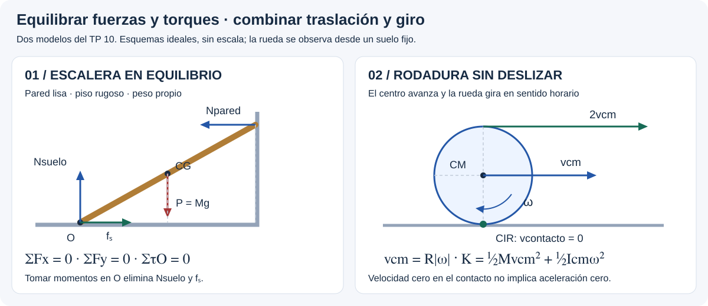

# Estática y Rototraslación — teoría esencial

## 🎯 Qué recordar

- **Equilibrio de un cuerpo rígido:** deben anularse tanto la fuerza externa
  neta como el torque externo neto. Cumplir una sola condición no alcanza.
- **Estática:** cuerpo en reposo en el marco elegido. También puede haber
  traslación uniforme sin giro con fuerzas y torques equilibrados.
- **Centro de gravedad (CG):** punto donde puede representarse la resultante
  del peso. En un campo gravitatorio uniforme coincide con el centro de masa.
- **Rototraslación:** traslación del CM + rotación alrededor del CM.
  Requiere estudiar ambas, vinculadas por la condición de rodadura si no patina.
- **Rozamiento estático:** se calcula de las ecuaciones y luego se verifica
  su límite. Su sentido se opone a la tendencia de deslizamiento del contacto;
  puede favorecer o frenar el movimiento del CM.

## 🖼️ Esquema / dibujo

## 📐 Fórmula

### Equilibrio: fuerzas y momentos

$$\sum F_x=0,\qquad \sum F_y=0,\qquad \sum\tau_{O,z}=0.$$

En problemas planos hay tres ecuaciones independientes. Elegir O en un apoyo
o articulación suele eliminar torques de fuerzas desconocidas.
Con fuerza neta nula, el torque neto es el mismo respecto de cualquier punto.

$$\tau_{O,z}=r_xF_y-r_yF_x,\qquad |\tau|=Fd_\perp.$$

**Apoyos ideales:** pared lisa → normal perpendicular a la pared;
suelo rugoso → normal y rozamiento; cable → tensión a lo largo del cable;
articulación plana ideal → dos componentes de reacción, sin par resistente.
Una barra uniforme tiene su peso aplicado en el punto medio; no suponer
uniformidad si el enunciado da otro CG.

| Condición física | Planteo |
| --- | --- |
| Contacto estático | $|f_s|\le\mu_sN$ |
| Deslizamiento inminente | $|f_s|=\mu_sN$ |
| Roce cinético | $|f_k|=\mu_kN$ |
| Contacto unilateral | $N\ge0$; al perder apoyo, $N=0$ |
| Vuelco inminente | La resultante normal llega al borde de la base |

### Estabilidad: mirar la altura del CG

$$U_g=Mgy_{cm},\qquad F_x=-\frac{\partial U}{\partial x}.$$

Para una coordenada permitida q, equilibrio requiere $dU/dq=0$.
Un mínimo local estricto de U da equilibrio estable; un máximo, inestable;
U constante en un entorno da equilibrio neutro. Si la segunda derivada
es cero, estudiar la forma de U: no basta ese dato para clasificar.
En un giro puede usarse $\tau=-dU/d\theta$.

Para un bloque rectangular homogéneo, base b y altura H, sobre una tabla
que se inclina lentamente:

$$\tan\beta_{deslizamiento}=\mu_s,\qquad
\tan\beta_{vuelco}=b/H.$$

Ocurre primero el límite de menor ángulo. La proyección vertical del CG
llega al borde al comenzar el vuelco; este criterio supone la gravedad
y los contactos del caso, sin fuerzas adicionales.

### Rodadura: separar movimiento del CM y giro

$$\vec v_P=\vec v_{cm}+\vec\omega\times\vec r_{P/cm}.$$

Sobre suelo fijo, sin deslizamiento, $v_{contacto}=0$ y $v_{cm}=R|\omega|$.
R es el radio **exterior de contacto**. Para avanzar hacia +x, tomando
antihorario positivo: $v_{cm,x}=-R\omega_z$ y $a_{cm,x}=-R\alpha_z$
en rodadura rectilínea sobre un plano fijo.

El punto superior tiene rapidez $2v_{cm}$. El contacto es el **centro
instantáneo de rotación (CIR)**, pero no un pivote material fijo:
tener velocidad instantánea cero no implica aceleración cero.

$$K=\frac12Mv_{cm}^2+\frac12I_{cm}\omega^2
=\frac12I_{CIR}\omega^2,\qquad I_{CIR}=I_{cm}+MR^2.$$

La última igualdad es una alternativa: no sumar otra vez la energía de
traslación a $I_{CIR}\omega^2/2$.

### Dinámica y energía de la rototraslación

$$\sum\vec F_{ext}=M\vec a_{cm},\qquad
\sum\tau_{ext,cm,z}=I_{cm}\alpha_z.$$

Se usa el caso de la presentación: eje de simetría por el CM que no cambia
de dirección. No trasladar automáticamente esta ecuación al CIR.

$$K_i+U_i+W_{nc}=K_f+U_f.$$

El roce estático ideal en contacto con una superficie **fija**, sin
deformaciones ni deslizamiento, no realiza trabajo neto sobre el cuerpo.
Puede producir torque y ser necesario para rodar. Si patina o hay resistencia
al rodamiento, revisar las pérdidas y la restricción $v_{cm}=R|\omega|$.

Para una pendiente uniforme de ángulo β y $I_{cm}=cMR^2$, sin otras fuerzas:

$$a_{cm}=\frac{g\sin\beta}{1+c},\quad
f_s=\frac{c}{1+c}Mg\sin\beta,\quad
\mu_s\ge\frac{c}{1+c}\tan\beta.$$

a se dirige cuesta abajo; fₛ, cuesta arriba, incluso si el cuerpo inicialmente
sube sin patinar. Con descenso vertical h desde reposo:
$v_{cm}=\sqrt{2gh/(1+c)}$.

**Unidades:** fuerzas en N, distancias en m, I en kg·m², energía en J,
ω en rad/s y α en rad/s². Usar g = 9,8 m/s² salvo indicación.

## ⚠️ Error frecuente

- Usar sólo $\sum F=0$ y olvidar los torques.
- Medir el brazo sobre la barra en vez de perpendicular a la fuerza.
- Imponer $f_s=\mu_sN$ fuera del límite de adherencia.
- Suponer que la normal siempre actúa en el centro de la base.
- Dibujar fuerzas y sus componentes como si fueran fuerzas adicionales.
- Conservar energía mecánica en el caso del TP donde las ruedas **deslizan**.
- Usar $a_{cm}=R\alpha$ para la aceleración total en una pista curva:
  la vinculación es tangencial, y el CM también tiene aceleración normal.

## 🔗 Ver también

- [Casos del TP 10](resolucion-por-casos.md)
- [Inercias y Steiner](../cuerpo-rigido/teoria-esencial.md)
- [Trabajo y Energía](../trabajo-energia/README.md)
- [Fuentes y comprobaciones](fuentes.md)
- [Volver al tema](README.md)
