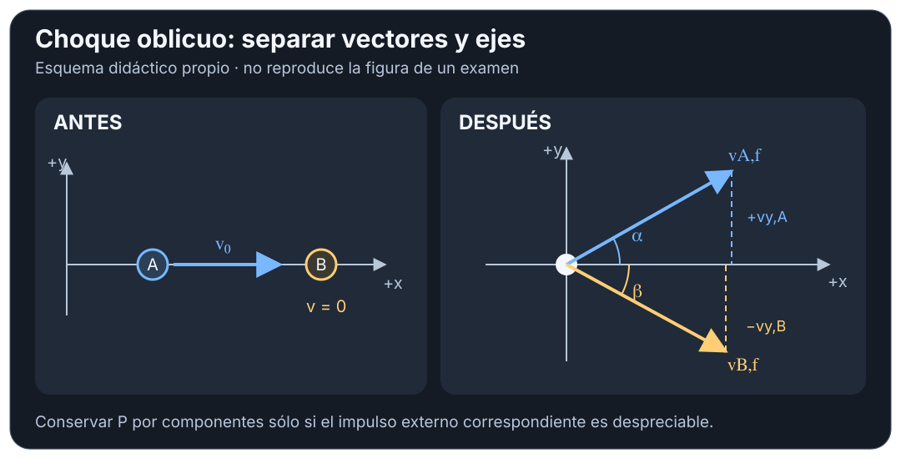

# Choques oblicuos — vectores, signos y ecuaciones

## 🎯 Qué recordar

La cantidad de movimiento es **vectorial**. En 2D se necesitan dos
balances, uno por eje, **si** el impulso externo sobre el sistema
en esas direcciones es despreciable. El choque **no tiene por qué ser
elástico**: no escribir $K_i=K_f$ sin justificación.

## 🖼️ Esquema / dibujo

El diagrama es **propio y genérico**: representa una elección posible de
ejes y sentidos; **no reproduce** la figura del examen. Antes de aplicarlo,
revisar dónde están medidos los ángulos en el enunciado original y si
las velocidades finales realmente se ubican en esos cuadrantes.

| Cuerpo / instante | $v_x$ | $v_y$ |
| --- | --- | --- |
| A antes | $v_0$ | $0$ |
| B antes (si parte del reposo) | $0$ | $0$ |
| A después, arriba de $+x$ | $v_A\cos\alpha$ | $+v_A\sin\alpha$ |
| B después, abajo de $+x$ | $v_B\cos\beta$ | $-v_B\sin\beta$ |

Las filas corresponden **sólo al esquema indicado**, no a cualquier choque.

## 📐 Fórmula

### ¿Por qué se pueden conservar componentes?

Para el sistema de **ambos cuerpos** y un intervalo que abarca sólo el
contacto, la tercera ley cancela los impulsos internos entre A y B.
El teorema general sigue siendo:

$$
\Delta\vec P=\vec J_{\rm ext}.
$$

Si el impulso externo es despreciable en $x$ e $y$, para este modelo:

$$
m_Av_0=m_Av_A\cos\alpha+m_Bv_B\cos\beta,\qquad (x)
$$

$$
0=m_Av_A\sin\alpha-m_Bv_B\sin\beta.\qquad (y)
$$

En cada ecuación las velocidades son **rapideces positivas**; el signo
de la componente proviene de su dirección respecto del eje. Si
$m_A=m_B$, se puede cancelar la masa **como factor no nulo de todos
los términos**. Las dos ecuaciones permiten relacionar las dos
rapideces desconocidas sin agregar una conservación de $K$.

### Después del planteo, ¿cómo avanzar?

1. Despejar una incógnita en (y) (si $\sin\beta\ne0$).
2. Sustituir la **expresión completa** en (x).
3. Sacar factor común y despejar, sin redondear valores trigonométricos.
4. Volver a (x) e (y): el residuo en cada componente debe ser cercano
   a cero dentro de la precisión usada.
5. Sólo **después**, calcular $K_i$ y $K_f$ por separado si se solicita
   su variación o una fracción de disminución. No dar por supuesto que
   son iguales.

En 1D se resuelven velocidades algebraicas sobre un eje; en 2D se
proyectan **vectores**. Esta diferencia no se salva usando módulos.

### Lo que sabemos del relato posterior al segundo parcial

El estudiante informó dos asteroides de **igual masa**; A inicialmente a
**40 m/s**, B en reposo, y desviaciones de **30°** y **45°** hacia lados
opuestos. **No informó que el choque fuera elástico.** No se cuenta en
este repositorio con la figura y el enunciado completo **de ese examen**:
no se certifica aquí desde qué ejes se miden los ángulos ni se
presentan velocidades numéricas como resultados verificados.
Es una **descripción posterior del estudiante**, no un texto oficial
ni una verificación de cátedra.

## ⚠️ Error frecuente

- Conservar $\vec P$ sin comprobar $\vec J_{\rm ext}$.
- Dibujar fuerzas y velocidades como si fueran la misma magnitud.
- Cambiar $-v_B\sin\beta$ a positivo al sustituir.
- Presuponer choque elástico o redondear seno/coseno demasiado pronto.
- Usar rapidez sin reconstruir componentes al volver a comprobar.

## 🔗 Ver también

- [Impulso: condiciones de conservación](conservacion-y-choques.md)
- [Relacionar dos ecuaciones](../dinamica/herramientas-matematicas/relacionar-ecuaciones.md)
- [Descomponer vectores](../dinamica/herramientas-matematicas/descomponer-fuerza-inclinada.md)
- [Práctica sin respuestas](../../parciales/Segundo_Parcial/practica.md)

**Procedencia:** modelo y diagrama de elaboración propia; fundamentos
respaldados por la [trazabilidad registrada del TP 8](fuentes.md).
