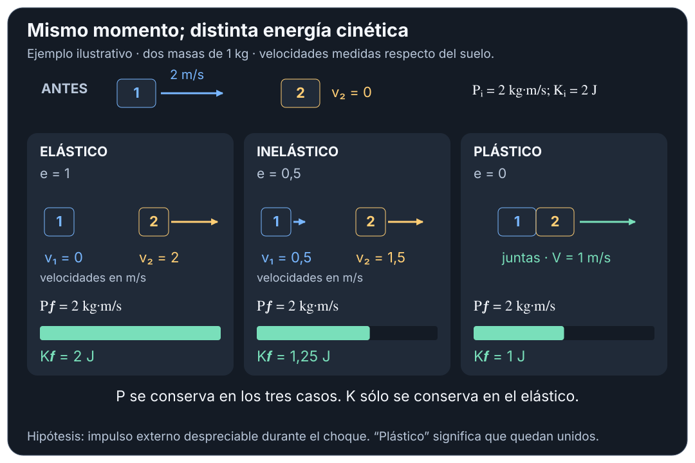

# Cantidad de movimiento — qué se conserva y cuándo

## 🎯 Qué recordar

Una conservación se justifica para **un sistema, una componente y un
intervalo**. El choque puede conservar la cantidad de movimiento del
conjunto aunque cambien las cantidades de movimiento de sus cuerpos.

La energía cinética exige otra comprobación: el tipo de choque.
Fuentes: [cátedra, diap. 3–9 y 19–26; Sears §8.1–8.5](fuentes.md#trazabilidad-por-concepto).

## 🖼️ Esquema / dibujo

| Pregunta | Qué decidir antes de plantear |
| --- | --- |
| ¿Se conserva el momento? | ¿Cuál es el impulso externo sobre el sistema en ese intervalo? |
| ¿Se conserva $K$? | ¿El choque es elástico? ¿Se comparan estados antes y después del contacto? |
| ¿Se conserva $K_{CM}$? | ¿Son constantes la masa total y el momento del sistema? |
| ¿Se conserva el momento de cada cuerpo? | Generalmente no: el otro cuerpo le entrega un impulso |

## 📐 Fórmula

### Impulso externo y fuerzas internas

$$
\vec P_f-\vec P_i=\vec J_{ext},\qquad
\vec J_{ext}=\int_{t_i}^{t_f}\sum\vec F_{ext}\,dt.
$$

Si $\vec J_{ext}\simeq0$, se conserva $\vec P$. En impactos breves puede
ser despreciable el impulso del peso o del roce aunque esas fuerzas existan.
Durante el recorrido posterior, sus efectos ya no se desprecian automáticamente.

Para la pareja que choca, los impulsos internos son iguales y opuestos;
se cancelan en el balance total. Para hallar la fuerza media **sobre un
cuerpo**, usar el cambio de momento de ese cuerpo, no el del conjunto.

### Segunda ecuación de un choque frontal

Con velocidades algebraicas en un eje común:

$$
e=\frac{v_{2f}-v_{1f}}{v_{1i}-v_{2i}}.
$$

El cociente expresa separación relativa respecto de aproximación relativa;
el denominador debe ser distinto de cero. Para un choque pasivo ordinario,
$0\leq e\leq1$. Con $e=1$ el choque es elástico; con $e=0$ no queda
velocidad relativa en ese eje. En el modelo de choque plástico frontal,
los cuerpos permanecen unidos.

En 2D, si el impulso externo es despreciable, se conserva momento por
componentes. El coeficiente de restitución se refiere a la dirección de
impacto, no al cociente entre rapideces completas.
Momento por sí solo no determina todas las velocidades finales desconocidas.

### Centro de masa y energía

$$
\vec v_{CM}=\frac{\vec P}{M},\qquad
K=K_{CM}+K_{rel},\qquad K_{CM}=\frac{P^2}{2M}.
$$

Si se conserva $\vec P$ y $M$ es constante, también lo son $\vec v_{CM}$ y
$K_{CM}$. Eso **no** obliga a conservar $K$: puede disminuir la energía
cinética del movimiento relativo. En un choque plástico de partículas,
$K_{rel,f}=0$; no desaparece la energía térmica ni se destruye energía total.

Para dos cuerpos en 1D, como deducción propia útil para comprobar:

$$
K_i-K_f=\frac12\frac{m_1m_2}{m_1+m_2}(1-e^2)(v_{1i}-v_{2i})^2.
$$

Vale con momento conservado y el modelo de restitución anterior. No hace
falta memorizarla: calcular $K_i$ y $K_f$ por separado siempre permite
revisar la variación. Si $\vec P=0$, el CM está quieto, pero los cuerpos
pueden tener energía cinética y moverse en sentidos opuestos.

### Referencias y viabilidad física

En canoa o tablón, $v_{persona/suelo}=v_{persona/soporte}+v_{soporte/suelo}$;
la misma relación se aplica a desplazamientos medidos entre los mismos
instantes. La conservación usa todas las velocidades en una misma referencia.

Al terminar un choque frontal ordinario, comprobar que los cuerpos se
separen o queden unidos según el tipo de choque, que el signo coincida
con el sentido y que $K_f\leq K_i$.
Un resultado algebraico que requiere $e<0$ o ganancia de $K$ sin fuente
de energía exige revisar los datos; no arreglarlos cambiando un signo sin avisar.

## ⚠️ Error frecuente

- Afirmar «en todo choque se conserva momento» sin declarar sistema e impulso externo.
- Conservar energía mecánica desde antes de una caída hasta después de
  un choque plástico con una única ecuación.
- Suponer que elástico significa que cada cuerpo conserva su propia $K$.
- Restar módulos para calcular impulso en un rebote.
- Confundir pérdida positiva $K_i-K_f$ con variación $K_f-K_i$.

## 🔗 Ver también

- [Teoría esencial](teoria-esencial.md) · [Casos del TP 8](resolucion-por-casos.md)
- [MAS: estado posterior y masa oscilante](../movimiento-armonico-simple/fase-y-equilibrio.md)
- [Fuentes y erratas](fuentes.md)
