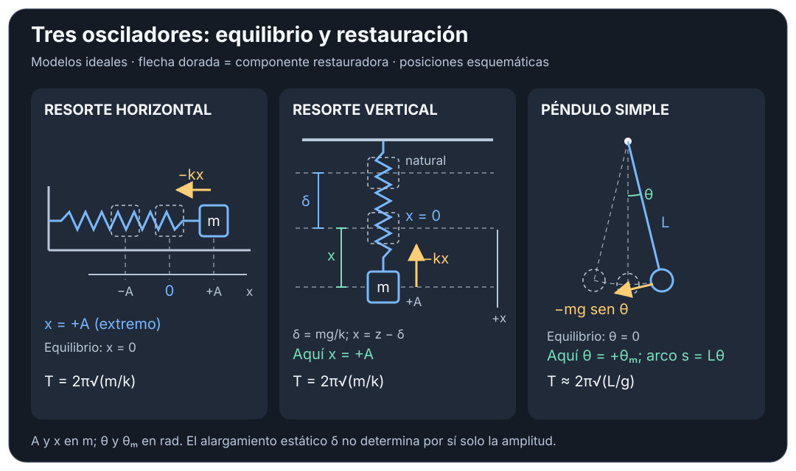
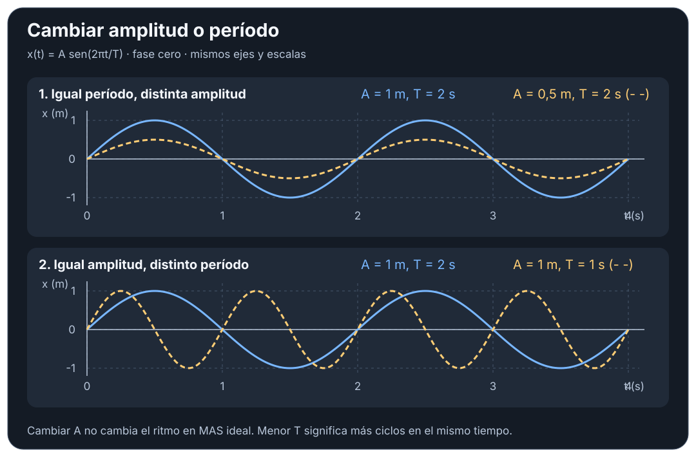

# MAS — reconocer y comparar osciladores

## 🎯 Qué recordar

Primero identificar **qué oscila, alrededor de qué equilibrio y qué
componente de fuerza lo restaura**. Modelos ideales: resorte sin masa,
ley de Hooke, masa unida y sin pérdidas; péndulo simple de masa puntual,
hilo inextensible sin masa, soporte fijo y ángulos pequeños.

## 🖼️ Esquema / dibujo

En el vertical, con eje positivo hacia abajo, $z$ se mide desde la
longitud natural; $\delta=mg/k$ es la deformación estática;
$x=z-\delta$ y $A=\max|x|$. Una masa quieta en equilibrio puede tener
$\delta\ne0$ aunque $A=0$. En el péndulo, $\theta$ se mide desde la
vertical y $s=L\theta$ es el arco con signo. Las flechas restauradoras
son resultantes en la dirección de oscilación, no fuerzas adicionales.

## 📐 Fórmula

### Ecuaciones comunes y específicas

Sea $\psi=\omega t+\varphi_0$ (convención seno).

| Magnitud | Resorte horizontal | Resorte vertical | Péndulo (ángulo pequeño) |
| --- | --- | --- | --- |
| Equilibrio | $x=0$, sin deformación si no hay otras fuerzas horizontales | $z=\delta=mg/k$, $x=0$ | $\theta=0$ |
| Período | $T=2\pi\sqrt{m/k}$ | igual | $T\simeq2\pi\sqrt{L/g}$ |
| Frecuencia | $f=1/T$ | igual | igual |
| Frecuencia angular | $\omega=\sqrt{k/m}$ | igual | $\omega\simeq\sqrt{g/L}$ |
| Posición | $x=A\sin\psi$ | igual desde equilibrio | $\theta=\theta_m\sin\psi$ |
| Velocidad | $v=A\omega\cos\psi$ | igual | $\dot\theta=\theta_m\omega\cos\psi$; $v_t=L\dot\theta$ |
| Aceleración | $a=-\omega^2x$ | igual | $\ddot\theta=-\omega^2\theta$; $a_t=L\ddot\theta$ |
| Máximos en módulo | $v_m=\omega A$, $a_m=\omega^2 A$ | iguales | $\max(\lvert\dot\theta\rvert)=\omega\theta_m$; $\max(\lvert\ddot\theta\rvert)=\omega^2\theta_m$ |
| Restauradora | $-kx$ | $mg-kz=-kx$ | $F_t=-mg\sin\theta\approx-mg\theta$ |
| Cinética | $K=mv^2/2$ | igual | $K=mL^2\dot\theta^2/2$ |
| Potencial desde equilibrio | $U=kx^2/2$ | $U_{\rm ef}=kx^2/2$ | $U=mgL(1-\cos\theta)\approx mgL\theta^2/2$ |
| Energía mecánica | $E=kA^2/2$ | igual con potencial efectivo | $E\approx mgL\theta_m^2/2$ |
| Validez | Hooke y sin pérdidas | igual, gravedad uniforme | $\sin\theta\simeq\theta$ en rad; sin pérdidas |

Para el péndulo, $|v_t|_{\max}=L\omega\theta_m$ y $|a_t|_{\max}=L\omega^2\theta_m$;
existe también aceleración radial $v_t^2/L$, de modo que en el centro
puede haber aceleración total no nula. La presentación registrada
usa 15° aproximadamente como criterio práctico, no frontera exacta.
El potencial vertical incluye gravedad y elasticidad, salvo constante;
la energía elástica sola es $kz^2/2$. Ver [fase y equilibrio](fase-y-equilibrio.md).

### Diccionario de magnitudes (SI)

| Magnitud | Símbolo | Unidad | Qué representa |
| --- | --- | --- | --- |
| Masa | $m$ | kg | Inercia |
| Peso | $\vec P=m\vec g$ | N | Fuerza gravitatoria |
| Gravedad | $g$ | m/s² | Módulo de aceleración gravitatoria |
| Período | $T$ | s | Tiempo de un ciclo |
| Tensión | $F_T$ (a veces $T$) | N | Fuerza del hilo |
| Frecuencia | $f$ | Hz = s⁻¹ | Ciclos por segundo |
| Frecuencia angular | $\omega$ | rad/s | Ritmo de cambio de fase |
| Tiempo | $t$ | s | Desde origen elegido |
| Fase inicial | $\varphi_0$ | rad | Estado inicial de la función |
| Elongación | $x$ | m | Posición con signo desde equilibrio |
| Amplitud | $A$ | m | Máximo módulo de elongación |
| Deformación / estática | $z,\delta$ | m | Desde longitud natural / en equilibrio vertical |
| Longitud del hilo | $L$ | m | Distancia pivote–masa |
| Ángulo / amplitud angular | $\theta,\theta_m$ | rad | Posición angular / máximo módulo |
| Arco | $s$ | m | Posición sobre arco: $L\theta$ |
| Velocidad / aceleración lineal | $v,a$ | m/s; m/s² | Cambio de posición / velocidad |
| Velocidad / aceleración angular | $\dot\theta,\ddot\theta$ | rad/s; rad/s² | Cambio de ángulo / velocidad angular |
| Constante elástica | $k$ | N/m | Rigidez |
| Coeficiente de restitución | $e$ | sin unidad | Cociente de velocidades relativas en choque |
| Energías | $K,U,E$ | J | Cinética, potencial, mecánica |

### ¿Qué cambia si modifico un parámetro?

Mantener los demás parámetros y la validez del modelo; para el período
del péndulo, asumir ángulos suficientemente pequeños.

| Cambio | Resorte horizontal/vertical | Péndulo | Por qué |
| --- | --- | --- | --- |
| $m\to4m$ | $T\to2T$ | sin cambio | Más inercia con misma rigidez; en el péndulo también crece el peso restaurador |
| $k\to4k$ | $T\to T/2$ | no aplica | Mayor restauración por elongación |
| $A\to2A$ | sin cambio | sin cambio aprox. si se duplica $\theta_m$ y sigue pequeña | Mayor desplazamiento, mayor restauración lineal |
| $g\to4g$ | sin cambio; $\delta$ se cuadruplica | $T\to T/2$ | Desplaza equilibrio vertical, intensifica restauración del péndulo |
| $L\to4L$ | no aplica | $T\to2T$ | Menor aceleración angular restauradora para igual ángulo |

Mismo $T$ significa mismos tiempos de repetición, no iguales velocidades:
duplicar $A$ con el mismo resorte duplica $v_m$ y $a_m$ y cuadruplica
$E$. A igual $A$, menor $T$ implica mayor $\omega$ y picos de rapidez y
aceleración mayores. A grandes ángulos el período del péndulo aumenta.
Curvas de elaboración propia.

Si sólo conocés los factores de cambio, usá
[comparación mediante cocientes](../dinamica/herramientas-matematicas/comparar-por-cocientes.md).

## ⚠️ Error frecuente

- Confundir $\delta$ con $A$ o medir $x$ vertical desde longitud natural.
- Confundir período (s) y tensión (N), $f$ (Hz) y $\omega$ (rad/s).
- Confundir $\dot\theta$, que varía, con $\omega$, constante en MAS ideal.
- Mezclar grados y radianes o usar la fórmula del resorte en el péndulo.

## 🔗 Ver también

- [Teoría esencial](teoria-esencial.md) · [Fase y equilibrio](fase-y-equilibrio.md)
- [Fuentes y trazabilidad](fuentes.md#comparaciones-didácticas)
- [Volver al tema](README.md)

**Procedencia:** síntesis y recursos propios apoyados en referencias de
cátedra y Sears previamente registradas; no son enunciados oficiales.
