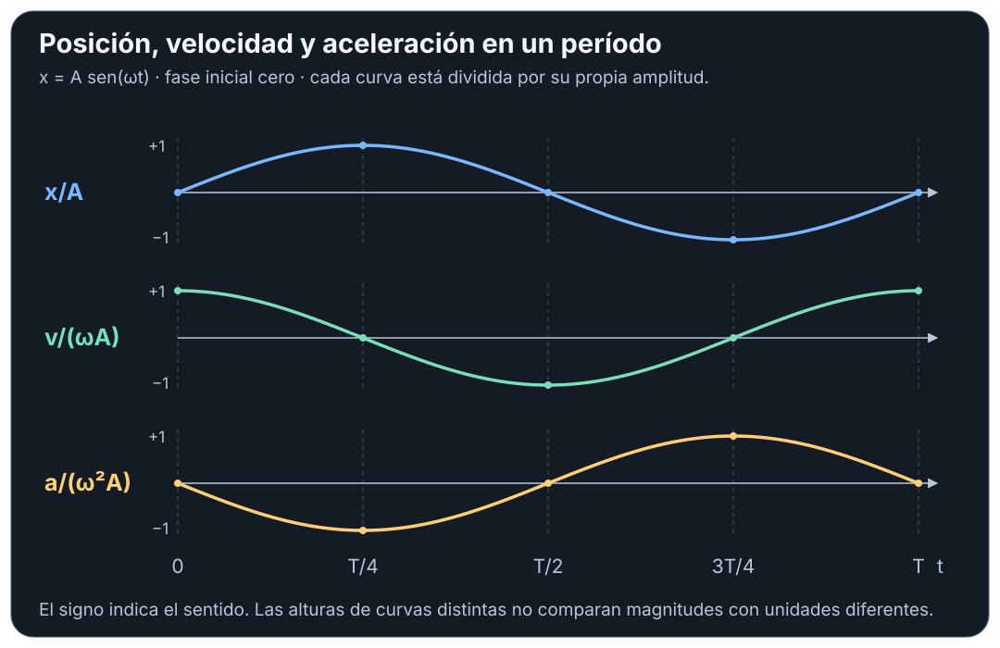

# MAS — fase inicial, equilibrio y masa oscilante

## 🎯 Qué recordar

Para describir un MAS hacen falta el equilibrio, la frecuencia angular y un
estado inicial **con posición y velocidad**. Una posición sola generalmente
no dice hacia dónde se mueve el cuerpo.

La condición dinámica es una fuerza neta restauradora proporcional al
desplazamiento desde el equilibrio: $F_{net}=-kx$ en el oscilador ideal.
No todo movimiento periódico es MAS.
Fuentes: [cátedra, diap. 4–17; resorte vertical en el resumen antiguo](fuentes.md#trazabilidad-por-concepto).

## 🖼️ Esquema / dibujo

| Instante elegido como $t=0$ | Posición | Velocidad | Fase para usar seno |
| --- | --- | --- | --- |
| Cruza el equilibrio hacia $+x$ | $0$ | $+A\omega$ | $0$ |
| Se suelta desde el extremo positivo | $+A$ | $0$ | $\pi/2$ |
| Cruza el equilibrio hacia $-x$ | $0$ | $-A\omega$ | $\pi$ |
| Se suelta desde el extremo negativo | $-A$ | $0$ | $-\pi/2$ |

La tabla es elaboración propia a partir de la convención seno de cátedra.
Fases que difieren en $2\pi n$ representan el mismo estado.

## 📐 Fórmula

### Construir y comprobar la función

$$
x=A\sin(\omega t+\varphi_0),\qquad
v=A\omega\cos(\omega t+\varphi_0),\qquad a=-\omega^2x.
$$

Con $x_0,v_0$ conocidos:

$$
A=\sqrt{x_0^2+(v_0/\omega)^2},\qquad
\sin\varphi_0=\frac{x_0}{A},\qquad
\cos\varphi_0=\frac{v_0}{A\omega}.
$$

Estas relaciones fijan el cuadrante. Si $A=0$, el cuerpo permanece en
equilibrio y no hace falta asignarle fase. Si se usa coseno, derivar esa
expresión: su velocidad lleva signo negativo delante del seno.

Antes de seguir, sustituir $t=0$ en **las dos** funciones. Así se detectan
fases que parten de un extremo aunque el enunciado indique un cruce del centro.

### Energía como función del tiempo y de la posición

Para el oscilador ideal con coordenada desde su equilibrio:

$$
K(t)=\tfrac12kA^2\cos^2(\omega t+\varphi_0),\qquad
K(x)=\tfrac12k(A^2-x^2).
$$

$E=\tfrac12kA^2$ es constante; $U=E-K$. Como las funciones están al
cuadrado, $K$ y $U$ repiten sus valores cada $T/2$, aunque el estado
completo del oscilador se repite cada $T$. Duplicar $A$ cuadruplica $E$,
pero no cambia $T$ en este modelo lineal.

### Elegir el reloj después de otra etapa

Si el oscilador se forma después de un choque, se puede elegir ese instante
como nuevo $t=0$. Anotar expresamente la posición y velocidad **posteriores**
al impacto y la masa que quedó oscilando. Un tiempo medido desde el inicio
de la caída no se usa sin ajustar el origen temporal.

| Dispositivo | Qué revisar |
| --- | --- |
| Bloque unido a resorte horizontal | Puede oscilar a ambos lados del equilibrio |
| Bloque sólo apoyado contra resorte horizontal | Puede perder contacto al relajarse el resorte; no prolongar un seno a toda la trayectoria |
| Proyectil atraviesa el bloque | La masa oscilante posterior es la del bloque |
| Proyectil o segundo bloque queda adherido | La masa oscilante incluye ambos cuerpos |
| Se agrega masa a un resorte vertical | Cambian la frecuencia y la posición de equilibrio |

### Resorte vertical: dos distancias diferentes

Con el eje hacia abajo, sea $z$ la deformación desde la longitud natural,
$\delta=mg/k$ la deformación de equilibrio y $x=z-\delta$ la elongación
desde ese equilibrio. Entonces $mg-kz=-kx$.

La energía elástica sola es $\tfrac12kz^2$. La expresión
$\tfrac12kx^2$ representa el potencial **efectivo** del movimiento
(gravitatorio y elástico, salvo una constante).

Después de agregar una masa, calcular primero el nuevo $\delta$ y luego
$x_0$ respecto de ese nuevo equilibrio. La máxima bajada desde el equilibrio
anterior no tiene por qué ser la nueva amplitud.

## ⚠️ Error frecuente

- Tomar siempre $A=v_0/\omega$: sólo vale en módulo si $x_0=0$.
- Confundir deformación estática, desplazamiento desde el equilibrio y amplitud.
- Identificar $\omega$ con el coeficiente escrito fuera del seno; está dentro
  del argumento, multiplicando a $t$.
- Buscar un primer instante con una única rama del arco seno, sin revisar
  el sentido de movimiento ni el intervalo pedido.
- Llamar «péndulo» a un masa–resorte y cambiar su ley de período por el nombre.

## 🔗 Ver también

- [Teoría esencial](teoria-esencial.md) · [Casos del TP 7](resolucion-por-casos.md)
- [Choques y condiciones de conservación](../impulso-cantidad-movimiento/conservacion-y-choques.md)
- [Fuentes y erratas](fuentes.md)
