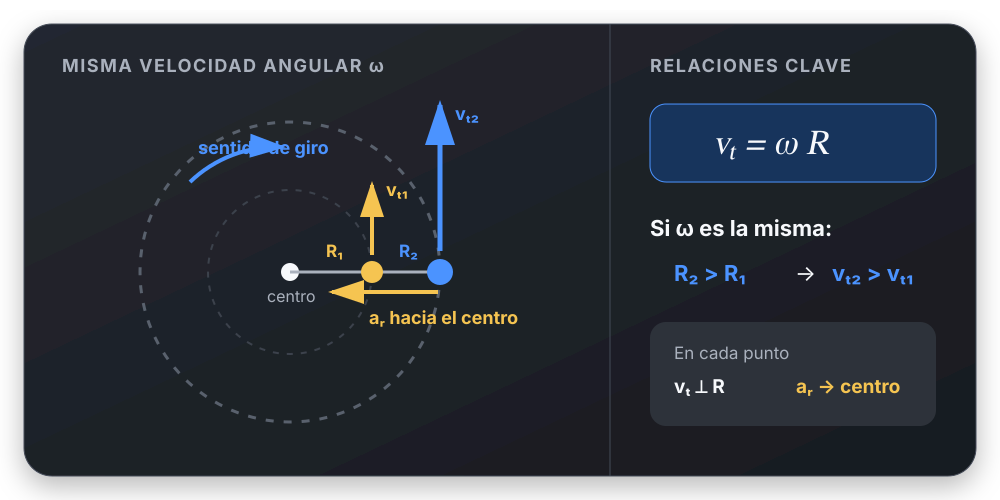
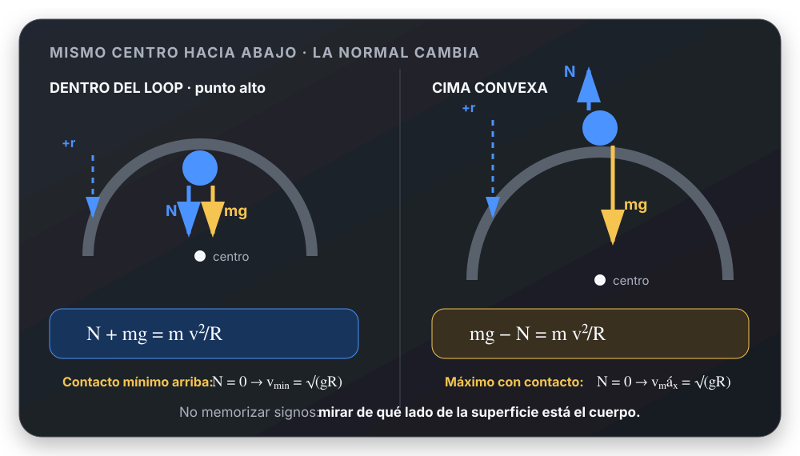

# MCU y Movimiento Circular: el tema explicado

[Volver al tema](README.md) · [Elegir un caso](resolucion-por-casos.md) · [Ejercicios resueltos](../../ejercicios/movimiento-circular/README.md) · [Fuentes](fuentes.md)

## Recorrido de estudio

El núcleo es el **Movimiento Circular Uniforme (MCU)**: secciones 1–5.
La dinámica de los giros horizontales y las órbitas aplica ese núcleo.
MCUV y los círculos verticales se explican como extensiones porque aparecen
en tus guías y permiten reconocer cuándo un problema **deja de ser MCU**.

Usamos $R$ para el radio de la trayectoria, $v$ para la rapidez,
$\omega$ para la velocidad angular algebraica y $g=9{,}8\ \mathrm{m/s^2}$
en los ejercicios terrestres. El período se escribe $T_{\mathrm{per}}$
cuando también aparece una tensión $T$.

## 1. Qué hace circular a un movimiento

Una partícula describe una circunferencia si su distancia a un centro fijo
se mantiene igual a $R$. La posición cambia aunque la longitud del radio
no cambie: cambia la **dirección** del vector posición.

Elegimos un origen angular y un sentido positivo. Si el centro es el origen
y $\theta$ se mide desde $+x$ en sentido antihorario:

$$
\vec r(t)=R\cos\theta(t)\,\hat i+R\sin\theta(t)\,\hat j.
$$

Hay que distinguir:

| Magnitud | Qué describe |
| --- | --- |
| Posición angular $\theta$ | Orientación del radio respecto del origen elegido |
| Desplazamiento angular $\Delta\theta$ | Cambio de ángulo, con signo |
| Arco recorrido $s$ | Longitud del camino sobre la circunferencia |
| Desplazamiento $\Delta\vec r$ | Vector que une las posiciones inicial y final |

En una vuelta completa, el arco recorrido es $2\pi R$, mientras que
$\Delta\vec r=\vec0$. Para un giro sin invertir el sentido:

$$
s=R|\Delta\theta|,\qquad n=\frac{|\Delta\theta|}{2\pi}.
$$

Si cambia el sentido, el desplazamiento angular neto puede cancelar parte
del recorrido: hay que sumar las longitudes de cada tramo.

**El radián** es la razón entre arco y radio: $\theta=s/R$ para el ángulo
subtendido. Por eso $360^\circ=2\pi\ \mathrm{rad}$.
Las ecuaciones $s=R\theta$, $v=\omega R$ y $a_t=\alpha R$ requieren radianes.

Base: [C-cinemática, diap. 3–6; Sears-3, §3.4](fuentes.md#teoria).

## 2. Velocidad angular, frecuencia y período

### Media e instantánea

$$
\omega_{\mathrm{med}}=\frac{\Delta\theta}{\Delta t},
\qquad
\omega(t)=\frac{d\theta}{dt}.
$$

En MCU ambas coinciden en cualquier intervalo. Fuera de MCU, la media
no fija el valor instantáneo en cada punto.

El signo indica el sentido de giro elegido; la rapidez angular es
$|\omega|$. En un giro uniforme no detenido:

$$
T_{\mathrm{per}}=\frac{2\pi}{|\omega|},\qquad
f=\frac1{T_{\mathrm{per}}},\qquad |\omega|=2\pi f.
$$

$T_{\mathrm{per}}$ es el tiempo de una vuelta, en segundos. $f$ cuenta vueltas
por segundo, en Hz. $\omega$ se expresa en rad/s.
En un giro no uniforme, $2\pi/|\omega(t)|$ no es, en general, el tiempo real
que demora la próxima vuelta.

### Si el dato está en rpm

Para $n_{\mathrm{rpm}}$ revoluciones por minuto:

$$
f=\frac{n_{\mathrm{rpm}}}{60}\ \mathrm{Hz},\qquad
|\omega|=\frac{2\pi n_{\mathrm{rpm}}}{60}\ \mathrm{rad/s}.
$$

Ejemplo: $60\ \mathrm{rpm}=1\ \mathrm{Hz}=2\pi\ \mathrm{rad/s}$.
El dato informa cuánto gira por unidad de tiempo; no es una velocidad
lineal. Para obtener esta última falta el radio.

## 3. Velocidad tangencial: misma vuelta, distinto recorrido

Al derivar el arco, para radio fijo:

$$
v_t=R\omega,\qquad v=R|\omega|.
$$

La velocidad vectorial es tangente a la circunferencia. En coordenadas:

$$
\vec v=R\omega(-\sin\theta\,\hat i+\cos\theta\,\hat j).
$$

En una rotación alrededor de un eje fijo también puede escribirse
$\vec v=\vec\omega\times\vec r$, tomando $\vec r$ desde un punto del eje.
El módulo usa la distancia perpendicular al eje, no cualquier distancia
al centro del objeto.

### Dos comparaciones que se usan mucho

- **Puntos del mismo cuerpo rígido, en el mismo eje:** comparten $\omega$,
  pero $v$ y $a_r$ aumentan con la distancia al eje.
- **Poleas unidas por una correa sin deslizamiento:** sus bordes comparten
  rapidez lineal, de modo que $|\omega_1|R_1=|\omega_2|R_2$. Sus velocidades
  angulares no tienen por qué ser iguales.

En la Tierra, a latitud $\lambda$, el radio de giro alrededor del eje es
$R_{\mathrm T}\cos\lambda$. Por eso dos personas a distintas latitudes
completan la vuelta en el mismo tiempo, pero tienen distintas rapideces.

## 4. Por qué hay aceleración en MCU

La aceleración mide el cambio del **vector velocidad**. Al girar, dos
velocidades sucesivas tienen el mismo módulo pero distinta dirección.
Su diferencia apunta hacia el interior de la curva en el límite de
intervalos pequeños.

Para un ángulo pequeño $\Delta\theta$:

$$
|\Delta\vec v|\simeq v|\Delta\theta|,
\qquad
\frac{|\Delta\theta|}{\Delta t}=\frac vR,
$$

de donde:

$$
\boxed{a_r=\frac{v^2}{R}=\omega^2R}.
$$

$a_r$ es un módulo no negativo. La aceleración radial o centrípeta apunta
**hacia el centro** y cambia la dirección de la velocidad.

Si usamos el versor polar $\hat e_R$ positivo hacia afuera:

$$
\vec a_r=-\omega^2R\,\hat e_R.
$$

Si elegimos un eje radial local positivo hacia adentro, la misma componente
vale $+v^2/R$. El signo cambia por la elección del eje, no por la física.

### Qué permanece constante en MCU

$$
\omega=\text{constante},\qquad
\theta(t)=\theta_0+\omega(t-t_0).
$$

Con $R$ fijo, también son constantes $v$, $T_{\mathrm{per}}$ y el módulo
$a_r$. **Los vectores $\vec v$ y $\vec a$ cambian de dirección**.
MCU no tiene aceleración vectorial constante como un MRUV rectilíneo.

Después de una vuelta, la aceleración **media** es cero porque
$\Delta\vec v=\vec0$; la aceleración instantánea sigue siendo centrípeta.

## 5. Aceleración tangencial y movimiento no uniforme

$$
\alpha_{\mathrm{med}}=\frac{\Delta\omega}{\Delta t},
\qquad
\alpha=\frac{d\omega}{dt},
\qquad [\alpha]=\mathrm{rad/s^2}.
$$

Para un círculo de radio fijo y un sentido tangencial positivo ligado a
$\theta$:

$$
a_t=R\alpha,\qquad
\vec a=R\alpha\,\hat e_\theta-\omega^2R\,\hat e_R.
$$

Las componentes radial y tangencial son perpendiculares:

$$
|\vec a|=\sqrt{a_t^2+a_r^2}.
$$

| Componente | Qué cambia | En MCU |
| --- | --- | --- |
| Tangencial | La velocidad tangencial algebraica; su sentido respecto de $\vec v$ determina si aumenta o baja la rapidez | $a_t=0$ |
| Radial | La dirección de $\vec v$ | $a_r=v^2/R$ |

Si $\omega$ y $\alpha$ tienen igual signo, aumenta la rapidez angular;
si tienen signos opuestos, disminuye, hasta un posible cambio de sentido.
No alcanza con decir “$\alpha$ negativa = frena”.

### MCUV: sólo si $\alpha$ es constante

Con $\Delta t=t-t_0$:

$$
\omega=\omega_0+\alpha\Delta t,
\qquad
\Delta\theta=\omega_0\Delta t+\frac12\alpha\Delta t^2,
$$

$$
\omega^2=\omega_0^2+2\alpha\Delta\theta.
$$

La relación entre $\omega^2$ y $\Delta\theta$ no fija por sí sola el signo
de $\omega$. Para un giro que arranca, gira uniforme y frena, se analiza
cada etapa con sus propias condiciones.

Al partir del reposo puede haber $a_t\ne0$ y $a_r=0$. En cuanto hay
velocidad, aparece también $a_r$. Si $\alpha$ es constante, $a_t$ lo es,
pero $a_r$ generalmente cambia.

## 6. La dinámica radial es la Segunda Ley de Newton

Elegí un marco inercial y, en el punto que analizás, $+r$ hacia el centro:

$$
\boxed{\sum F_r=m\frac{v^2}{R}},\qquad
\sum F_t=ma_t.
$$

No se dibuja una fuerza “centrípeta” además de las interacciones reales.
El nombre describe su **resultante radial**.

| Caso | Fuerzas reales que pueden aportar la componente radial |
| --- | --- |
| Cuerda sobre mesa lisa | Tensión |
| Péndulo cónico | Componente horizontal de la tensión |
| Curva plana | Rozamiento estático |
| Peralte | Normal y, si corresponde, rozamiento |
| Viraje de avión | Componente de la sustentación |
| Órbita | Gravedad |
| Círculo vertical | Peso y tensión o normal, según el punto |

Si se rompe una cuerda, la velocidad **inicial** al liberarse es tangente.
La trayectoria posterior depende de las fuerzas que continúan actuando:
puede ser rectilínea si no hay resultante, o un tiro si queda la gravedad.

### Marco inercial y marco que gira

En un marco inercial, un cuerpo en MCU acelera hacia el centro. Un observador
que gira con él puede verlo quieto; para escribir las ecuaciones en ese
marco necesita fuerzas inerciales, incluida la centrífuga.
Esta no es una interacción real ni la reacción a la fuerza radial.

El término centrífugo no se agrega al DCL inercial de los ejercicios.
Que el eje radial local cambie de dirección tampoco significa que hayamos
elegido observar desde un marco giratorio: podemos proyectar Newton
inercial sobre direcciones locales.

## 7. Giros horizontales: sostener y curvar

La aceleración vertical es cero si la altura se mantiene. Eso no elimina
la aceleración horizontal hacia el centro.

### Péndulo cónico

Una masa suspendida describe una circunferencia horizontal. Si el hilo
de longitud $L$ forma $\theta$ con la vertical:

$$
R=L\sin\theta,\qquad
T\cos\theta=mg,\qquad
T\sin\theta=m\frac{v^2}{R}.
$$

Dividir las dos ecuaciones elimina $T$:

$$
\tan\theta=\frac{v^2}{Rg},\qquad
\omega^2=\frac{g}{L\cos\theta}
$$

para un cono de radio no nulo. La tensión sostiene el peso con una
componente y produce la aceleración radial con la otra.

### Curva plana

Para un auto que gira con rapidez constante sobre una calzada horizontal:

$$
N=mg,\qquad f_e=m\frac{v^2}{R}\leq\mu_eN.
$$

De allí:

$$
v_{\max}=\sqrt{\mu_egR}.
$$

El contacto sin patinamiento usa rozamiento estático. Si el auto además
acelera o frena, parte del rozamiento disponible debe producir aceleración
tangencial: no se puede asignar todo el máximo simultáneamente a cada eje.

### Peralte sin rozamiento

Si la calzada se inclina $\beta$ respecto de la horizontal:

$$
N\cos\beta=mg,\qquad
N\sin\beta=m\frac{v^2}{R},
$$

$$
\tan\beta=\frac{v^2}{Rg}.
$$

Es la rapidez de diseño para la cual no se necesita rozamiento lateral.
No significa que la fuerza horizontal sea cero: la normal la aporta.

Con roce, definir $f$ positivo cuesta abajo, hacia el interior:

$$
N\sin\beta+f\cos\beta=m\frac{v^2}{R},
\qquad N\cos\beta-f\sin\beta=mg,
\qquad |f|\leq\mu_eN.
$$

$f>0$ corresponde a impedir que el auto suba hacia afuera; $f<0$, a impedir
que baje hacia adentro. Calculá su signo o la tendencia a deslizar antes de
imponer el límite.

### Avión en viraje nivelado

En el modelo del TP, la sustentación $S$ es perpendicular a las alas.
Con inclinación $\phi$, altura y rapidez constantes:

$$
S\cos\phi=mg,\qquad
S\sin\phi=m\frac{v^2}{R},
\qquad R=\frac{v^2}{g\tan\phi}.
$$

El patrón matemático coincide con el del peralte; el agente que ejerce
la fuerza es el aire. Se supone que empuje y resistencia se compensan
en la dirección tangencial.

## 8. Órbitas y gravedad artificial

### Órbita circular

Para un satélite alrededor de una masa central mucho mayor:

$$
\frac{GMm}{r^2}=m\frac{v^2}{r}
\quad\Longrightarrow\quad
v=\sqrt{\frac{GM}{r}},
$$

$$
a_r=\frac{GM}{r^2},\qquad
T_{\mathrm{per}}=2\pi\sqrt{\frac{r^3}{GM}},\qquad
r=R_{\mathrm{astro}}+h.
$$

La masa del satélite se cancela. El satélite está en caída libre: la
gravedad curva su trayectoria continuamente. No hace falta equilibrarla
con una fuerza hacia afuera en el marco inercial.

### Nave con forma de anillo

El piso empuja al astronauta hacia el eje:

$$
N=m\omega^2R.
$$

Para que la fuerza por unidad de masa coincida con la terrestre,
$N/m=g$, se diseña $\omega^2R=g$.
No se creó un campo gravitatorio terrestre: se reproduce una fuerza de
apoyo equivalente mediante el movimiento circular.

## 9. Círculos verticales y radio de curvatura

Estos problemas **no son automáticamente MCU**. Si sólo actúan peso y una
tensión radial o normal ideal, el peso tiene componente tangencial fuera
de los puntos alto y bajo, y modifica la rapidez.

Para una cuerda o un contacto por el interior del círculo:

| Punto | $+r$ hacia el centro | Ecuación radial |
| --- | --- | --- |
| Abajo | Arriba | $T-mg=mv_{\mathrm{abajo}}^2/R$ |
| Arriba | Abajo | $T+mg=mv_{\mathrm{arriba}}^2/R$ |
| Lateral | Horizontal | $T=mv_{\mathrm{lateral}}^2/R$ |

Se reemplaza $T$ por $N$ para el carril interior ideal.
En el lateral, el peso es tangencial; que no aparezca en la ecuación
radial no significa que se lo haya despreciado.

Para un ángulo $\varphi$ medido desde el punto bajo, con sentido tangencial
positivo al aumentar $\varphi$:

$$
F_{\mathrm{vínculo}}-mg\cos\varphi=m\frac{v^2}{R},
\qquad a_t=-g\sin\varphi
$$

si no hay otra fuerza tangencial.

### Por qué importan el tipo de apoyo y el punto

Arriba, una cuerda o un carril **interior** sólo puede aportar fuerza hacia
el centro. El límite $T=0$ o $N=0$ exige:

$$
v_{\mathrm{arriba,min}}=\sqrt{gR}.
$$

En la cima de un camino convexo, la normal apunta **alejándose** del centro:

$$
mg-N=m\frac{v^2}{R}.
$$

Ahora $\sqrt{gR}$ es la rapidez **máxima** compatible con contacto en esa cima.
Una varilla o un carril que sujeta al cuerpo por ambos lados puede ejercer
fuerzas en ambos sentidos: no hereda automáticamente el límite de una cuerda.

### Rapidez entre dos alturas

Si el centro y el radio son fijos, la tensión radial o normal ideal no
realiza trabajo. Si sólo el peso realiza trabajo:

$$
\frac12mv_A^2+mgy_A=\frac12mv_B^2+mgy_B.
$$

Para ir de abajo a arriba, $\Delta y=2R$:

$$
v_{\mathrm{abajo}}^2=v_{\mathrm{arriba}}^2+4gR.
$$

Combinado con el límite superior se obtiene
$v_{\mathrm{abajo,min}}=\sqrt{5gR}$.
La igualdad depende de ausencia de pérdidas o aportes de energía y del
tipo de vínculo. Newton determina la fuerza **en un punto**; energía
relaciona las rapideces **entre puntos**.

Si se impone rapidez constante en un círculo vertical, una acción tangencial
debe compensar al peso tangencial. No se debe imponer a la vez conservación
de energía mecánica para el modelo de peso y vínculo solamente.

### Radio de curvatura local

En una trayectoria que no es una circunferencia completa, la aceleración
normal instantánea vale $v^2/\rho$, donde $\rho$ es el radio de curvatura
en ese punto. Es la idea usada en el descenso del piloto del TP actual.

## 10. Preguntas para comprobar comprensión

| Pregunta | Respuesta que deberías poder justificar |
| --- | --- |
| ¿Qué es uniforme en MCU? | Rapidez y velocidad angular; no el vector velocidad |
| ¿Por qué $a_r$ apunta hacia adentro? | Es el cambio de dirección de $\vec v$ |
| ¿Qué fuerza hace de centrípeta? | La resultante radial de las interacciones presentes |
| ¿Es $a_r$ negativa o positiva? | El módulo es positivo; la componente depende del eje |
| ¿Misma $\omega$ implica misma $v$? | Sólo si el radio de giro es igual |
| ¿El período se mide en Hz? | No: segundos; Hz es la unidad de frecuencia |
| ¿Por qué no usar $T=mv^2/R$ en cualquier cuerda? | Puede haber peso u otras componentes radiales |
| ¿Tensión cero significa aceleración cero? | No; arriba puede quedar $a_r=g$ por el peso |
| ¿Una vuelta vertical con cuerda siempre tiene rapidez constante? | No; hace falta revisar la fuerza tangencial |
| ¿Cuál es el radio de una órbita? | Distancia al centro del astro, no altura sobre su superficie |

[Pasar a resolución por casos](resolucion-por-casos.md)
