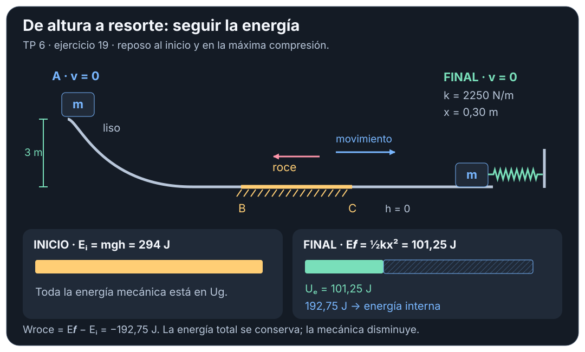

# Trabajo y Energía — balances, tramos y pérdidas

## 🎯 Qué recordar

Elegir **dos estados y un sistema** antes de escribir el balance. Un estado
se describe por su rapidez, altura y deformación del resorte. Un tramo se
describe por las fuerzas que actúan durante el recorrido.

La energía permite relacionar estados sin conocer cuánto tarda el cuerpo.
Para una normal, una tensión o un tiempo, puede hacer falta otra herramienta.
Fuentes: [presentación de cátedra, diap. 7–17 y 20–27](fuentes.md#trazabilidad-por-concepto).

## 🖼️ Esquema / dibujo

| Estado | Anotar antes de calcular |
| --- | --- |
| Inicio | ¿Parte del reposo? ¿Qué altura y deformación tiene? |
| Cambio de tramo | ¿Termina el roce? ¿Empieza el contacto con el resorte? |
| Final | ¿Se detiene un instante, alcanza una altura o debe mantener contacto? |

Esta tabla es una herramienta didáctica propia, aplicable a distintos enunciados.

## 📐 Fórmula

### Dos formas del mismo balance

Para una partícula de masa constante en un marco inercial:

$$
W_{\mathrm{neto}}=\Delta K,
\qquad
K_i+U_i+W_{nc}=K_f+U_f.
$$

En la segunda forma, el trabajo del peso y del resorte ya está representado
por sus potenciales: **no volver a sumarlo como trabajo**.

Si el sistema incluye bloque, Tierra, resorte y superficie, y no intercambia
energía con el entorno, también puede escribirse:

$$
\Delta K+\Delta U+\Delta E_{\mathrm{int}}=0.
$$

Aquí el calentamiento es interno. No agregar además el mismo roce como una
segunda pérdida externa. Un sistema cerrado no intercambia materia; eso no
implica por sí solo que esté aislado ni que conserve energía mecánica.

### Qué significa cada signo

| Magnitud pedida | Cómo informarla |
| --- | --- |
| Variación de energía mecánica | $\Delta E=E_f-E_i$; negativa si disminuye |
| Trabajo del roce cinético en superficie fija | $W_r<0$ mientras hay deslizamiento |
| Energía mecánica disipada por ese roce | $D=-W_r\geq0$ |
| Trabajo neto | Puede ser positivo, negativo o cero; cambia $K$, no necesariamente $E$ |

Para un tramo horizontal rugoso de longitud $L$, con $N=mg$:
$W_r=-\mu_kmgL$. En un plano inclinado cambia $N$; si sólo hay peso y normal
en la dirección perpendicular, $N=mg\cos\alpha$.

### Porcentajes: mirar qué magnitud cambia

Con la misma masa en ambos estados:

| Dato | Consecuencia |
| --- | --- |
| Se conserva una fracción $q$ de la rapidez | $v_f=qv_i$; $K_f=q^2K_i$ |
| Se pierde una fracción $p$ de $K$ | $K_f=(1-p)K_i$; $v_f=\sqrt{1-p}\,v_i$ |
| Se duplica la compresión inicial de un resorte ideal | Su energía inicial se multiplica por cuatro |

Aplicación para reconocer variantes: S3 habla de **rapidez** y S4 de
**energía cinética**. Ver [el catálogo del parcial](../../parciales/Segundo_Parcial/patrones.md).

### Una pista recorrida varias veces

Marcar cada entrada y salida de la zona rugosa. Cada cruce completo cuesta
$D=\mu_kmgL$ bajo las hipótesis anteriores. En un retorno por una rampa lisa
se intercambian $K$ y $U_g$; no se agrega otra pérdida.

Si la energía cinética al entrar al tramo es menor que $D$, el cuerpo se
detiene **dentro** de él: ese intento no cuenta como cruce completo. Para
encontrar la posición final, usar la distancia realmente recorrida. La fuerza
de roce seco no produce un MAS ideal durante toda la ida y vuelta.

## ⚠️ Error frecuente

- Confundir el final de la zona rugosa con la máxima compresión del resorte.
- Usar toda la distancia de la pista para el trabajo de un roce localizado.
- Suponer que $v=0$ significa equilibrio: en una compresión máxima suele haber
  fuerza restauradora y el cuerpo vuelve a moverse.
- Elegir «llegar arriba con rapidez cero» cuando también se exige contacto
  con la cara interior de una pista abierta. Hay que revisar Newton radial.
- Usar $\sum\vec F_{ext}\cdot\Delta\vec r_{CM}$ como trabajo externo real de
  cualquier sistema deformable; el patinador de la diap. 17 muestra ese límite.

## 🔗 Ver también

- [Teoría esencial](teoria-esencial.md) · [Casos del TP 6](resolucion-por-casos.md)
- [Fuentes y erratas](fuentes.md)
- [Práctica del segundo parcial sin resultados](../../parciales/Segundo_Parcial/practica.md)
