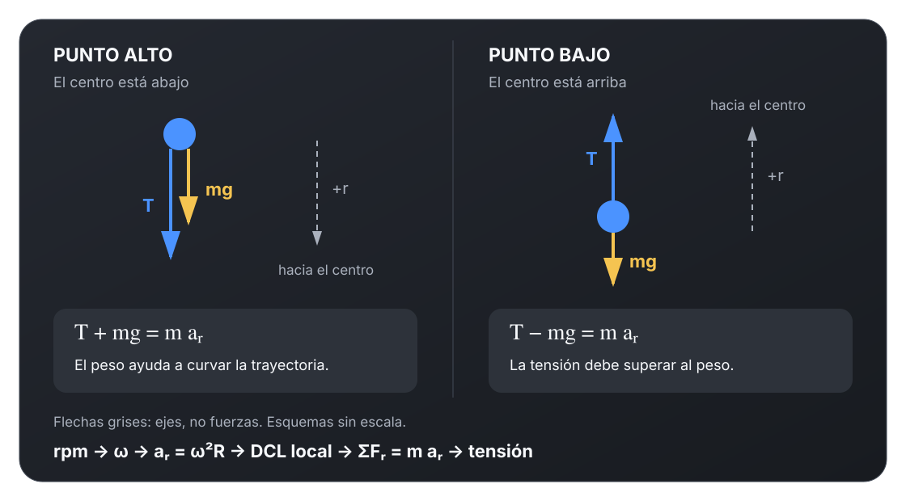
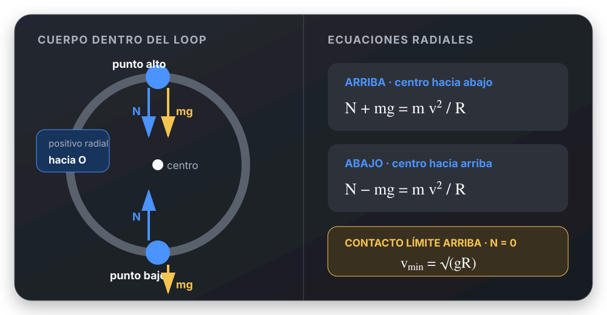

# Círculo vertical: rapidez local, signos y condiciones límite

[Índice](README.md) · [Teoría](../../apuntes/movimiento-circular/teoria-completa.md#9-círculos-verticales-y-radio-de-curvatura) · [Fuentes](../../apuntes/movimiento-circular/fuentes.md)

## 1. Cuerda de 0,6 m y giro de 60 rpm

**Fuente identificada:** C-PDF, ejercicio 9, páginas PDF 2–3.
Es el mismo caso ya desarrollado en el
[machete de consulta](../../apuntes/movimiento-circular/Movimiento_Circular_UTN_FRLP.md#de-rpm-a-tensión-caso-de-parcial).

**Datos:** $m=1\ \mathrm{kg}$, $R=0{,}6\ \mathrm m$, 60 rpm.
Se piden tensiones arriba, abajo y en el lateral, y rapidez superior
para tensión nula.

**Modelo:** cuerda ideal, centro fijo y radio constante mientras permanece
tensa. La guía indica $\omega$ constante para a–c.
Observamos desde un marco inercial y elegimos $+r$ **hacia el centro
en cada punto**.

### Dato angular y aceleración radial

$$
\omega=2\pi\ \mathrm{rad/s},\qquad
v=\omega R=3{,}7699\ \mathrm{m/s},
$$

$$
a_r=\omega^2R=23{,}6871\ \mathrm{m/s^2}.
$$

### Tres DCL distintos

La tensión siempre apunta al centro; el peso siempre es vertical abajo.

| Punto | Fuerzas proyectadas sobre $+r$ | Tensión |
| --- | --- | --- |
| Arriba: centro abajo | $T+mg=ma_r$ | $13{,}887\ \mathrm N$ |
| Abajo: centro arriba | $T-mg=ma_r$ | $33{,}487\ \mathrm N$ |
| Lateral: centro horizontal | $T=ma_r$ | $23{,}687\ \mathrm N$ |

**La condición de rapidez constante necesita una aclaración física.**
En el lateral, el peso es completamente tangencial. Si sólo actuaran
peso y tensión, habría $|a_t|=g$ y la rapidez cambiaría. Para sostener el
MCU impuesto se necesita una acción externa tangencial que compense
esa componente del peso. Aquí se supone que no añade componente radial,
por lo que las tensiones de la tabla siguen siendo las indicadas.

En un giro libre con sólo peso y cuerda, se puede usar la ecuación de
cada fila, pero con la **rapidez local** de ese punto. Un dato de rpm
medio por vuelta no permite asignar la misma rapidez a todos los puntos.

### Rapidez superior para T = 0

Es una condición nueva, no el mismo giro de 60 rpm:

$$
mg=m\frac{v_{\mathrm{arriba}}^2}{R}
\Rightarrow
\boxed{v_{\mathrm{arriba,min}}=\sqrt{gR}=2{,}4249\ \mathrm{m/s}}.
$$

**Control:** en ese límite $a_r=g$, no cero. A igual rapidez, la diferencia
entre tensión inferior y superior es $2mg=19{,}6\ \mathrm N$.
**Error típico:** cambiar el signo del peso por memoria sin ubicar el centro.
**Pregunta oral:** ¿es esta la rapidez mínima para partir desde abajo?
No. Bajo el modelo libre sin pérdidas, sería $\sqrt{5gR}$ abajo.

## 2. Carro dentro de un loop

**Fuente:** C-PDF, ejercicio 13, página PDF 3; TP5EJ13.pdf.
**Datos:** $m=100\ \mathrm{kg}$, $R=5\ \mathrm m$;
la fuerza de contacto no debe superar $6mg$.
La figura nombra $P_a$ abajo, $P_c$ arriba, $P_d$ a la derecha y
$P_e$ a 60° del radio vertical inferior, hacia la izquierda.

**Modelo:** carro como partícula, carril interior sin roce tangencial,
contacto unilateral. El carril empuja radialmente hacia el centro.
En cada punto, el DCL tiene peso vertical y normal radial.

### a. Rapidez máxima abajo por límite de fuerza de contacto

Abajo, $+r$ apunta hacia arriba:

$$
N-mg=m\frac{v_a^2}{R}.
$$

Al imponer $N_{\max}=6mg$:

$$
\boxed{v_{a,\max}=\sqrt{5gR}=15{,}652\ \mathrm{m/s}}.
$$

La coincidencia con la fórmula de rapidez mínima inferior para completar
un loop sin pérdidas se debe a que el límite dado es precisamente $6mg$.
Aquí el dato de partida es un **máximo de normal**.

### b. Aceleraciones abajo

$$
\boxed{a_{r,a}=\frac{v_a^2}{R}=49\ \mathrm{m/s^2}},
\qquad \boxed{a_{t,a}=0}.
$$

Peso y normal son radiales en ese punto. Que $a_t=0$ instantáneamente
no vuelve uniforme todo el recorrido.

### c. Rapidez arriba para N = 0

Arriba, $+r$ apunta hacia abajo:

$$
N+mg=m\frac{v_c^2}{R}
\Rightarrow
\boxed{v_c=\sqrt{gR}=7\ \mathrm{m/s}}.
$$

### d. Lateral derecho, con rapidez local de 12,25 m/s

El peso no tiene componente radial:

$$
\boxed{a_{r,d}=\frac{12{,}25^2}{5}=30{,}0125\ \mathrm{m/s^2}},
$$

$$
\boxed{N_d=ma_{r,d}=3001{,}25\ \mathrm N}.
$$

La aceleración tangencial apunta hacia abajo y tiene módulo
$|a_{t,d}|=g=9{,}8\ \mathrm{m/s^2}$.
Los 30 m/s² y 3000 N del TP son aproximaciones. La resolución aparte
escribe 30,05 y 3005; el cálculo directo con 12,25 da los valores anteriores.

### e. Punto a 60° desde abajo, con rapidez local de 14 m/s

El peso tiene componente **opuesta** al centro de módulo $mg\cos60^\circ$:

$$
N-mg\cos60^\circ=m\frac{v_e^2}{R}.
$$

$$
\boxed{a_{r,e}=\frac{14^2}{5}=39{,}2\ \mathrm{m/s^2}},
$$

$$
\boxed{N_e=100[39{,}2+9{,}8\cos60^\circ]=4410\ \mathrm N}.
$$

La componente tangencial apunta descendiendo hacia el punto bajo:

$$
\boxed{|a_{t,e}|=g\sin60^\circ=8{,}487\ \mathrm{m/s^2}}.
$$

**Corrección:** 32,9 m/s² y 44.100 N, impresos en el TP, no satisfacen
los datos. El archivo TP5EJ13, página 7, confirma 39,2 m/s² y 4410 N.

**Control global:** $N_d$ y $N_e$ son positivas y menores que
$6mg=5880\ \mathrm N$. Las rapideces de d y e se usan como datos locales
de esos incisos; no se impone sin verificar que correspondan exactamente
a la misma vuelta libre de a.

**Error típico:** tratar “normal” como sinónimo de “vertical” o eliminar
el peso del análisis porque no tiene componente radial en un lateral.
**Pregunta oral:** ¿por qué hay aceleración tangencial en d y e?
Porque el peso tiene componente sobre la tangente.

## 3. Traducción de las condiciones límite

| Frase del enunciado | Qué imponer | Qué comprobar después |
| --- | --- | --- |
| Cuerda a punto de aflojarse | $T=0$ | En el resto del movimiento supuesto, $T\geq0$ |
| Contacto interior a punto de perderse | $N=0$ | La superficie sólo puede empujar |
| Cuerda a punto de romperse | $T=T_{\mathrm{rotura}}$ | No confundir con tensión nula |
| Asiento o carril con carga máxima | $N=N_{\max}$ | La normal no es la fuerza neta |
| Velocidad mínima de entrada abajo | Límite superior + relación entre alturas | Que se cumplan las hipótesis energéticas |

Las igualdades se imponen por la condición física pedida. En una situación
ordinaria, primero se calcula la fuerza requerida y después se verifica
si es posible.
