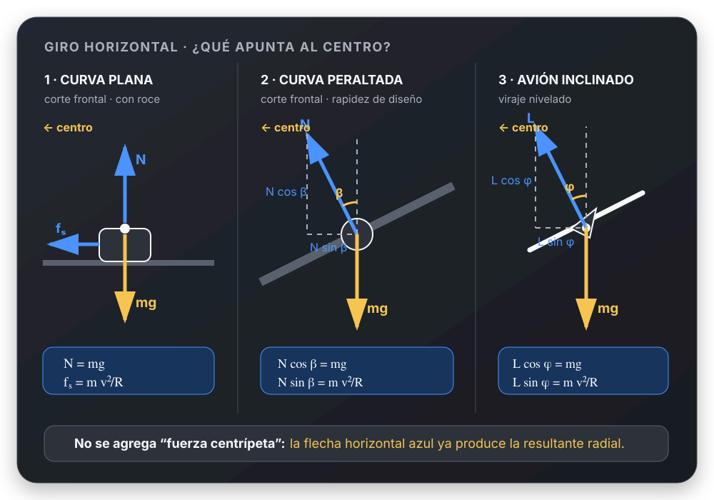
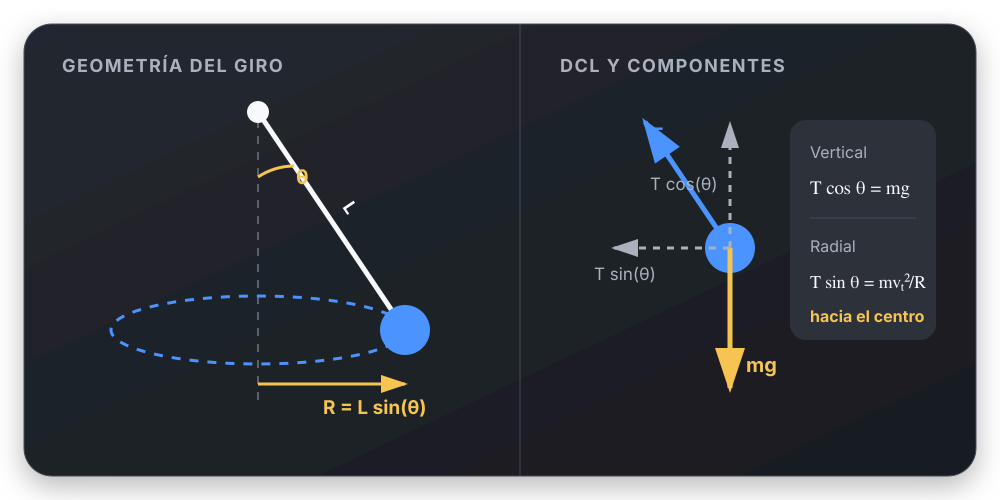

# Giros horizontales: identificar quién sostiene y quién curva

[Índice](README.md) · [Guía por casos](../../apuntes/movimiento-circular/resolucion-por-casos.md) · [Fuentes](../../apuntes/movimiento-circular/fuentes.md)

En todos los casos elegimos un marco inercial, $+r$ horizontal hacia el
centro y $+y$ hacia arriba. La altura constante da $a_y=0$, pero
$a_r=v^2/R$ no es cero. No se dibuja una fuerza centrípeta adicional.

## 1. Avión con alas inclinadas

**Fuente:** C-actual, ejercicio 3.
**Datos:** rapidez $482\ \mathrm{km/h}$ e inclinación de alas
$\phi=38{,}2^\circ$. Se busca el radio del viraje horizontal.

**Modelo y DCL:** peso abajo y sustentación $S$ perpendicular a las alas,
inclinada hacia el centro. Se supone rapidez y altura constantes; empuje
y resistencia se compensan tangencialmente.

$$
S\cos\phi=mg,\qquad S\sin\phi=m\frac{v^2}{R}.
$$

Dividir elimina sustentación y masa:

$$
\tan\phi=\frac{v^2}{Rg}.
$$

Convertimos $v=482/3{,}6=133{,}8889\ \mathrm{m/s}$:

$$
\boxed{R=\frac{(133{,}8889)^2}{9{,}8\tan38{,}2^\circ}
=2324{,}51\ \mathrm m\approx2{,}325\ \mathrm{km}}.
$$

**Control:** a igual inclinación, duplicar la rapidez cuadruplica el radio.
**Error típico:** usar 482 como m/s o confundir el ángulo de las alas
con el ángulo de $S$ respecto de la horizontal.
**Pregunta oral:** ¿por qué se puede cancelar la masa? Porque ambas
componentes de Newton son proporcionales a ella.

## 2. Carretera: curva plana y peralte

**Fuente:** C-actual, ejercicio 6.
**Datos:** $v=60\ \mathrm{km/h}=16{,}6667\ \mathrm{m/s}$,
$R=150\ \mathrm m$. Se busca el coeficiente mínimo si es plana y
el peralte para no necesitar roce lateral a esa rapidez.

### a. Curva plana

**DCL:** peso, normal vertical y roce estático hacia el centro.

$$
N=mg,\qquad f_e=m\frac{v^2}{R}\leq\mu_eN.
$$

En el coeficiente mínimo:

$$
\boxed{\mu_{e,\min}=\frac{v^2}{Rg}=0{,}18896\approx0{,}189}.
$$

### b. Peralte sin rozamiento lateral

**DCL:** peso y normal inclinada hacia el centro.

$$
N\cos\beta=mg,\qquad N\sin\beta=m\frac{v^2}{R}.
$$

$$
\boxed{\beta=\arctan\left(\frac{v^2}{Rg}\right)
=10{,}70^\circ}.
$$

**Control:** la masa no es necesaria. El mismo cociente $v^2/(Rg)$
determina el coeficiente mínimo en a y la tangente del ángulo en b.
**Error típico:** exigir $N=mg$ en el peralte; lo que iguala al peso
es su componente vertical.
**Qué aprender:** se satisface la misma aceleración con fuerzas distintas.

**Variante C-PDF 14:** con $R=35\ \mathrm m$ y $\mu_e=0{,}5$,
la ecuación anterior despejada da
$v_{\max}=\sqrt{0{,}5(9{,}8)(35)}=13{,}10\ \mathrm{m/s}$.
No requiere usar los 1500 kg del auto.

## 3. Péndulo cónico

**Fuente:** C-PDF, ejercicio 11, página PDF 3; TP5EJ11.pdf.
**Datos:** $m=80\ \mathrm{kg}$, $L=10\ \mathrm m$,
$\theta=5^\circ$ desde la vertical.
Se piden las componentes de tensión y la aceleración radial.

**DCL:** tensión a lo largo del alambre y peso abajo. La componente
horizontal de la tensión tira hacia el centro de la circunferencia.

$$
T_y=T\cos\theta=mg=784\ \mathrm N,
$$

$$
T_r=T\sin\theta=mg\tan\theta=68{,}59\ \mathrm N.
$$

$$
\boxed{a_r=T_r/m=g\tan5^\circ=0{,}8574\ \mathrm{m/s^2}}.
$$

La tensión completa vale
$T=\sqrt{T_y^2+T_r^2}=786{,}99\ \mathrm N$.
Para comprobar la cinemática:

$$
R=L\sin5^\circ=0{,}87156\ \mathrm m,\qquad
v=\sqrt{a_rR}=0{,}8644\ \mathrm{m/s}.
$$

**Control:** la tensión es apenas mayor que el peso y $R$ es mucho menor
que 10 m, como corresponde a un ángulo pequeño desde la vertical.
**Error típico:** usar $R=L$ o tomar $T=mg$.
**Pregunta oral:** ¿por qué $a_y=0$ no significa equilibrio total?
Porque la componente horizontal de tensión produce $a_r$.

## 4. Dos cuerdas unidas a una barra vertical

**Fuente:** C-PDF, ejercicio 18, página PDF 4; TP5EJ18.pdf.
**Datos:** $m=8\ \mathrm{kg}$, cuerdas de 1,5 m, anclajes separados
2,4 m; tensión superior $T_s=147\ \mathrm N$.
Se pide tensión inferior $T_i$ y vueltas por minuto.

**Geometría:** ambas cuerdas tienen la misma longitud, así que el bloque
está a mitad de altura entre los anclajes. Cada triángulo rectángulo tiene
cateto vertical 1,2 m e hipotenusa 1,5 m:

$$
R=\sqrt{1{,}5^2-1{,}2^2}=0{,}9\ \mathrm m.
$$

Para cada cuerda, la fracción vertical del módulo es $1{,}2/1{,}5=0{,}8$;
la horizontal es $0{,}9/1{,}5=0{,}6$.

**DCL:** peso abajo; tensión superior hacia el anclaje alto (arriba y
hacia el eje); tensión inferior hacia el anclaje bajo (abajo y hacia el eje).

En vertical:

$$
0{,}8T_s-0{,}8T_i-mg=0
\Rightarrow
\boxed{T_i=\frac{0{,}8(147)-8(9{,}8)}{0{,}8}=49\ \mathrm N}.
$$

En radial, las dos componentes de tensión **se suman**:

$$
0{,}6(T_s+T_i)=m\omega^2R,
$$

$$
\omega=\sqrt{\frac{0{,}6(147+49)}{8(0{,}9)}}
=4{,}04145\ \mathrm{rad/s}.
$$

$$
\boxed{n_{\mathrm{rpm}}=\frac{60\omega}{2\pi}=38{,}59\ \mathrm{rpm}}.
$$

**Control:** $0{,}8(147-49)=78{,}4\ \mathrm N=mg$;
$0{,}6(147+49)=117{,}6\ \mathrm N=m\omega^2R$.

**Condimento del caso:** no se puede mantener esta geometría con tensión
inferior negativa. En el umbral $T_i=0$, $T_s=98\ \mathrm N$ y
$n\approx27{,}29\ \mathrm{rpm}$. Para velocidades menores habría que
replantear con la cuerda inferior floja.

**Error típico:** sumar las tensiones también en vertical o usar
$R=\sqrt{1{,}5^2+1{,}2^2}$. La resolución original contiene un signo “+”
en esa raíz, aunque su resultado de 0,9 m corresponde a restar.

## 5. Piedra suspendida: no olvidar el peso

**Fuente:** C-PDF, ejercicio 8; TP 05 Ej 08.pdf.
**Datos:** $m=0{,}4\ \mathrm{kg}$, círculo horizontal de radio
$R=0{,}8\ \mathrm m$, 80 rpm. Se busca tensión y el límite para
una cuerda que soporta hasta 500 N.

**DCL:** peso y tensión inclinada. No hay mesa que aporte una normal.
La tensión tiene componentes:

$$
T_y=mg,\qquad T_r=m\omega^2R.
$$

Con $\omega=80(2\pi)/60=8{,}37758\ \mathrm{rad/s}$:

$$
T_y=3{,}92\ \mathrm N,\qquad T_r=22{,}4588\ \mathrm N,
$$

$$
\boxed{T=\sqrt{T_r^2+T_y^2}=22{,}80\ \mathrm N}.
$$

Para el límite, **manteniendo $R=0{,}8$ m como en el cálculo de la guía**:

$$
500^2=(m\omega_{\max}^2R)^2+(mg)^2
\Rightarrow
\boxed{\omega_{\max}=39{,}5279\ \mathrm{rad/s}}.
$$

La aproximación $T\simeq m\omega^2R$ da 39,5285 rad/s: aquí es excelente
en el límite porque $mg\ll500$ N. A 80 rpm cambia el módulo de la tensión
en aproximadamente 1,5%, pero el peso sigue siendo esencial para determinar
su inclinación y el equilibrio vertical.

Si al variar la rapidez se fija la **longitud** de una misma cuerda en vez
del radio, el ángulo y $R=L\sin\theta$ cambian: hay que resolver también
esa geometría. No se puede conservar ambos radios y ángulos por costumbre.

**Error típico:** tratar “círculo horizontal” como “cuerda horizontal”.
**Pregunta oral:** ¿cuándo sí vale exactamente $T=mv^2/R$?
Por ejemplo, sobre una mesa horizontal lisa donde la normal compense
el peso y la cuerda aporte toda la resultante horizontal.
