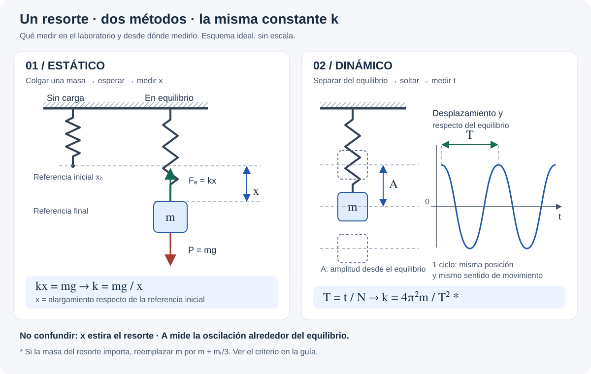

# Laboratorio 3 — Constante de un resorte

Guía de campo basada en `lab3.pdf`, UTN FRLP, edición 2019, páginas impresas
2–7 (páginas 4–9 del PDF). Fuente local: `E:\UTN\Fisica I\Laboratorios\lab3.pdf`.

## 🎯 Qué recordar

Buscamos **k**, que indica cuánto cuesta estirar el resorte, por dos métodos:
**colgar masas y medir el estiramiento**; **hacerlo oscilar y medir el tiempo**.

Usar las unidades de la planilla: masa en **g**, longitud en **cm**, tiempo en
**s**, fuerza en **dinas** y k en **dina/cm**. Tomar g = 980 cm/s².

## 🖼️ Esquema / dibujo

[Abrir el esquema en tamaño completo](diagramas/resorte-metodos.svg).

## 📐 Fórmula

### 1. Método estático — Tablas I y II

1. Registrar la posición inicial **x₀**, sin las masas que se agregarán.
2. Colgar una masa, esperar a que quede quieta y leer la posición final.
3. Calcular **x = posición final − x₀**, tomando positivo el alargamiento.
4. Repetir para las **5 cargas** de la Tabla I. Registrar la masa total que
   produce ese alargamiento; si el portapesas ya estaba al tomar x₀, contar
   solamente la masa añadida.
5. Para cada fila calcular:

| Dato de la planilla | Cuenta |
| --- | --- |
| Fuerza | $F_i = m_i\,980$ |
| Constante | $k_i = F_i/x_i$ |
| Error relativo | $r_i = 0{,}1/x_i$ |
| Error absoluto | $\Delta k_i = k_i r_i$ |
| Última columna | $(\Delta k_i)^2$ |

La consigna fija **Δx = 0,1 cm** y desprecia el error de las masas.
Luego calcular los promedios:

$$\bar{k}_E=\frac{k_1+\cdots+k_5}{5},\qquad R=\frac{r_1+\cdots+r_5}{5}.$$

Para completar el casillero de error **tal como está impreso**:

$$E_E=\sqrt{\frac{\sum(\Delta k_i)^2}{5(5-1)}},\qquad
k_E=(\bar{k}_E\pm E_E)\;\text{dina/cm}.$$

**Consultar a la cátedra:** la Tabla II usa errores propagados Δkᵢ en una
fórmula que habitualmente se usa con desvíos respecto del promedio. Si piden
el error estadístico del promedio, el numerador sería
$\sum(k_i-\bar{k}_E)^2$. Conservar ambas cantidades identificadas; no mezclarlas.

### 2. Método dinámico — Tablas III y IV

1. Registrar **m**, masa colgante total que oscila, y **mᵣ**, masa del resorte.
2. Separar un poco la masa del equilibrio y soltarla sin empujar.
3. Medir el tiempo **t** de **N oscilaciones completas** y calcular **T = t/N**.
   Volver a la misma posición y al mismo sentido de movimiento completa un ciclo.
4. Con ese período preliminar elegir el instrumento: debe satisfacer
   **ΔT/T ≤ R/2**. La guía da resoluciones de 0,1 s (analógico), 0,01 s
   (digital) y 0,001 s (adquisidor). Si se mide t de N ciclos, usar
   **ΔT = Δt/N**; con cronómetro manual también influye la reacción humana.
5. Elegir la fórmula antes de completar la Tabla IV:

| Condición de la guía | Fórmula para cada medición |
| --- | --- |
| $m_r < \frac35 mR$: masa del resorte despreciable | $k_i=4\pi^2m/T_i^2$ |
| Si no cumple: incluir la masa del resorte | $k_i=4\pi^2(m+m_r/3)/T_i^2$ |

**R se usa como fracción:** por ejemplo, 2 % corresponde a 0,02.

6. Conservar la misma carga y repetir **5 mediciones**. Anotar N y t en cada
   una; el encabezado «nT» del PDF significa el tiempo total t = NT.
7. Calcular cada Tᵢ y kᵢ, el promedio $\bar{k}_D$ y las dos últimas columnas:
   $e_i=\bar{k}_D-k_i$ y $e_i^2$.
8. Informar:

$$E_D=\sqrt{\frac{\sum e_i^2}{5(5-1)}},\qquad
k_D=(\bar{k}_D\pm E_D)\;\text{dina/cm}.$$

### 3. Comparar y concluir

- Escribir ambos resultados con sus errores y unidades. Si los intervalos
  se superponen, son compatibles con esos márgenes; si no, revisar medidas,
  unidades, rozamiento y corrección por masa del resorte.
- **Carga elevada en estático:** baja el error relativo de lectura, pero
  puede superar el límite elástico y deformar permanentemente el resorte.
- **Carga elevada en dinámico:** aumenta T y reduce la importancia relativa
  de la masa del resorte, pero también puede exceder el límite elástico o el
  recorrido disponible durante la oscilación.

## ⚠️ Error frecuente

- Usar la longitud total en vez del **alargamiento x**.
- Mezclar gramos con kg o centímetros con metros. **1 dina/cm = 0,001 N/m**.
- Confundir amplitud con alargamiento estático o contar medio ciclo como uno.
- Omitir el portapesas de la masa oscilante o cambiar la carga entre repeticiones.
- Presentar los errores estadísticos como si incluyeran todos los errores
  instrumentales y sistemáticos: registrar también resolución e instrumento.

## 🔗 Ver también

- [Movimiento Armónico Simple: teoría esencial](../apuntes/movimiento-armonico-simple/teoria-esencial.md)
- [Volver al material de estudio](../README.md)
- [Acceso rápido de la portada](../../README.md)
