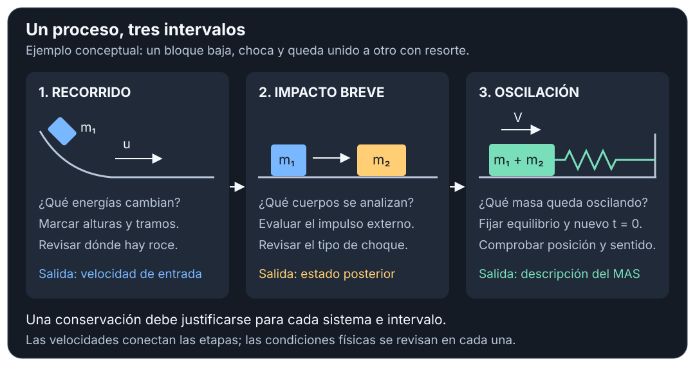

# Segundo parcial

Espacio para organizar el enunciado, la preparación y las resoluciones del
**segundo parcial de Física I**.

## Datos de la evaluación

- Fecha: pendiente de confirmar.
- Alcance indicado: **Trabajo y Energía, MAS e Impulso/Cantidad de Movimiento**.
- Material: siete PDF históricos fechados, fotos auxiliares y una hoja con
  teoría llamada `Parcial_2025_1.png`; ese año no está confirmado en la imagen.

## Empezar a practicar

- [Patrones observados y cruce con TP 6–8](patrones.md).
- [Práctica priorizada sin respuestas](practica.md).
- [Pistas opcionales y graduales](pistas.md).
- [Preguntas teóricas para explicar con tus palabras](preguntas-teoricas.md).
- [Comprobaciones: revelan resultados, abrir después del intento](comprobaciones.md).
- [Enunciados originales seleccionados](enunciados/).
- [Auditoría actual de las cuatro carpetas, duplicados y límites](auditoria-fuentes.md).

Los exámenes antiguos contienen algunos temas ajenos al recorte actual;
la guía indica qué seleccionar. La muestra no garantiza qué se tomará.

## Qué conviene dominar

En los siete PDF fechados aparece Trabajo/Energía en **7/7**, resorte en
**6/7**, momento/choques/CM en **6/7** y MAS/péndulo en **4/7**.
Las categorías se superponen. El patrón central es justificar cada etapa
y conectar sus estados, no memorizar una fórmula para todo el problema.

La hoja [F1](enunciados/Parcial_2025_1.png) reproduce **TP 6.19 y TP 8.16**,
y agrega teoría. Es evidencia de reutilización en esa hoja; no confirma
el formato ni las preguntas del próximo examen.

| Para reforzar | Entrada conceptual |
| --- | --- |
| Estados, roce localizado y pérdidas | [Trabajo y Energía: balances y tramos](../../apuntes/trabajo-energia/balances-y-tramos.md) |
| Función horaria y masa que oscila | [MAS: fase y equilibrio](../../apuntes/movimiento-armonico-simple/fase-y-equilibrio.md) |
| Qué conservar en un impacto | [Impulso: sistema, intervalo y tipo de choque](../../apuntes/impulso-cantidad-movimiento/conservacion-y-choques.md) |

## Consulta visual antes de practicar

[MAS: sistemas, magnitudes y parámetros](../../apuntes/movimiento-armonico-simple/comparar-osciladores.md) ·
[Comparar estados por cocientes](../../apuntes/dinamica/herramientas-matematicas/comparar-por-cocientes.md) ·
[Conservación y referencias de energía](../../apuntes/trabajo-energia/balances-y-tramos.md) ·
[Tipos de choque y etapas](../../apuntes/impulso-cantidad-movimiento/conservacion-y-choques.md).

Leer primero todos los incisos y la figura original; después resolver por
partes. Estas fichas contienen teoría y ejemplos propios, no soluciones
del examen elegido.

## Material

Guardar aquí los enunciados originales sin modificarlos. Usar nombres claros,
por ejemplo `parcial-2-2026.pdf` o `recuperatorio-parcial-2-2026.pdf`.
Para una resolución propia: `resolucion-parcial-2-2026-ej-01.md`, incluyendo
DCL/esquema, ejes, estrategia, desarrollo, unidades y verificación.

**Archivo previo:** [1ParcialT2_2026.jpeg](1ParcialT2_2026.jpeg) corresponde
al **primer parcial de otro turno/comisión**, no al segundo parcial.
Se conserva en su ubicación original; su análisis está en el
[índice de parciales](../README.md#primer-parcial--segundo-turnocomisión-2026).

## Preparación

- [ ] Confirmar fecha.
- [x] Registrar temas y vincular guías de los TP 6–8.
- [x] Incorporar y clasificar los exámenes anteriores.
- [x] Contrastar presentaciones, TP y apoyos escritos; registrar erratas y límites de lectura.
- [x] Separar enunciados, pistas y comprobaciones; agregar práctica de teoría.
- [ ] Resolver sin consultar y registrar dificultades.
- [ ] Revisar planteos, resultados y unidades.
- [ ] Rehacer los ejercicios que costaron y practicar un simulacro con tiempo.

## Seguimiento de ejercicios

El seguimiento concreto y la selección por prioridad están en [Práctica](practica.md).

| Ejercicio / fuente | Tema y caso | Estado | Dificultad / próxima acción |
| --- | --- | --- | --- |
| Hoja sin fecha, 1–3 | Energía, MAS y choque | Sin comenzar | Diagnóstico inicial |
| F1 / TP 6.19 y TP 8.16 | Energía y choques 1D, más teoría | Sin comenzar | No contar el mismo enunciado dos veces |
| S1 ej. 2 / S3 ej. 2 | Choque → resorte/MAS | Sin comenzar | Separar etapas |

Estados sugeridos: sin comenzar, planteado, resuelto, revisado, rehacer.
Registrar los errores reutilizables en [Errores frecuentes](../../errores-comunes/README.md).

[Todos los parciales](../README.md) · [Tercer parcial](../Tercer_Parcial/README.md)
